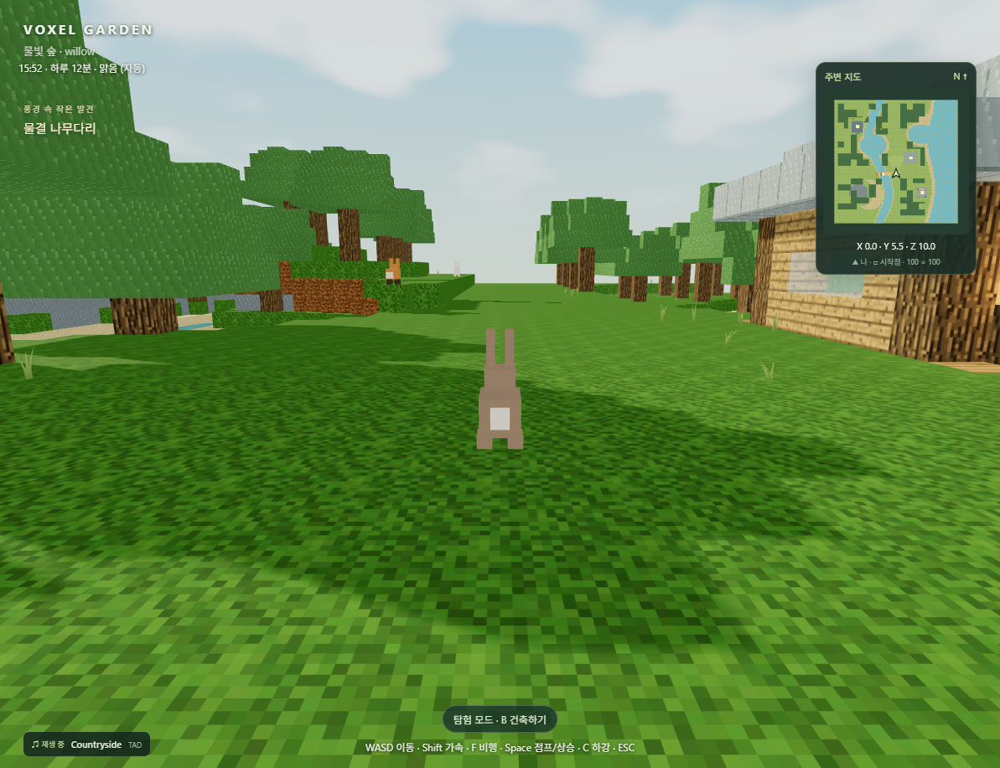
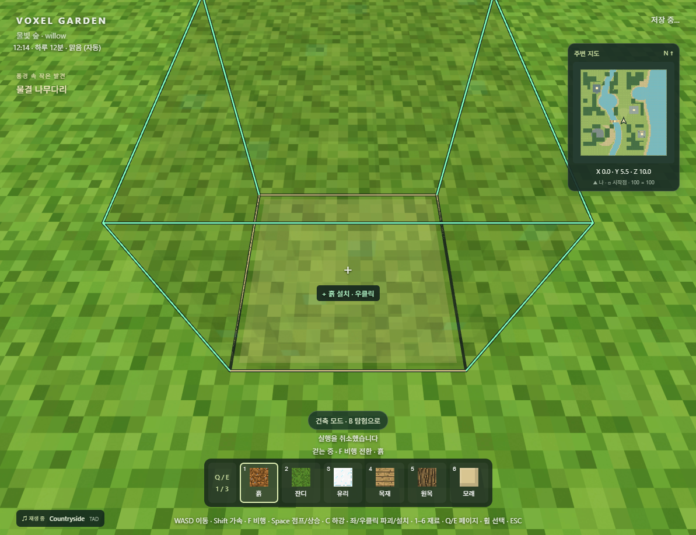
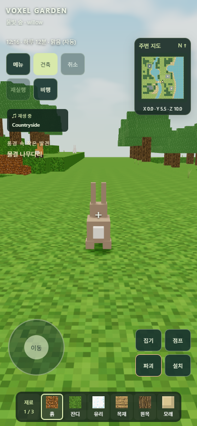

# 탐험 / 건축 모드

- 월드를 열거나 새로고침하면 탐험 모드로 시작한다. 모드 선택은 저장 파일에 기록하지 않는다.
- 플레이 중 PC는 B, 모바일은 상단 건축 버튼으로 전환한다. 일시정지 후 재개할 때는 현재 모드를 유지한다.
- 탐험 중에는 설치·파괴·집기, 재료 선택, 실행 취소·다시 실행 입력을 차단한다. 조준점, 설치 미리보기와 재료 도구도 숨긴다.
- 이동·점프·비행은 두 모드 모두 가능하다. 모드를 전환해도 건축물, 선택 재료, 편집 이력은 유지한다.

## 검증

- Vitest 28개 파일, 129개 테스트 통과. 프로덕션 빌드 및 git diff --check 통과.
- 키보드 회귀 테스트: 기본 탐험 상태, 이동/점프/비행 유지, 편집 단축키 차단, B 반복 입력 방지, 일시정지 및 입력 필드에서 전환 방지.
- 데스크톱 브라우저: 실제 포인터 잠금 후 B 전환, 건축 UI 표시/숨김 확인. 건축 모드에서 블록 설치 후 탐험 모드에서 파괴와 Ctrl+Z를 시도해도 편집 이력이 유지됨. 건축으로 복귀한 후 Ctrl+Z로 해당 설치 취소 확인.
- 모바일 390×844 브라우저 에뮬레이션: 기본 탐험 상태에서 설치 버튼 없음/점프 버튼 있음, CDP 터치 입력으로 건축 켜기·끄기 확인. 건축 버튼과 발견 장소 안내의 겹침을 수정하고 재확인.
- 검증 후 브라우저의 모바일 에뮬레이션을 해제했다. 실제 모바일 기기 검증은 하지 않았다.

