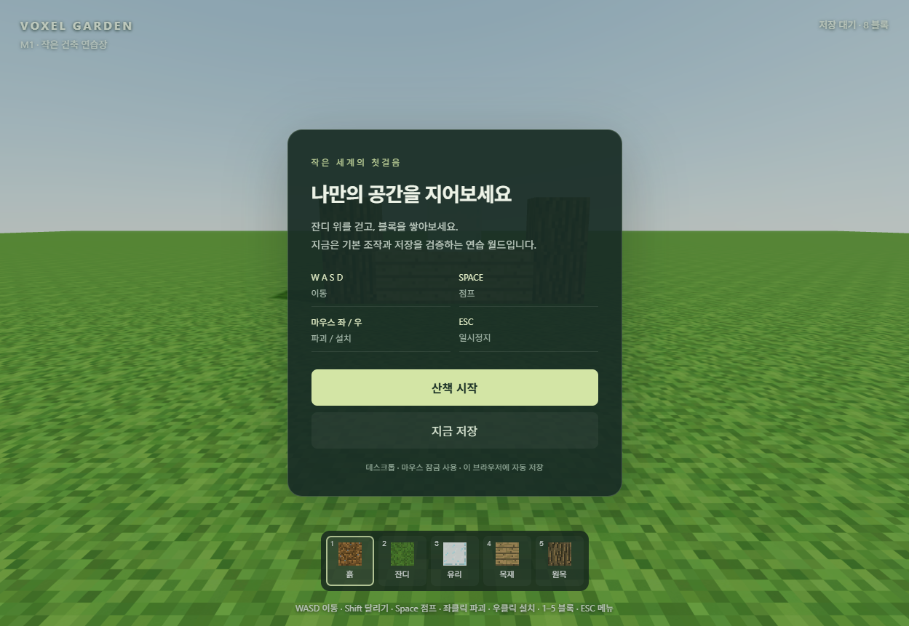
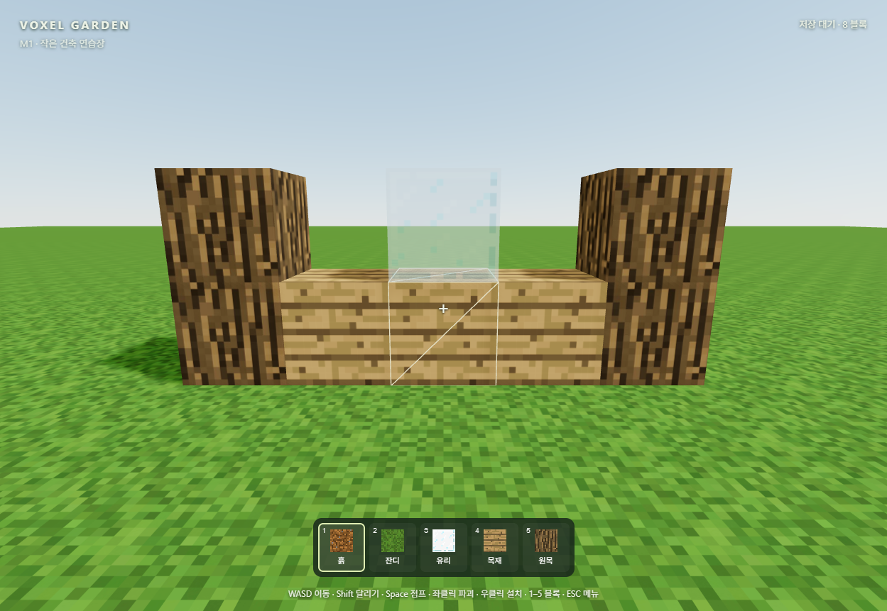
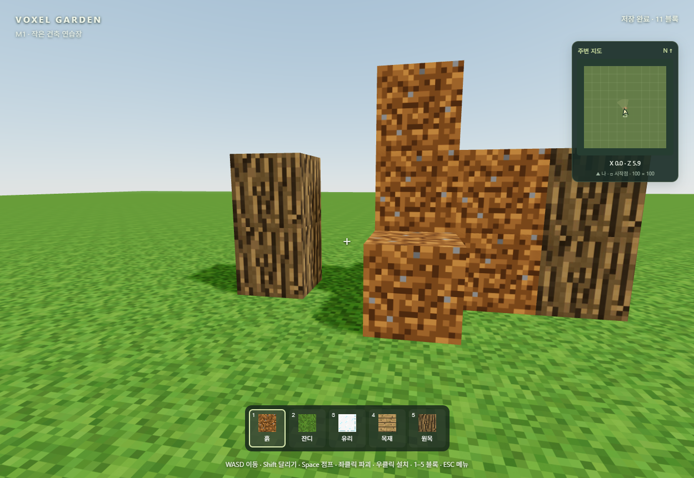

# M1 검증 기록

검증일: 2026-11-14 (Asia/Seoul)

## 재현한 문제

1. 기존 소스에서 새 브라우저 저장소로 실행하면 평면과 하늘이 렌더링되었다.
2. 테스트 브라우저의 `world` 값을 `{broken`으로 설정하고 새로고침했다.
3. `useStore.js`의 `JSON.parse`에서 SyntaxError가 발생해 앱 초기화가 중단되었다.
4. 수정 후 같은 저장값으로 실행하면 원본을 유지하며 연습 월드와 복구 안내가 표시되었다.

사용자의 기존 브라우저 저장값은 읽거나 변경하지 않았다. 위 결과는 별도 테스트 브라우저에서 재현한 오류 경로다.

소스를 수정한 뒤에는 기존 설치 폴더의 Babel 등 패키지 파일 누락으로 재컴파일이 실패했다.
`npm ci --ignore-scripts --no-audit --no-fund`로 잠금 파일에 맞춰 재설치한 뒤 컴파일·테스트를 진행했다.

## 자동 테스트

명령: `npm run test:ci`

- 저장 형식 이전, 중복·잘못된 블록 정리, 빈 월드 유지
- 손상 원본 보존, 저장소 접근 거부와 백업 실패
- 저장·삭제 직렬화, 저장 공간 부족 시 변경 유지와 재시도
- 지면·블록 착지, 공중 재점프 방지, 벽·머리 충돌
- 대각선 속도 정규화, 반대 방향 키 상쇄, 안전한 스폰

최종 검증 결과: 2개 스위트, 14개 테스트 통과.

## 브라우저 조작 검증

- 시작 버튼으로 마우스 잠금 및 WASD 이동 확인.
- 전진 후 Z 좌표가 10에서 약 5.5로 변화했다.
- 점프 시 발 높이가 0.5에서 약 1.49로 상승한 뒤 0.5에 착지했다.
- 우클릭 설치 후 8 → 9 블록, 자동 저장 확인.
- 새로고침 후 9 블록 복원 및 저장 직렬화 값 일치 확인.
- 좌클릭 파괴 후 9 → 8 블록 및 자동 저장 확인.
- ESC 메뉴 표시와 계속하기 확인.
- 개발 서버에서 자동 입력 472초까지 런타임 예외 0건, 마우스 잠금 손실 0건을 확인했다.
- 이후 소스 줄바꿈 정리로 개발 서버가 자동 새로고침되어 세션이 초기화되었다. 따라서 10분 무중단 검증으로 집계하지 않는다.
- 배포용 빌드에서 150.007초 추가 검증 완료. 총 누적 622.007초(10분 22초), 확인 구간의 런타임 예외 0건, 마우스 잠금 손실 0건.
- [배포용 자동 입력 로그](m1-production-soak.json): 0.5초마다 이동 방향을 변경하고 점프·설치·파괴 입력을 반복했다. 10초 간격으로 위치와 저장 상태를 기록했다.
- 창 포커스 이탈 이벤트를 발생시키기 전 이동 키를 누른 뒤, 일시정지·재개 후 위치가 동일함을 확인했다.
- 배포용 빌드에서 새로고침 후 저장 데이터 일치, 손상된 현재 저장값의 원본 백업 및 복구 안내를 확인했다.
- 최종 배포용 페이지 콘솔 오류·경고 0건.

## 배포용 빌드

- `npm run build`: 컴파일 성공.
- `npm run preview`: 로컬 `http://127.0.0.1:4173/react-three/` 제공.
- 빌드 매니페스트의 HTML·JS·CSS·텍스처·소스맵 등 14개 경로에서 HTTP 200 확인.
- GitHub Pages로 실제 업로드하는 작업은 아직 수행하지 않았다.

## 현재 제한

- 평면 기반 100×100 연습 월드, 기존 5종 블록을 사용한다.
- 블록별 메시와 전체 블록 목록을 순회하는 충돌 계산이다. 대규모 월드 성능은 M2에서 다룬다.
- 월드 블록은 저장하지만 플레이어 위치는 저장하지 않는다.
- 기기 간 동기화·월드 파일 내보내기는 M5 범위다.
- 브라우저 저장소가 차단되거나 가득 찬 경우 화면 안내를 제공하며 저장 성공으로 표시하지 않는다.
- Chromium에서 검증하며 다른 브라우저와 모바일 검증은 포함하지 않는다.

## 데모 확인 순서

1. `npm run build` 후 `npm run preview`를 실행한다.
2. 로컬 데모 주소를 열고 **산책 시작**을 누른다.
3. 앞의 작은 블록 구조물로 걸어가 점프와 벽 충돌을 확인한다.
4. 1–5로 블록을 고른 뒤 우클릭 설치, 좌클릭 파괴를 시도한다.
5. ESC로 메뉴를 열고 저장 상태를 확인한다.
6. 새로고침 후 설치한 블록이 복원되는지 확인한다.

## 화면 기록

[수정 전 깨끗한 저장 상태](m1-before.png) · [장시간 검증 중 화면](m1-soak.png)

## 사용자 피드백 후 보완 검증

초기 M1 검증은 정면 이동과 반복 입력 위주였으며, 카메라 회전 후 이동 방향 검증이 누락되었다. 따라서 초기 통과 결과가 모든 방향의 이동 정확성을 보장하지 않았다.

- 수정 전 재현: 180도 돌아 W를 누르면 Z가 10 → 7.699로 감소했다.
- 수정 후: 같은 방향에서 W를 누르면 Z가 약 1.2 증가했다.
- 자동 회귀 테스트: 카메라 기본 XYZ Euler를 유지한 채 PointerLockControls와 같은 YXZ 쿼터니언을 적용한다. 0/90/180/270도 × 상하 시선 3종 × WASD 4종의 이동 벡터를 확인한다. 수직 시선에서 직전 방향 유지도 검증한다.
- 브라우저: 0도(수평), 90도(위), 180도(아래), 270도(위)에서 각각 WASD 입력. 총 16가지 모두 기대 방향과 일치하고 발 높이가 유지되었다.
- 미니맵: 게임 위치 (X 0, Z 5.882)와 지도 좌표 일치, 90도 회전 시 게임·지도 방향 모두 1.57 rad, 블록 설치·파괴 후 지도 이미지 변경 확인.
- 최종 테스트 3개 스위트 / 19개 통과. 프로덕션 빌드 성공. 브라우저 콘솔 오류 0건.

