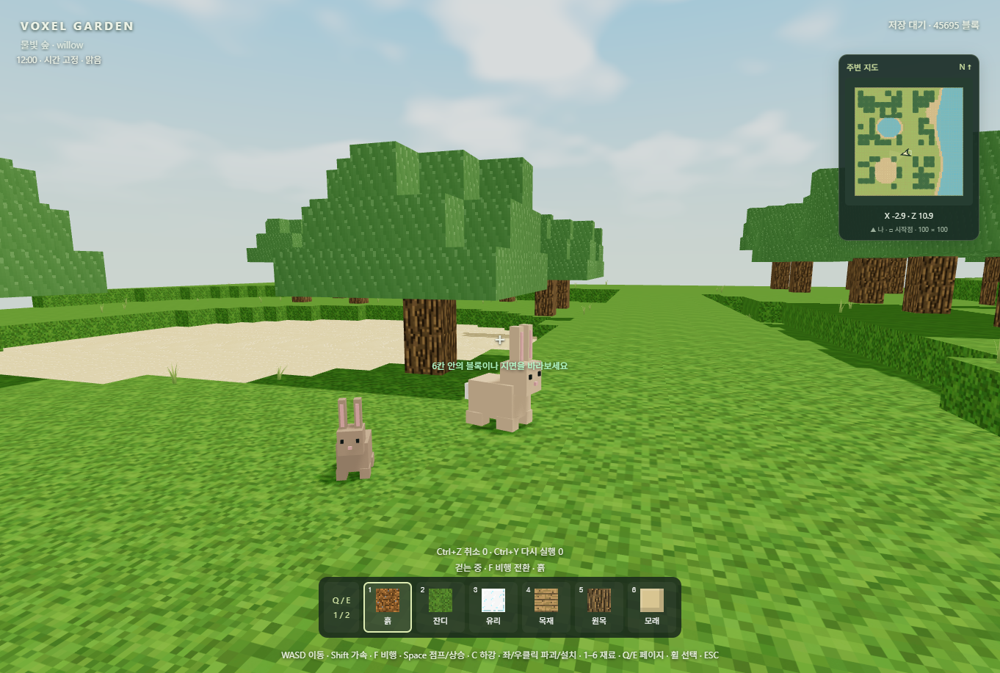
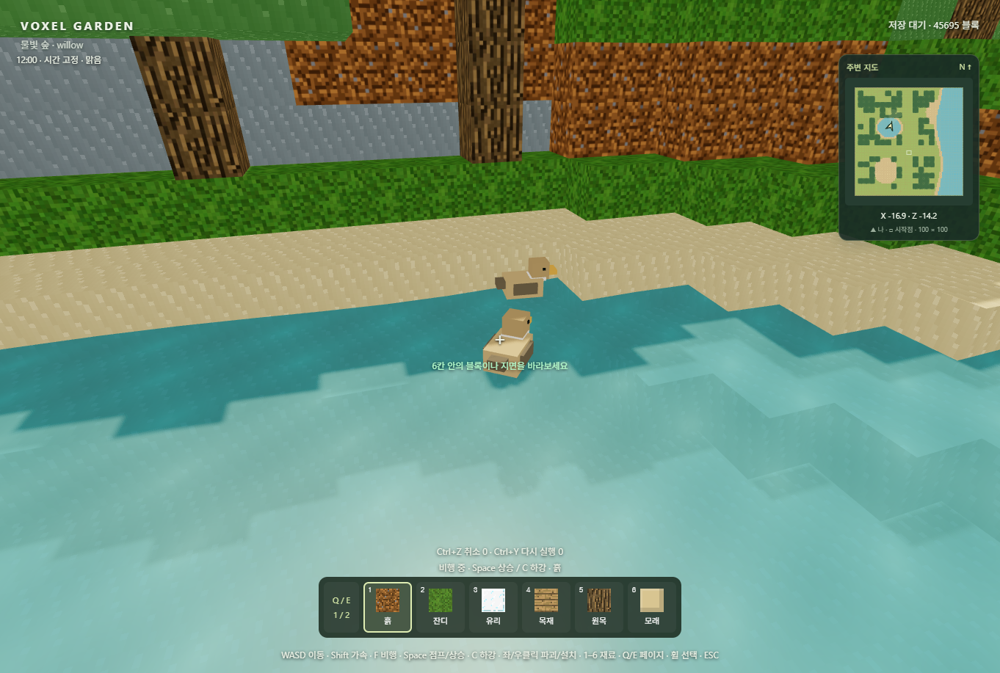
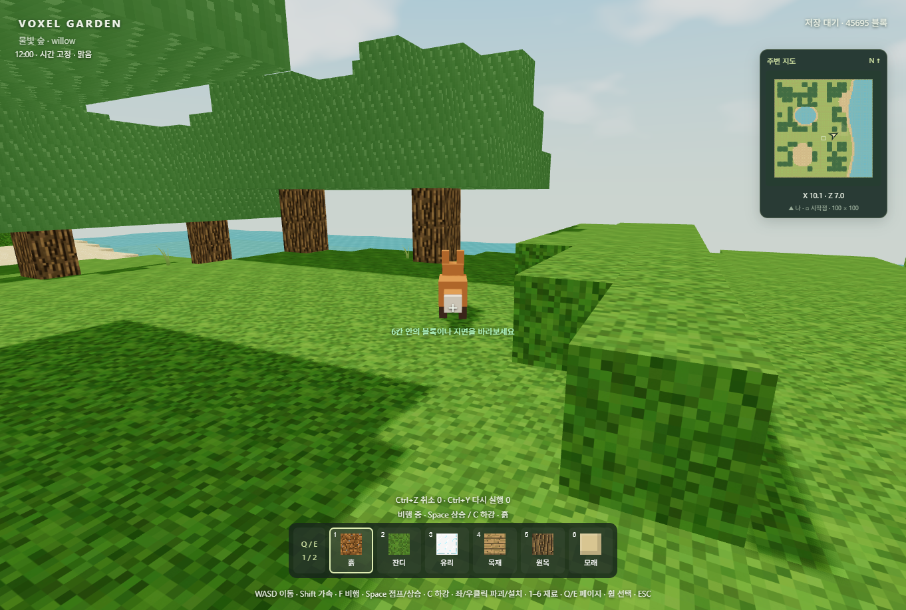
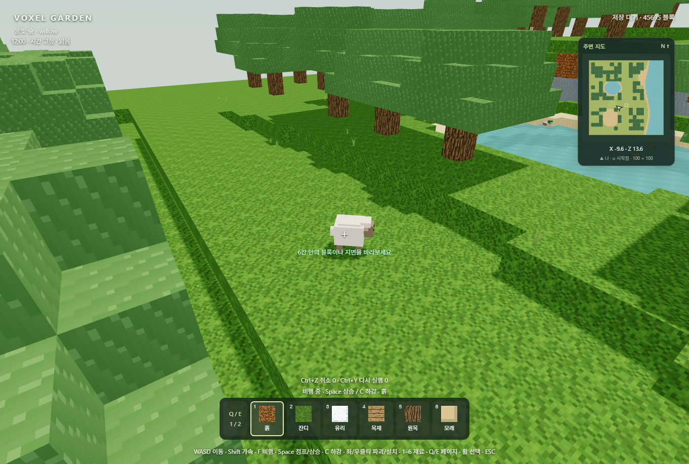
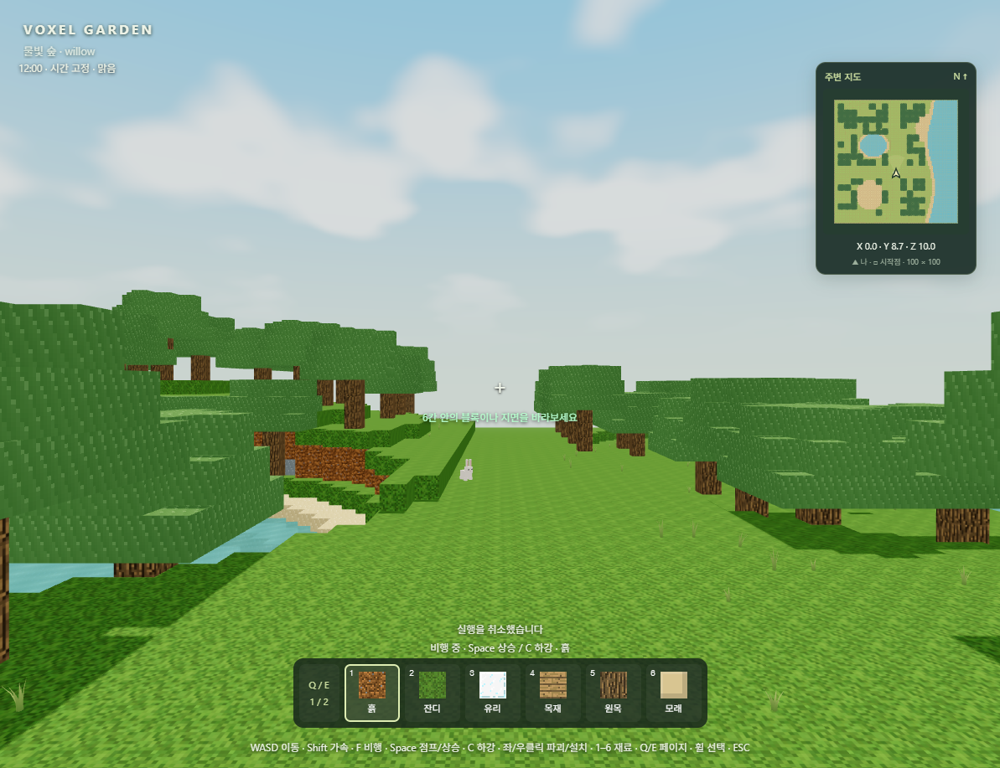

# M10 작은 생태계 검증

2026-11-14. M9를 `d69b604`로 커밋한 뒤 구현했다. M10은 아직 커밋하거나 배포하지 않았다.

## 구현

- 시드 숲에 토끼 8마리와 오리 4마리, 최대 12마리. 토끼는 풀밭, 오리는 기존 수면에 서식한다. 가까운 산책로와 연못에서도 발견할 수 있다.
- 배회·휴식·접근 시 도망. 밤이나 비·눈에는 현재 행동을 마친 뒤 쉬며, 가까이 다가오면 여전히 도망간다.
- 절벽·벽·나무·막힌 물가를 피하고, 서식지에 블록을 설치하면 안전한 곳으로 이동한다. 안전한 자리가 없으면 숨긴 뒤 제한된 후보 수로 재탐색한다.
- 하나의 InstancedMesh로 모든 동물의 몸·귀·날개 등을 렌더링한다. 플레이어 반경 45칸 밖에서는 숨기고 배회를 멈춘다. 메뉴·숨겨진 탭에서는 시뮬레이션을 멈춘다.
- 설정의 ‘작은 생태계 · 토끼와 오리’로 켜고 끌 수 있으며 설정을 저장한다. 별도 울음소리를 추가하지 않아 기존 ASMR 분위기를 유지한다.

## 자동 검증

- `npm run test:ci`: 17개 파일, 98개 테스트 통과.
- `npm run build`: 프로덕션 빌드 통과.
- 추가 테스트: 개체 상한·시드 재현·안전한 서식지, 접근 시 거리 증가, 밤/악천후 휴식·정지, 건축 시 재배치, 1,200회 시뮬레이션의 서식지 및 개체 간 거리 유지, 설정 호환성.

## 실제 브라우저 검증

프로덕션 프리뷰 4173과 개발 StrictMode 5173에서 확인했다. 테스트용 분리 저장 공간을 사용했다.

- 직접 걷고 비행하여 산책로 토끼와 연못 오리를 관찰했다. 동물 형태·그림자·움직임 확인. ESC 후 1초 동안 동물 좌표/행동 상태가 동일했다.
- 밤 8초, 눈 12초 플레이 후 각 12마리 모두 휴식 상태 확인. 눈 강도 1.0, 밤 daylight 0.0.
- 토끼가 있던 `(-5,5.5,10)`에 우클릭으로 `(-5,6,10)` 블록을 설치하자 토끼가 `(0,5.5,5)`로 이동했다. 청크 재생성은 65→66으로 해당 편집만 반영. Ctrl+Z로 설치를 되돌렸다.
- 생태계 OFF 후 새로고침해 설정 유지 확인. 개발 StrictMode에서 3회 OFF/ON 후 12마리, 가시 범위 10마리 정상.
- 동일한 연못 시점에서 ON/OFF 비교: 가시 동물 9→0, 드로콜 176→174, 삼각형 68,942→66,278. 청크 재생성 수는 양쪽 모두 65였다. 그림자를 포함해 동물 묶음이 2개 드로콜을 추가했다. 이 수치는 해당 장면 측정이며 모든 기기의 FPS를 보장하지 않는다.
- 실제 브라우저 창 크기 변경 시 뷰포트/Canvas가 각각 884×605, 1362×917로 정확히 일치했다. 고정 뷰포트 에뮬레이션을 남기지 않고 원래 창 크기로 복원했다.
- 개발/프로덕션 런타임 오류 0. 기존 R3F 내부 `THREE.Clock` 경고 1건은 동일하다.

## 데모

[로컬 숲 열기](http://127.0.0.1:4173/react-three/?world=willow). 시작점 왼쪽 풀밭에 토끼가 있고 북서쪽 연못에 오리가 있다. F로 비행, Space 상승, C 하강, ESC로 설정을 열 수 있다.

## 현재 범위

- 관찰용 동물이며 플레이어를 막지 않는다. 먹이·길들이기·번식·전투는 없다.
- 토끼는 같은 높이의 안전한 풀밭을 돌아다닌다. 언덕을 뛰어넘는 이동이나 장거리 경로 탐색은 없다.
- 기존 시드 지형을 서식지로 사용한다. 새로 지은 옥상·인공 연못으로 서식지를 확장하지 않는다. 평면 연습 월드와 작은 집 데모에는 동물을 생성하지 않는다.
- 동물 위치/행동은 저장하지 않는다. 재접속하면 같은 시드와 현재 건축물에 맞춰 다시 배치된다. 월드 블록 저장 형식은 바꾸지 않는다.

## 후속 확장 — 여우와 양

- 토끼 8·오리 4에 여우 2·양 2를 더해 최대 16마리다. 위의 12마리 검증과 성능 수치는 확장 전 기록이다.
- 여우는 주황 털·흰 꼬리 끝·짙은 발, 양은 양털 몸통·짧은 귀로 구분한다. 걷는 속도는 여우 .95, 양 .4칸/초이며 도망칠 때 2.3배다.
- 종별 반경으로 벽·절벽 및 다른 동물과 간격을 검사한다. 같은 높이 풀밭 이동, 야간/악천후 휴식, 건축 시 재배치 등 기존 규칙을 따른다. 포식 행동은 없다.
- 16마리 기준 생성 및 장시간 안전성 테스트를 갱신했다. 전체 98개 테스트와 빌드 통과.
- 실제 비행/이동으로 여우와 양에게 접근해 각각 flee 상태와 위치 변화를 확인했다. 16마리 모두 활성 상태이며 모델을 화면으로 확인했다. 뷰포트와 Canvas는 1362×917로 일치했다.

## M10 마감 — HUD 정리

- 우측 월드 블록 수와 초기 ‘저장 대기’ 표시를 제거했다.
- 변경 시 ‘저장 중…’, 성공 시 ‘저장됨’을 2.5초 표시한다. 반복 저장은 표시 시간을 갱신하며 실패/불가는 성공으로 복구될 때까지 유지한다.
- 미니맵에 X·Y·Z를 표시한다. Y는 카메라 높이가 아닌 플레이어 발밑 높이다.
- 18개 파일의 테스트 99개와 프로덕션 빌드 통과. 저장 상태 테스트에서 초기 숨김, 반복 성공, 시간 만료, 실패 유지, 복구, 타이머 정리를 확인했다.
- 실제 우클릭 설치에서 ‘저장 중… → 저장됨 → 빈 표시’를 확인하고 Ctrl+Z로 되돌렸다. 수동 저장 알림도 확인했다.
- 비행 상승 시 Y 5.5→8.7, 실제 발 위치 8.651과 소수점 한 자리 표시가 일치했다.
- 첫 조작은 브라우저 포커스가 없어 Pointer Lock API 오류가 발생했다. 창을 앞으로 가져온 뒤 다시 시작해 정상 잠금·상승·설치·취소를 확인했다.
- 테스트 창을 추가하지 않고 현재 데모 하나를 사용했다. M10 구현/검증 완료, 커밋·배포는 아직 하지 않았다.

