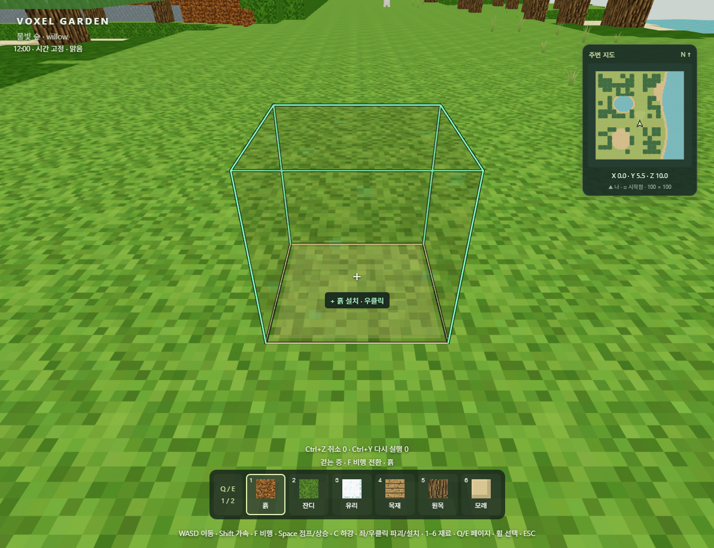
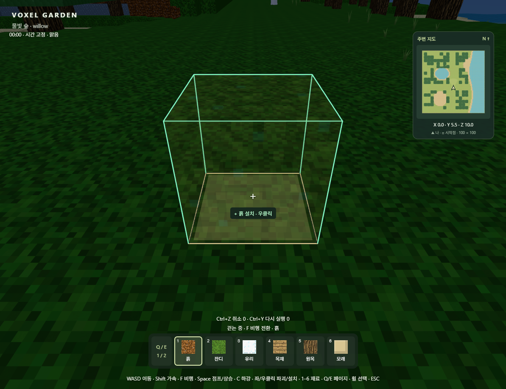
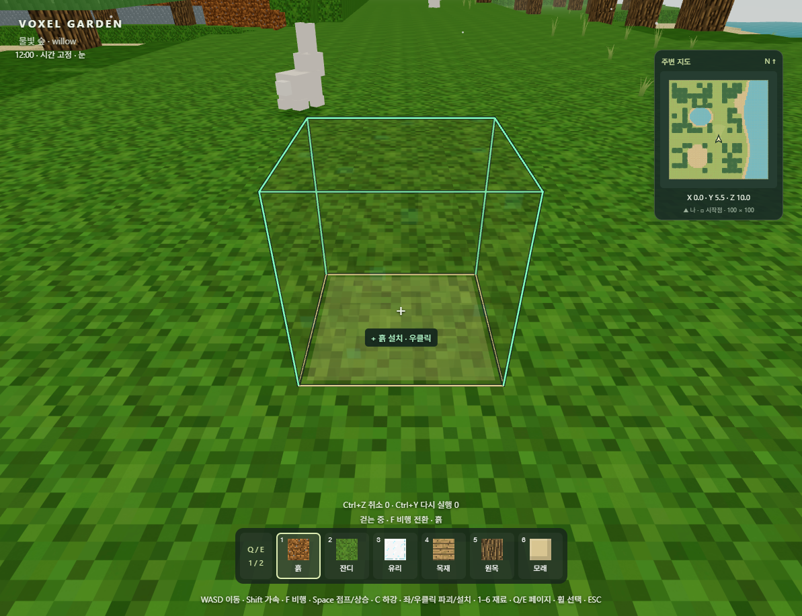
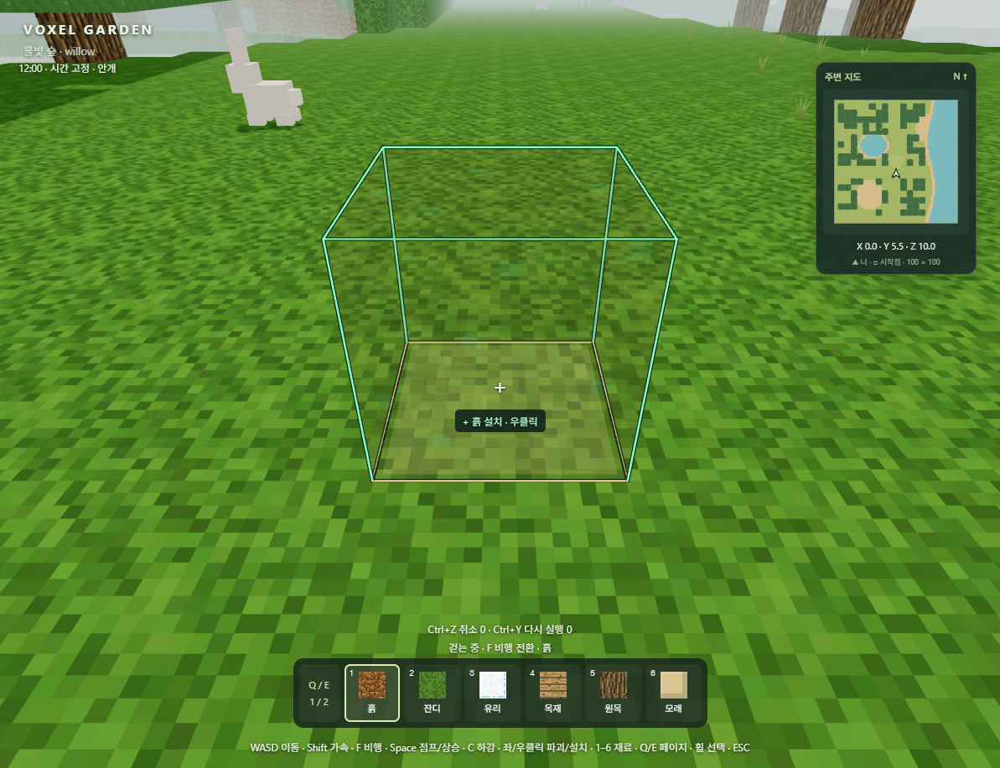
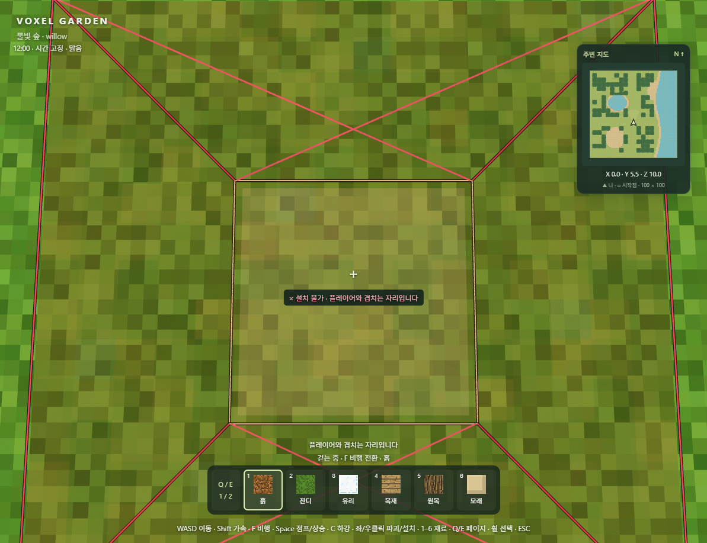
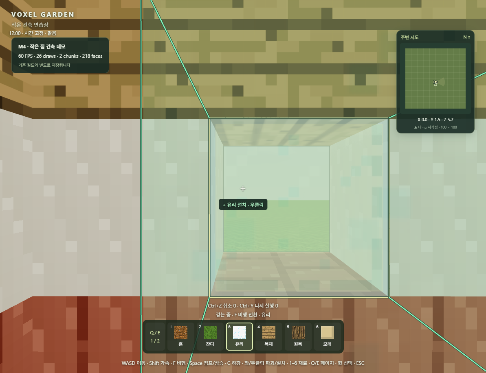
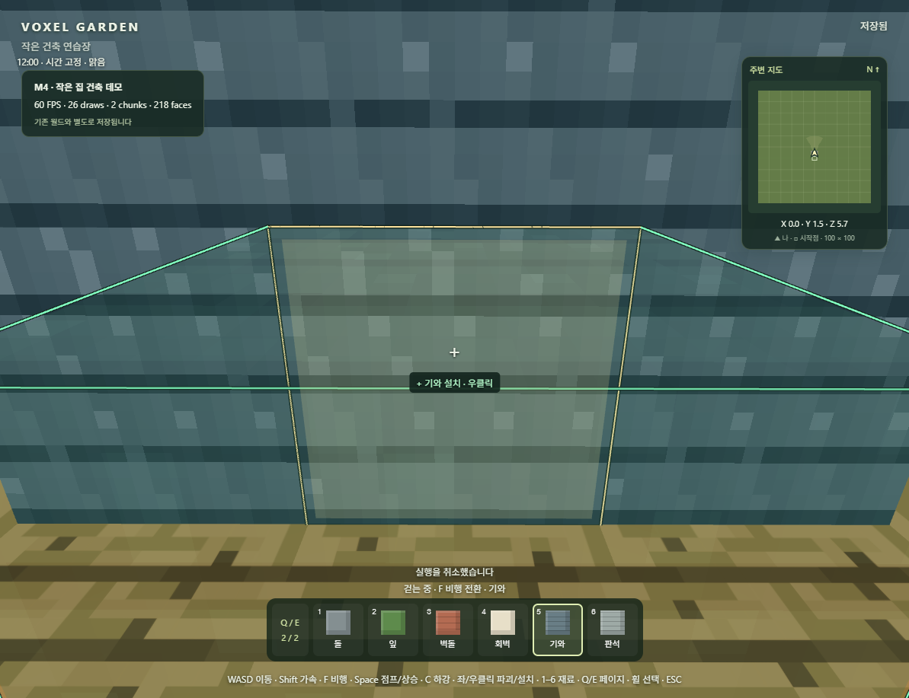
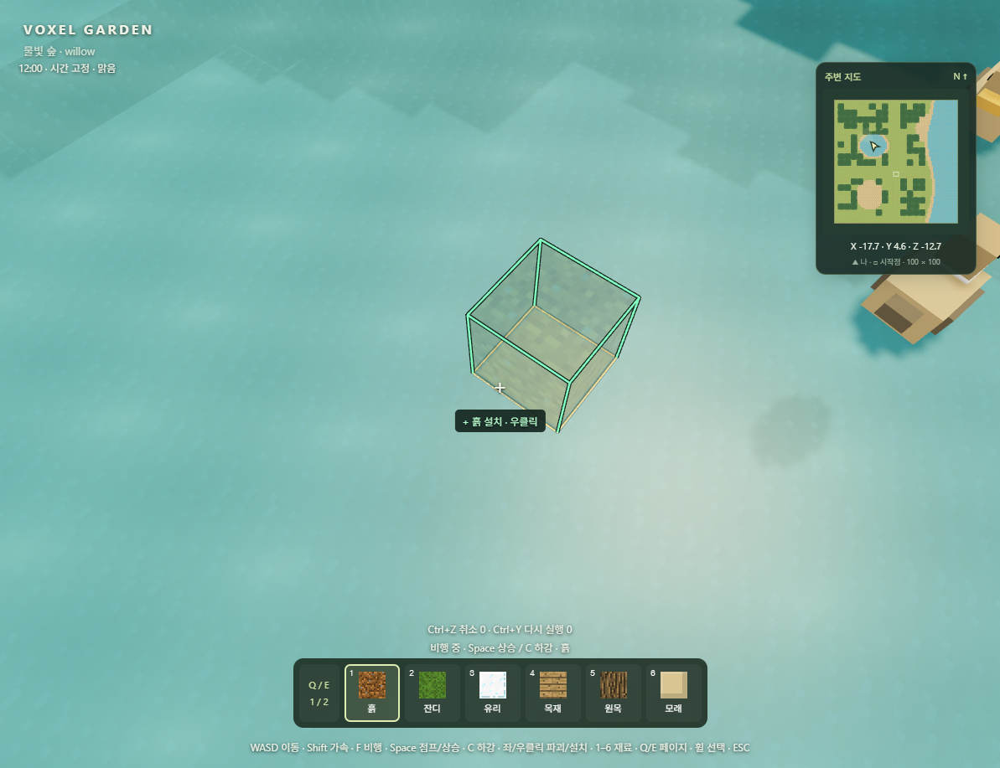

# M11 1인칭 건축 UX

2026-11-14. 1인칭을 유지하고 기존 설치/파괴 판정과 실행 취소를 재사용했다. 아직 커밋·배포하지 않았다.

## 변경

- 파괴 대상은 금색 윤곽, 조준한 면은 옅은 금색 면으로 표시한다.
- 설치 예정 블록은 재료 텍스처와 초록색 윤곽으로 표시한다. 화면 픽셀 기준 두께의 짙은 외곽선을 덧대 밝고 어두운 배경에서 대비를 확보했다. 가까운 벽을 가리지 않도록 깊이 검사는 유지하며 수면 뒤에서도 윤곽이 흐려지지 않게 렌더링 순서를 정했다.
- 설치 불가는 빨간 윤곽과 교차선, ‘× 설치 불가 · 이유’를 함께 표시한다.
- 조준점 안내는 대상이 있을 때만 선택 재료와 우클릭 설치를 표시한다. 허공을 볼 때 상시 거리 안내 및 좌표 문자열은 숨긴다.
- 마우스 가운데 버튼으로 조준한 블록의 재료를 집는다. 두 번째 핫바 페이지 재료도 자동 선택하며 블록/저장/이력을 변경하지 않는다. 기본 지면이나 허공에서는 선택을 유지한다.

## 검증

- 기존 자동 테스트 99개 통과, 최종 프로덕션 빌드 통과. 본 변경은 실제 조작과 화면 검증을 중심으로 확인했다.
- 낮·밤·눈·안개에서 같은 지면을 겨냥한 화면 비교. 밤 daylight 0, 눈 강도 .989, 안개 강도 .966 확인.
- 잔디 재료 집기 전후 청크 생성 수 65로 동일, 선택 dirt→grass. 설치 미리보기 `(0,6,8)`와 설치 후 대상 일치.
- 실내 유리벽: 대상 `(2,3,6)`, 법선 `(-1,0,0)`, 미리보기/설치 `(1,3,6)` 일치. 가운데 버튼으로 유리 선택.
- 실내 천장: 대상 `(0,5,5)`, 법선 `(0,-1,0)`, 미리보기/설치 `(0,4,5)` 일치. 기와를 집어 핫바 2페이지 자동 전환 확인.
- 천장 좌클릭 파괴 후 대상이 사라지고 Ctrl+Z로 원래 대상 복원.
- 몸과 겹치는 `(0,6,10)`은 빨간 표시와 이유 안내. 우클릭해도 청크 생성 수 65 유지. 허공을 보면 안내 문자열이 비어 있음.
- 실제 비행으로 연못까지 이동. 수면 아래 미리보기 `(-19,2,-15)`와 실제 설치 일치, Ctrl+Z로 복구. 수면 위로 윤곽을 선명하게 그리는 최종 수정도 화면 검증.
- 브라우저 런타임 오류 없음. 기존 R3F Clock 경고는 유지. 기존 테스트 탭 하나만 사용했고 고정 뷰포트 에뮬레이션은 적용하지 않았다.

## 화면

[로컬 숲](http://127.0.0.1:4173/react-three/?world=willow) · [건축 데모](http://127.0.0.1:4173/react-three/?demo=build)

M12 모바일 터치와 M13 맵 확장은 이번 변경에 포함하지 않는다. 입력은 PC 마우스·키보드 기준이다.
