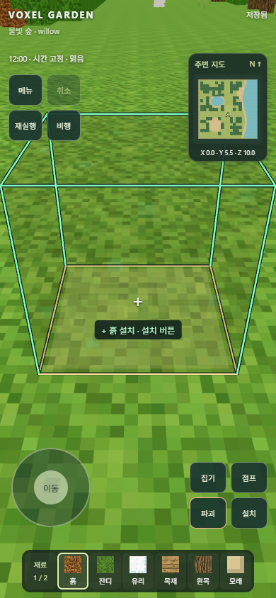
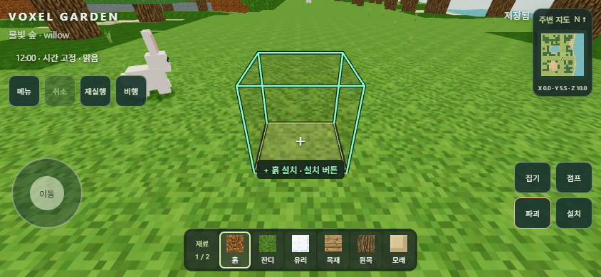
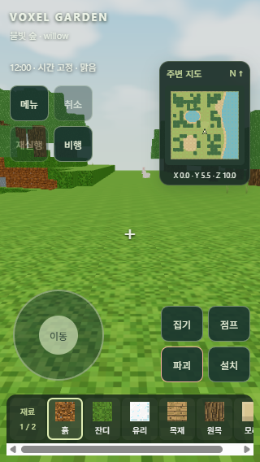

# M12 모바일 터치 대응

2026-11-14. M11은 `f0f3e2d`로 커밋했다. M12는 구현 및 Chromium 터치 에뮬레이션 검증을 마쳤으며, 실제 휴대폰 검증은 남아 있다. 아직 커밋/배포하지 않았다.

## 구현

- 주 입력이 터치인 기기에서 자동으로 터치 모드 시작. 설정의 ‘터치 조작’으로 수동 전환 가능. 모드 선택은 해당 세션에 적용한다.
- 마우스 잠금 없이 시작. 왼쪽 스틱은 이동 방향/속도를 조절하고 오른쪽 화면 드래그는 시점을 조절한다. 스틱 데드존과 대각선 속도 제한 적용.
- 설치·파괴·재료 집기, 점프, 비행 전환·상승·하강, 실행 취소/재실행, 재료 선택/페이지 전환, 메뉴 지원. 설치/파괴 판정·충돌·저장은 PC와 공유한다.
- 포인터별 캡처로 이동/시점/버튼 입력을 분리했다. 취소·캡처 해제·화면 크기 변경·포커스 이탈·탭 숨김 시 입력을 정리한다. 화면 회전과 앱 이탈은 일시정지하며 재개 버튼을 눌러 돌아온다.
- 행동 버튼은 터치 release를 직접 처리해 다른 손가락을 누르고 있어도 사용할 수 있다. 뒤따르는 호환 클릭은 중복 실행하지 않는다.
- 44px 이상 행동/재료 버튼, 세로·가로 레이아웃, safe-area 여백과 viewport-fit=cover. 좁은 화면에서는 재료 막대를 가로로 밀어 나머지 재료를 선택한다.
- 모바일 DPR은 1로 제한한다. 그림자는 기존 설정으로 끌 수 있다. 저장/월드 메뉴는 세로 스크롤을 유지한다.

## 자동 검증

- 20개 테스트 파일, 103개 테스트 통과. 프로덕션 빌드 성공.
- 스틱 데드존·비례 입력·대각선 제한, 시선 방향 이동·절반 속도, 전체 입력 초기화 검사.
- 터치 버튼은 click 없이 1회 실행, 호환 click 중복 억제, 취소·버튼 밖 release 무시, 키보드 활성화 검사.

## Chromium 에뮬레이션 검증

현재 PC의 Chromium에서 CDP 실제 터치 이벤트를 사용했다. 이는 실제 휴대폰 하드웨어나 Safari 테스트가 아니다.

- 390×844 세로, 844×390 가로, 320×568 작은 화면 검증. 터치 감지, Pointer Lock 없이 플레이, DPR 2 환경에서도 Canvas 렌더 타깃은 CSS 크기와 같은 DPR 1 확인.
- 두 손가락 이동+시점: 위치 `(0,5.5,10)`→`(.755,5.5,6.591)`, 방향 0→-.24. 손을 떼고 위치가 고정됨을 확인.
- 설치 `(1,6,5)` → 취소 시 원래 대상 `(1,5,5)` → 재실행 `(1,6,5)`, ‘저장됨’ 안내 확인. 새로고침 후 저장 delta와 복원 블록을 조준하여 확인하고 터치 파괴로 제거, 저장 edits가 빈 배열로 복구됨을 확인.
- 점프 Y 5.5→6.695→5.5, 비행 상승 Y 8.801 및 하강 Y 6.4 확인.
- 스틱과 설치 버튼 동시 터치 후 저장된 블록은 예상 `(0,6,8)` 한 개였다. 실행 취소로 원복했다.
- touchCancel 후 위치 `(.241,6.4,8.795)` 유지. blur 이벤트 후 메뉴 진입, 재개 후 같은 위치 유지. 회전 시 일시정지 및 재개 확인. 실제 OS 앱 전환은 미검증이다.
- 320px 화면의 재료 막대 304px/콘텐츠 328px. 터치 스와이프로 scrollLeft 24, 마지막 모래 재료 선택 확인.
- 데스크톱 개발 StrictMode에서 마우스 잠금과 W 이동 정상. 브라우저 오류 0, 기존 R3F Clock 경고만 관찰.
- PC 에뮬레이션 90프레임 표본 중앙값 16.7ms / p95 16.8ms. 실제 휴대폰 FPS·발열·메모리 성능을 의미하지 않는다.
- 같은 창 하나만 사용했다. 종료 시 터치 및 고정 뷰포트 에뮬레이션을 해제하고 네이티브 1193×917, Canvas 일치와 PC 모드 복귀를 확인했다.

## 데모

PC에서도 [로컬 숲](http://127.0.0.1:4173/react-three/?world=willow)의 설정에서 ‘터치 조작’을 켜면 배치를 확인할 수 있다. 이 localhost 주소는 실행 중인 PC용이다.

## 실기기 확인 잔여 항목

Android Chrome과 iOS Safari에서 손가락 동시 조작, 주소창/노치 안전 영역, 화면 회전, 실제 앱 전환·복귀, 오디오 시작, 저장 복원, 장시간 성능과 발열을 확인해야 한다. 이 확인 전까지 로드맵 상태는 ‘검증 중’으로 둔다. M13 맵 확장은 아직 시작하지 않았다.
