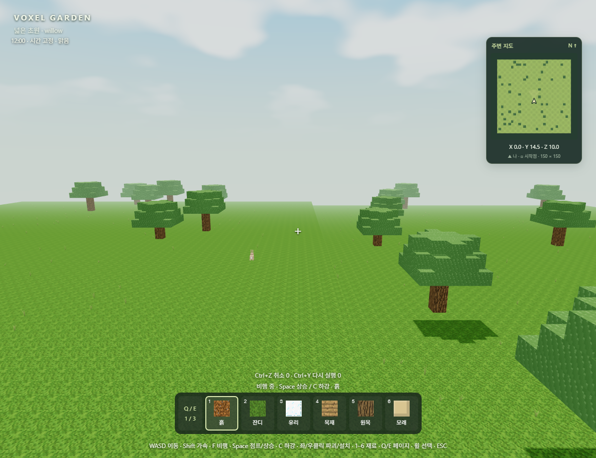
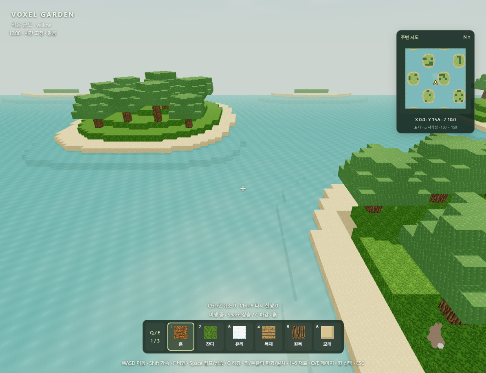
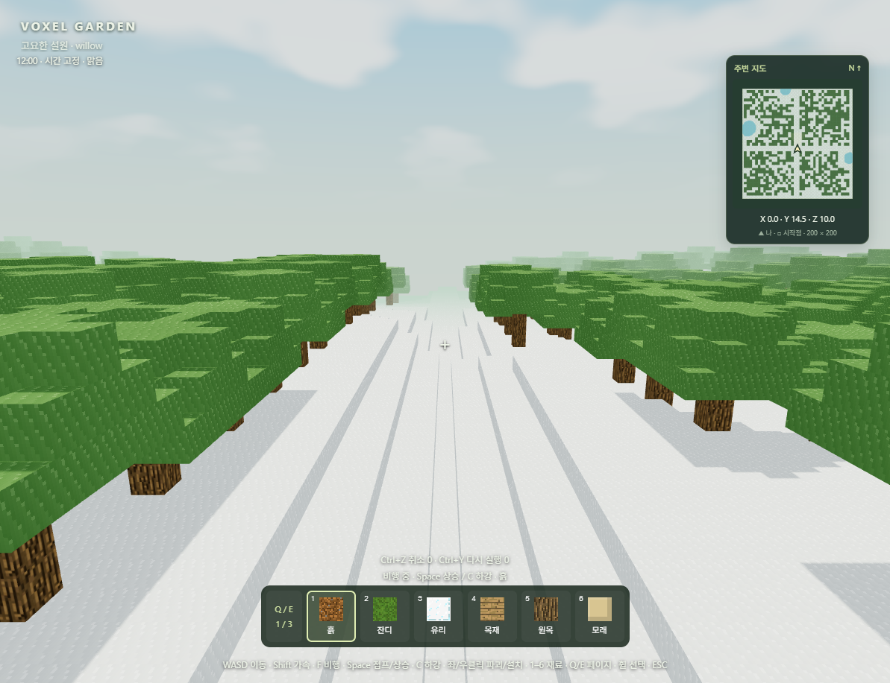
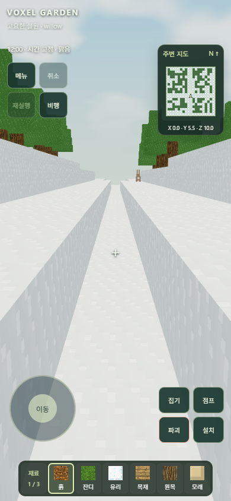

# M13 맵 종류·크기 확장

2026-11-14. M12는 `b78302e`로 커밋했다. M13은 PC 및 모바일 화면 에뮬레이션 기준 구현·검증 완료이며 아직 커밋/배포하지 않았다. 실기기 모바일 성능은 미검증이다.

## 제공 범위

| 종류 | 풍경 |
|---|---|
| 물빛 숲 | 기존 언덕·호수·해변. 100 크기의 기존 생성 결과 보존 |
| 넓은 초원 | 낮은 기복과 드문 나무, 넓은 건축 공간 |
| 작은 군도 | 여러 섬과 모래 해안, 얕은 바다 |
| 고요한 설원 | 눈 블록으로 덮인 언덕과 숲. 날씨와 별개인 지형이며 눈은 녹거나 쌓이지 않음 |

크기는 **100 기본/모바일 권장, 150 확장 PC용, 200 대형 PC용(실험)**으로 제공한다. 표시 크기는 기존 100 규칙을 따른 바닥 너비이며, 블록 중심 범위는 각각 ±49/74/99이다. 높이 범위는 기존 1~64를 유지한다. 무한 월드나 청크 스트리밍을 구현하지 않았으며 전체 블록 데이터를 메모리에 유지한다.

## 호환성과 규모 대응

- 종류·크기·시드가 월드의 식별자다. 기존 `?world=willow`는 숲/100이며 기존 localStorage 키를 유지한다. 새 조합은 별도 키에 저장한다.
- 기존 willow 숲 45,695블록의 JSON SHA-256이 변경 전과 동일하다: `013f81ff18f349c436a72e6f6ad648495d356431f7e957ee2809a4b8b5b4e84d`.
- 새 지형 파일은 생성기 버전·종류·크기·시드·변경분을 보관한다. 기존 전체 블록 스냅샷 파일도 읽는다. 가져온 월드도 별도 복사본에 압축된 변경분으로 저장한다.
- 가져온 파일의 맵 종류·크기·버전·좌표를 검증하며 모르는 규칙은 거부한다. 8MB 파일 제한, 구형 스냅샷 15만 블록 / 새 지형 15만 변경분 제한 유지.
- 이동/건축 경계, 기본 지면, 광선 판정, 미니맵 축척, 날씨 지붕 배열과 셰이더 좌표, 동물 서식 범위를 확장했다.
- 미니맵은 전체 블록 정렬 대신 열별 최고 블록을 한 번 순회해 선택한다. 큰 가져온 월드의 자동 저장은 이미 만들어 둔 원본 지형을 재사용한다.
- 눈 재료를 추가하고 핫바 페이지 수를 동적으로 계산한다. 눈을 집으면 3페이지로 이동한다. 동물 수 상한 16은 유지하며 물이 없는 초원·설원에는 오리가 활성화되지 않을 수 있다.

## 측정

Windows PC Chromium, 로컬 프로덕션 빌드, willow 시드, 기본 그림자 사용. PC 뷰포트 1193×917. 초기 표시는 탐색 시작부터 Canvas 측정 값이 처음 나타날 때까지의 단일 관측이다. 프레임 간격은 정지 화면 requestAnimationFrame 60개 표본이다. 실측치는 이 환경과 장면의 결과이며 최저 사양이나 보장 FPS가 아니다.

| 맵 | 크기 | 블록 | 생성 ms | 초기 표시 ms | 드로콜 | JS 힙 관측 MB |
|---|---:|---:|---:|---:|---:|---:|
| 숲 | 100 | 45,695 | 22.8 | 530 | 213 | 89 |
| 숲 | 150 | 97,050 | 43.2 | 824 | 267 | 137 |
| 숲 | 200 | 164,889 | 77.6 | 1,133 | 346 | 247 |
| 초원 | 150 | 103,466 | 55.8 | 735 | 179 | 124 |
| 군도 | 150 | 45,786 | 38.3 | 573 | 186 | 155 |
| 설원 | 150 | 156,736 | 68.1 | 994 | 242 | 190 |
| 설원 | 200 | 277,237 | 129.8 | 1,491 | 345 | 349 |

위 정지 화면의 프레임 중앙값은 모두 16.7ms, p95는 16.7~16.8ms였다. 개발 StrictMode의 200 설원에서 실제 비행 이동 중 180프레임 표본도 중앙값 16.7ms/p95 16.8ms였다. 정지 화면과 짧은 이동 표본이며 장시간 최악 조건 측정은 아니다.

JS 힙은 `performance.memory.usedJSHeapSize`의 순간 관측이다. GC/탐색 이력의 영향을 받으며 GPU 메모리나 기기의 전체 메모리 사용량이 아니다. 200 설원에서는 눈에 띄게 메모리가 증가하므로 실험적 PC 옵션으로 남긴다.

### 모바일 화면 에뮬레이션 — 실제 휴대폰 아님

같은 PC에서 390×844, 터치 감지, 기기 DPR 2 / 게임 렌더 타깃 DPR 1로 측정했다.

| 설원 크기 | 생성 ms | 초기 표시 ms | 드로콜 | JS 힙 관측 MB |
|---|---:|---:|---:|---:|
| 100 | 37.9 | 667 | 133 | 105 |
| 150 | 67.0 | 977 | 157 | 116 |
| 200 | 109.4 | 1,421 | 191 | 296 |

프레임 중앙값 16.7ms/p95 16.8ms, 터치 UI와 DPR 1 확인. **이 결과는 실제 Android/iPhone 성능을 뜻하지 않는다.** 모바일은 100을 권장하며 실제 기기의 발열·장시간 메모리·Safari 확인은 M12 잔여 검증과 함께 남긴다.

CPU 생성 비교는 `npm run benchmark:maps`로 다시 실행할 수 있다. 이 명령은 렌더링 성능을 측정하지 않는다.

## 기능 검증

- 자동 테스트 112개 통과. 기존 숲 해시, 새 맵 반복 생성·경계·스폰, 큰 변경분 파일 왕복, 맵 식별자 분리, 잘못된 구성 거부, 확장 지붕 범위 검증 포함.
- 200 설원에서 실제 비행으로 X=84까지 이동. 기존 ±49를 넘어 `(86,4,10)`에 눈 블록 설치, 미리보기/결과 일치, 청크 생성 수 198→199 확인. 종류/크기/수정 좌표가 저장됨을 확인.
- 277,238블록의 설원을 UI로 내보내고 파일 입력으로 새 복사본을 가져왔다. 파일은 기본 지형 대신 변경 한 개를 담고, 복원 후 snow/200과 해당 수정이 유지됐다.
- 가져온 200 군도에서 ±99 편집 허용, ±100 거부, 별도 저장/복원을 자동 테스트했다.
- 월드 메뉴에서 종류=군도, 크기=150 선택 후 정확한 주소로 이동. 최근 월드 기록에도 종류/크기 포함 확인.
- 최종 개발 StrictMode·프로덕션에서 렌더링 오류 없음. 기존 R3F Clock 경고만 유지. 초기 정지 화면 측정 중 Pointer Lock 거부 한 차례는 창을 앞으로 가져오고 실제 조작을 다시 확인했다.
- 테스트 창 하나만 사용했으며 모바일 에뮬레이션 해제 후 뷰포트/Canvas 1193×917 일치 확인.

## 데모

[초원 150](http://127.0.0.1:4173/react-three/?world=willow&map=meadow&size=150) · [군도 150](http://127.0.0.1:4173/react-three/?world=willow&map=islands&size=150) · [설원 200](http://127.0.0.1:4173/react-three/?world=willow&map=snow&size=200)

