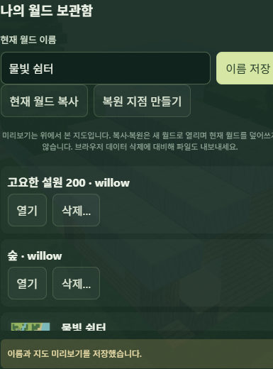

# M14 월드 관리

- 이름(40자), 지도 미리보기, 독립 복사본, 삭제 확인, 최근 2개 수동 복원 지점.
- 복원은 새 복사본으로 열어 현재 월드를 보존한다. JSON 내보내기/가져오기는 유지한다.
- 저장 공간 부족 시 이전 복원 지점은 유지하며 오류를 표시한다. 현재 월드는 삭제할 수 없다.
- 자동 테스트 114개 통과. 브라우저에서 이름/지도 저장, 복원 지점 생성, 새 슬롯으로 복사와 이름 유지 확인.
- 실제 휴대폰 검증은 사용자 요청으로 제외. 커밋/배포 전 로컬 구현이다.
- 추가 검증: 복원 버튼으로 새 슬롯/복원본 이름 생성, 원본 저장 문자열 불변 확인. 다른 복사본의 삭제 확인 후 목록과 저장 데이터에서 제거되고 현재 복원본은 유지됨을 확인.

