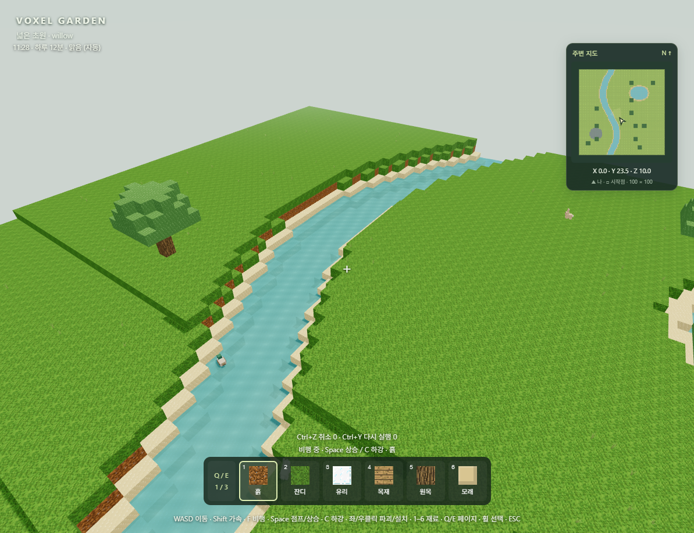

# M15 물과 지형

- 새 풍경에 굽이치는 강, 얕은 연못, 모래 물가, 바위 능선을 추가했다. 설원/초원에도 물과 오리 서식지가 생긴다.
- 물은 기존 물결 셰이더를 공유하는 고정 수면이다. 유체 시뮬레이션·수영·폭포는 이번 범위에 포함하지 않았다.
- 새 풍경은 generator 2 / `gen=2` / 별도 저장 키를 사용한다. 이전 generator 1의 지형 해시와 저장 키 회귀 테스트를 유지했다.
- 119개 테스트 통과: 모든 풍경의 범위/스폰/중복/물 생성, 변경분 내보내기와 복원, 주소/저장 분리.
- 브라우저 초원에서 수면 936셀, 정상 렌더링과 비행으로 강/연못 확인. 시작 시 약 19.6ms 지형 생성(개발 모드의 단일 참고 측정).

