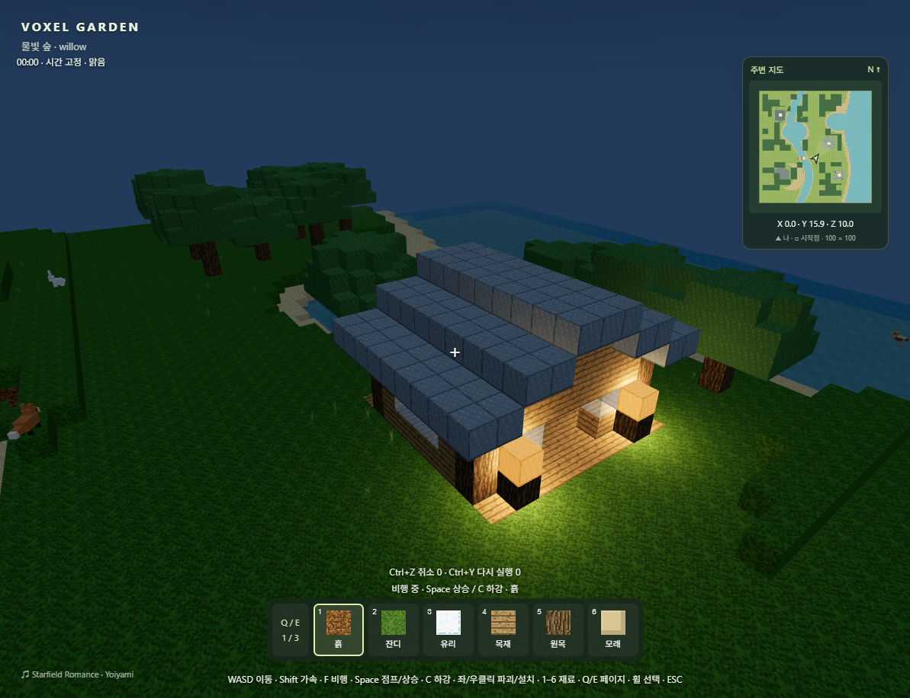
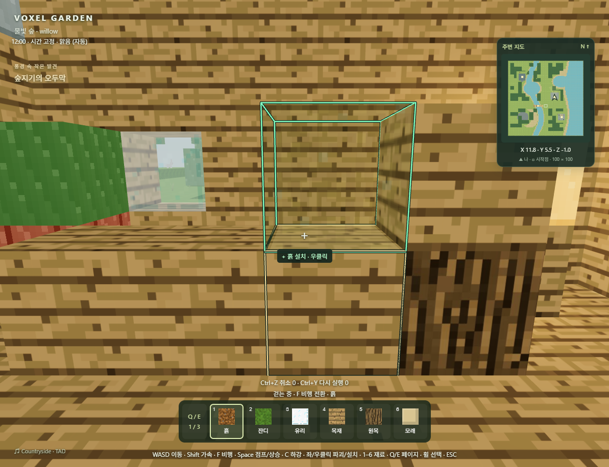
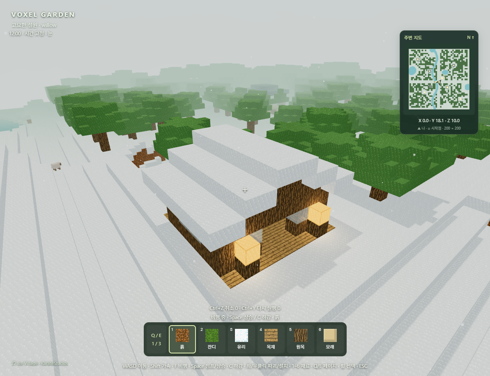

# M16 풍경 속 작은 발견

- 숲 오두막, 초원 농가, 군도 쉼터, 설원 산장: 벽·지붕 재료가 풍경에 맞게 달라진다.
- 정자·옛 돌터·강의 나무다리. 100/150/200에 최대 3/5/7개의 건물·발견 장소와 다리를 배치한다. 적절한 지형이 없으면 해당 후보를 생략한다.
- 내부 벤치·탁자·장·화분, 외부 등불. 모든 건물/가구/등불은 기존 블록으로 편집·저장·복원할 수 있다.
- 가장 가까운 등불 최대 4개만 실제 조명을 켠다. 추가 그림자 렌더링은 없다. 먼 등불은 발광 재질을 유지한다.
- 미니맵에 장소 표시, 접근하면 장소 이름 표시. 기존 월드는 재생성하지 않는다.
- 테스트: 모든 풍경의 스폰/좌표/재료/중복, 문 공간, 생성 변경분 복원. 전체 120개 통과(음악 테스트 포함).
- 브라우저: 실제 키보드로 오두막 진입 (X11.78 Y5.5 Z−1.19), 실내 지붕 판정, 낮·밤 등불/렌더링. 야간 참고 장면 224 draw calls, 가까운 조명 4개.
- 프로덕션 preview 실제 조작: 등불 (9,7,1) 가운데 버튼 집기 → 왼쪽 버튼 제거 → 자동 저장(generator 2, 제거 변경분 1개) → Ctrl+Z 복원 → 변경분 0개. 등불 개수 7→6→7 확인.
- 200 설원: 생성 228.6ms, 시작 화면 401 draw calls / 165,296 triangles, 등불 15개 중 가까운 4개만 조명. 정지 90프레임 중앙값 16.7ms, p95 16.8ms, JS 힙 순간값 약 250MB. 이 PC의 짧은 표본이며 최대 메모리/실기기 성능 보장이 아니다.

