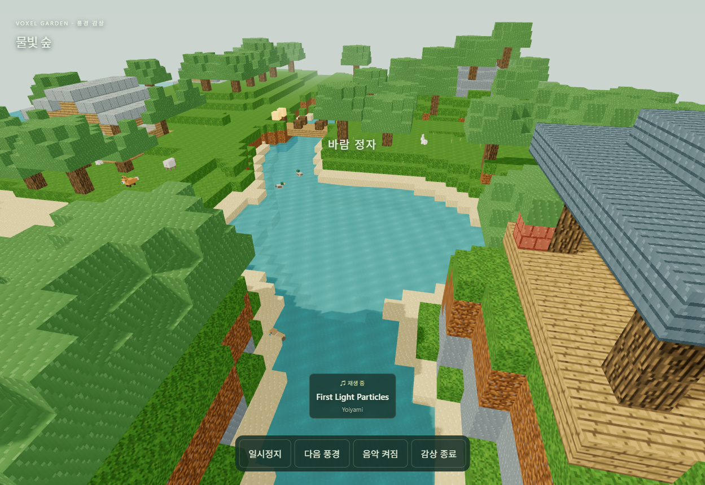
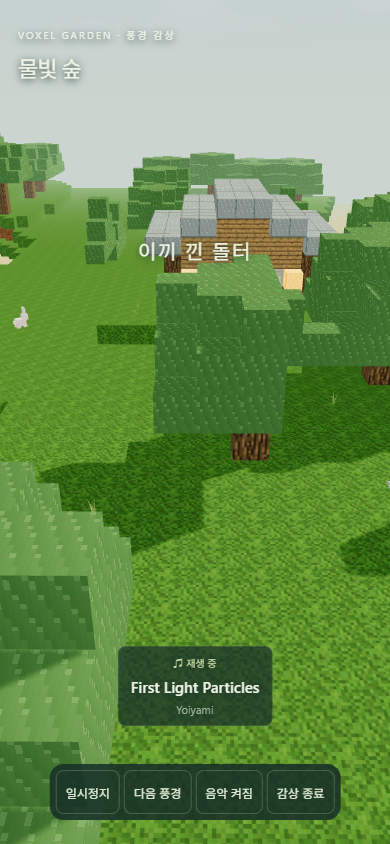

# M18 · 풍경 감상

2026-11-15 구현·공개 배포 및 검증 완료.

## 사용법

플레이 메뉴에서 **풍경 감상**을 선택하고 **감상 시작**을 누른다. 숲·초원·군도·설원 중 하나와 새 시드를 무작위로 골라 100×100 임시 월드를 만든다. 감상 시작 버튼은 브라우저의 오디오 재생 허용을 위한 사용자 입력도 제공한다.

건물과 물가 주변을 천천히 비행하며 둘러보고, 지점에서 잠시 머무른 뒤 같은 월드의 경로를 순환한다. 지형·나무·지붕의 높이를 조사해 안전한 고도를 미리 계산한다. 장소 이름은 잠시 나타났다 사라진다. 현재 음악과 감상 조작은 표시한다.

- 일시정지 / 재생, 다음 풍경(페이드 전환), 음악 켜기/끄기, 감상 종료.
- Esc, 창 포커스 이탈, 탭 숨김은 감상을 정지한다. 재개는 직접 누른다.
- 감상 종료는 진입 전 월드 메뉴로 돌아간다. 개인 설정, 최근 월드, 저장 파일은 변경하지 않는다.
- 시간과 날씨는 감상 세션에서만 자동으로 설정한다. 음악 켜짐/음량은 기존 선호를 따른다.
- 건축/이동 입력과 포인터 잠금은 연결하지 않는다. 시작 전 원래 월드에 저장할 변경이 있으면 저장 성공 후 이동한다.

## 검증

- 전체 31개 테스트 파일, 136개 테스트 통과. 프로덕션 빌드 및 diff 공백 검사 통과.
- 네 종류 지형에서 경로 전체를 0.5 샘플 간격으로 검사: 맵 경계, 블록 위 여유 높이, 연결부와 루프 연속성.
- 카메라가 실제 풍경 방향을 향하는지, 재생 중 이동하고 일시정지 시 위치와 회전이 고정되는지 회귀 테스트.
- 임시 월드가 동일 시드의 기존 저장을 읽거나 덮어쓰지 않고 설정과 최근 월드를 보존하는지 테스트.
- 프로덕션 브라우저: 메뉴 진입 → 랜덤 월드 → 이동 → 일시정지 → 다음 풍경 → 종료. localStorage 전체 비교 동일. 일시정지 전후 위치 일치, B 입력으로 건축 UI 열리지 않음.
- 390×844 모바일 터치 에뮬레이션: 시작, 일시정지, 다음 풍경, 음악 끄기, 재생, blur 자동 정지 검증. 가로 넘침 없음. 검증 후 에뮬레이션 해제.
- 실제 모바일 기기 검증은 사용자 요청에 따라 제외했다. 맵 간 자동 교체와 지상 보행은 이번 버전 범위에 포함하지 않는다.

## 공개 배포 확인 (2026-11-15)

- 구현 `204b005`, Pages `e01a8b244a19794c61688b0b055209d41e075c7a`.
- [Pages 배포 작업](https://github.com/yooseongc/react-three/actions/runs/43609470823) 성공. 공개 번들 `index-C2yj6LWI.js` 확인.
- 공개 메뉴에서 랜덤 감상 진입, 자동 이동, 일시정지 위치 고정, 다음 풍경 이동, 종료 후 메뉴 복귀 확인.
- 감상 전후 localStorage 전체 내용 동일. 브라우저 콘솔 오류 0건.
