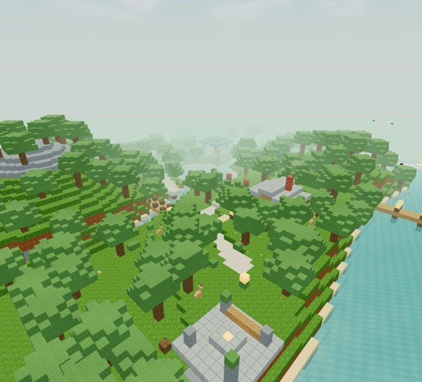
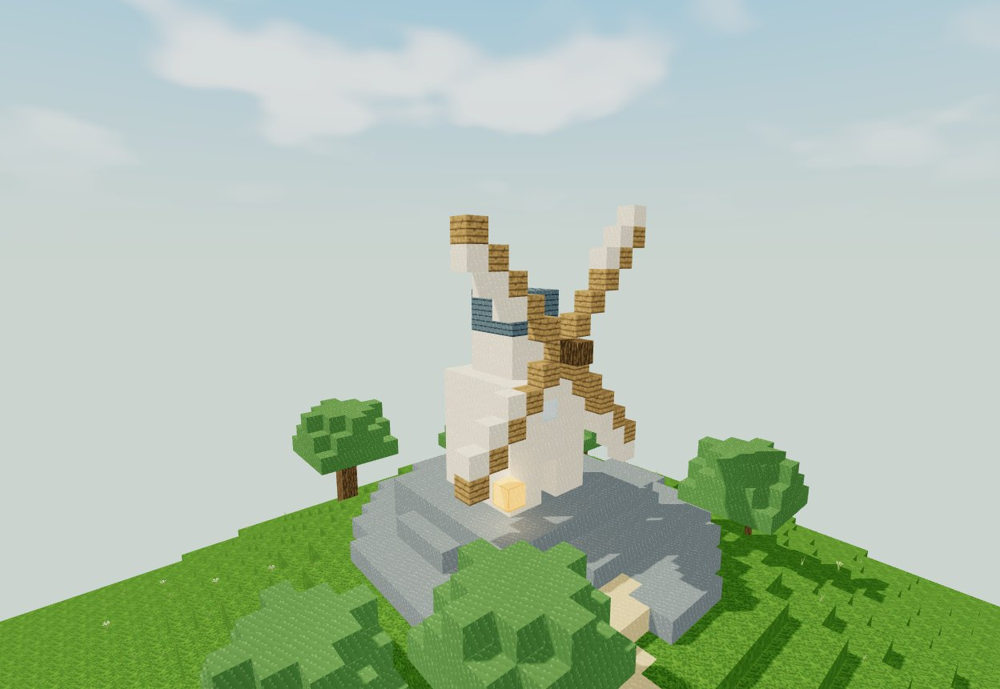
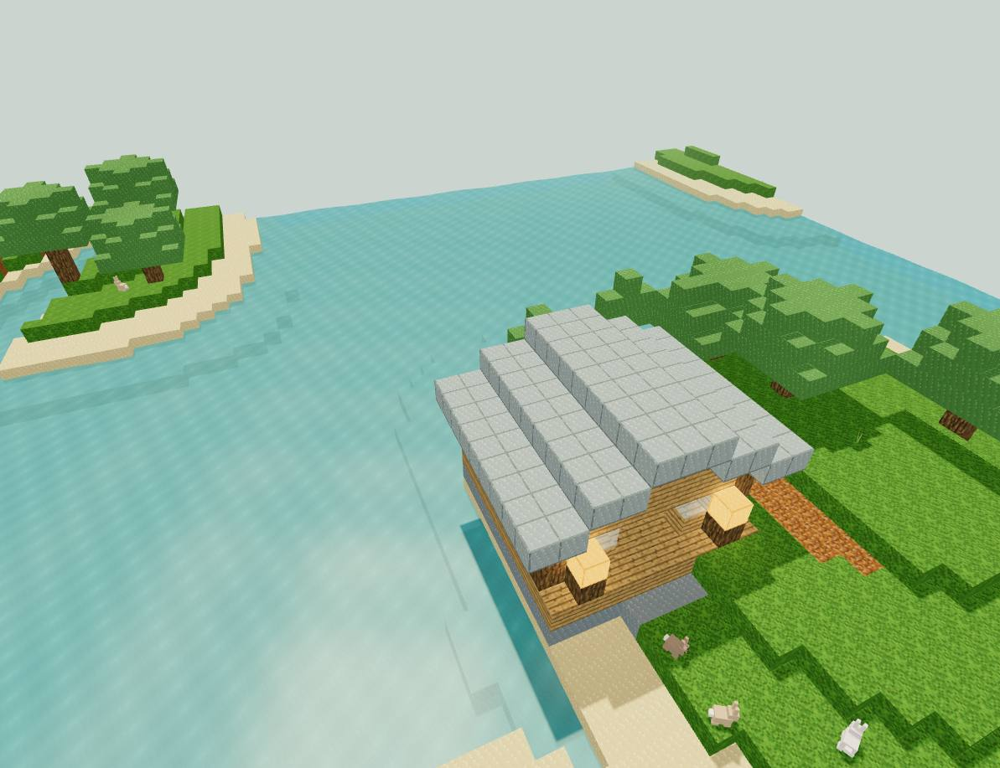
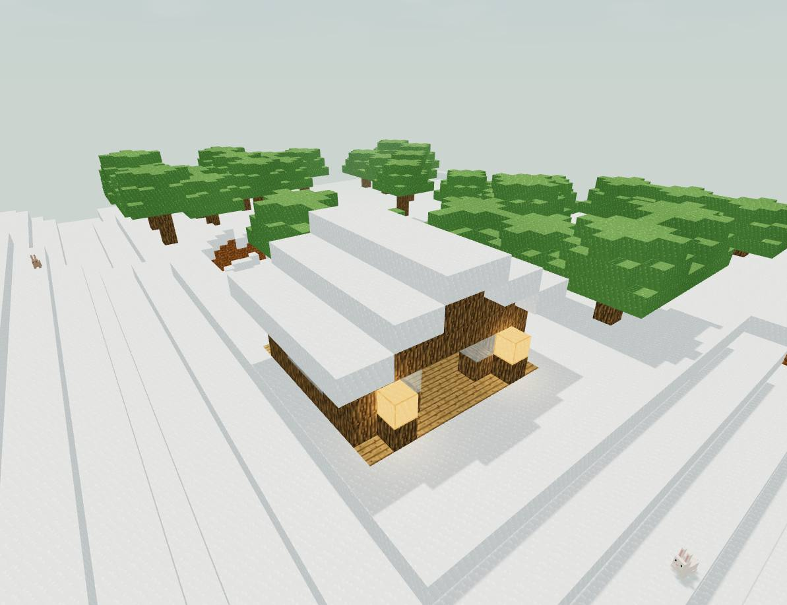
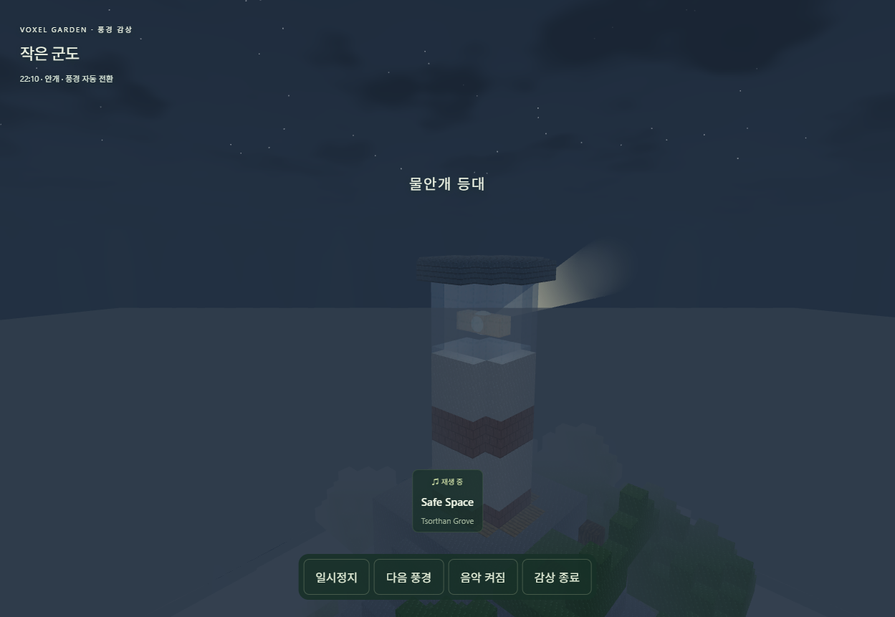
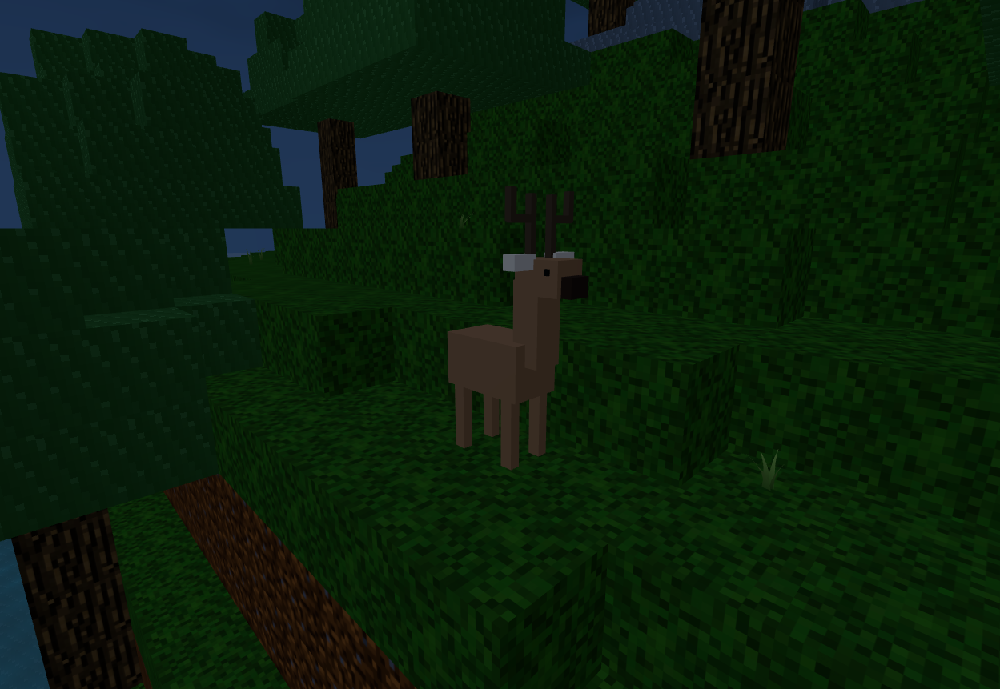
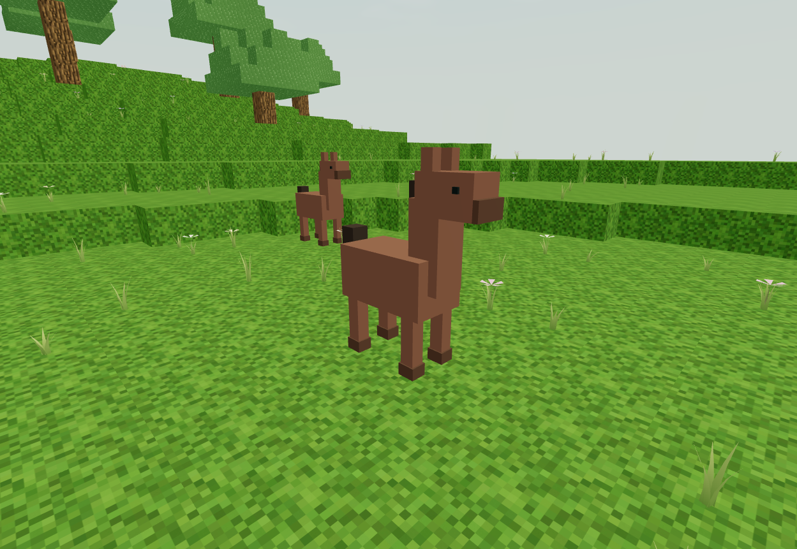
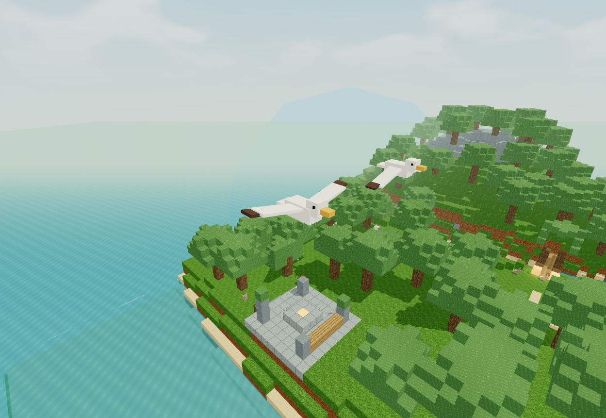
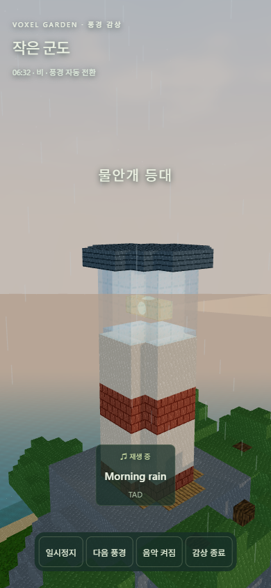

# M19 · 풍경 감상 재구성, 지형과 생태계 확장

2026-11-15 구현·커밋·공개 배포 완료.

## 감상 모드 수정

- 처음 만든 한 맵을 순환하던 M18과 달리, 35~55초 재생할 때마다 다른 종류 맵과 새로운 시드로 전환한다.
- 첫 맵 이후 나머지 종류를 섞어 방문한다. 같은 맵·시간대·날씨가 연달아 선택되지 않으며 아침·낮·노을·밤과 맑음·흐림·비·안개·눈을 조합한다.
- 다음 풍경 버튼도 새 월드로 전환한다. 페이드 뒤 월드·카메라 경로·동물 등을 교체한다. Canvas/WebGL 컨텍스트와 음악 시스템은 유지한다.
- 시계와 현재 음악은 실제 상태를 표시한다. 날씨는 장면별 선택, 시간은 장면의 시작 시각부터 흐른다.
- 일시정지·탭 숨김은 장면 타이머를 정지한다. 감상 종료는 원래 월드로 돌아간다. 저장 파일과 사용자 설정은 변경하지 않는다.

## 맵

- 숲: 굽이치는 강, 빈터와 언덕, 바다로 이어지는 부두·목조 돛배·등불.
- 초원: 굴곡 있는 언덕, 농가·울타리·오솔길·꽃·풍차.
- 군도: 높낮이가 다른 섬, 모래 해안·돛배·등대. 바다는 편집 경계 너머 수평선까지 시각적으로 이어진다.
- 설원: 산 능선·계곡·성긴 침엽수 군락·산장.
- 건물, 배, 돛, 길과 장식은 기존 블록처럼 편집 가능하다. 나무 격자를 흔들고 수종 및 분포를 달리했다.
- 사용자의 호환 불필요 지시에 따라 generator 2의 생성 지형 자체를 개선했다. 저장 파일을 삭제하지 않지만 기존 generator 2 변경분은 새 지형 위에 적용된다. generator 1 기준은 유지했다.
- 맵 종류 미리보기 4종을 새 장면으로 갱신했다.

## 등대

내부 등불만 있던 상태에서 실제 회전 스포트라이트, 밝은 광원과 거리에 따라 사라지는 빛줄기를 추가했다. 밤·안개에서 더 선명하다. 일시정지 시 회전 정지. 등대의 원래 등불 블록이 모두 제거되면 광원도 꺼진다. 추가 조명에는 그림자 맵을 만들지 않는다.

## 동물

기존 토끼·오리·여우·양에 사슴·말·갈매기·물고기를 추가했다. 숲/설원의 사슴, 초원의 말, 해안의 갈매기, 깊은 물의 물고기처럼 맵별 구성이 다르다.

- 전체 상한 32마리, 실제 맵별 20~28마리. 모든 모델은 하나의 인스턴스 메시를 공유한다.
- 물고기는 수면 아래 깊이가 확보된 셀만 이용한다. 갈매기는 기존 지형/건물보다 높은 안전 고도에서 움직이며, 편집된 장애물도 검사한다.
- 육지 동물의 몸 크기와 머리 높이에 맞춰 유효 공간을 확인한다. 가까운 플레이어를 피하고 밤/궂은 날씨에는 쉬는 비율이 높아진다.
- 멀리 이동하면 시야 밖 동물을 주변 서식지로 재배치한다. 개체 수를 누적하지 않는다. 길들이기·탑승·전투는 포함하지 않는다.

## 검증

- 전체 145개 테스트 통과. 동물 몸 크기 조정 후 관련 10개 테스트 재검증, 최종 프로덕션 빌드·diff 공백 검사 통과.
- 3개 시드 × 4종 맵: 랜드마크 존재, 유효 블록/중복 없음, 배의 전 구역이 실제 물 위인지 확인. 400 맵 경계/파일 왕복 회귀 포함.
- 장면 선택 60회로 맵·날씨·시간 반복 제한과 분포 검증. 정지/숨김 상태의 시간 누적 차단 검증.
- 브라우저에서 버튼 없이 숲 → 초원 자동 전환을 관측. 맵·시드·시간·날씨 모두 변경. 수동 6회 연속 전환에도 재생 지속.
- 연속 전환 중 GPU geometry 수 관측 317 → 245 → 200 → 221 → 152 → 226. 장면별 개수는 달랐고 이 표본에서 누적 증가는 보이지 않았다. 장시간 메모리 누수 부재를 보장하는 측정은 아니다.
- 감상 전후 localStorage 전체 내용 동일. 프로덕션 화면 콘솔 오류 0건.
- 밤/안개 등대 회전 각도 증가와 일시정지 시 고정 확인. 새 동물 4종 실제 메시를 QA 카메라로 근접 관찰했다.
- 390×844 모바일 터치 에뮬레이션: 시작 → 다음 맵 전환 → 일시정지, 등대 및 동물 표시, 가로 넘침 없음. 검증 후 에뮬레이션 해제. 실기기 검증은 사용자 요청으로 제외.

## 화면

## 공개 배포 확인

- 구현 `46bba63`, Pages `3613f65ac7b3cc30d5aad4395715fa641ad4ee24`.
- [Pages 배포 작업](https://github.com/yooseongc/react-three/actions/runs/43663897025) 성공. 공개 번들 `index-Bkn_mmC7.js` 확인.
- 공개 사이트에서 군도 등대의 빛줄기 활성화 및 회전 각도 증가 확인.
- 다음 풍경으로 군도 → 초원 → 설원 → 숲 전환, 시드·날씨·시간 변경 확인.
- 사슴·말·갈매기·물고기를 포함한 8종의 맵별 활성 상태 확인. 감상 전후 localStorage 동일, 콘솔 오류 0건.
