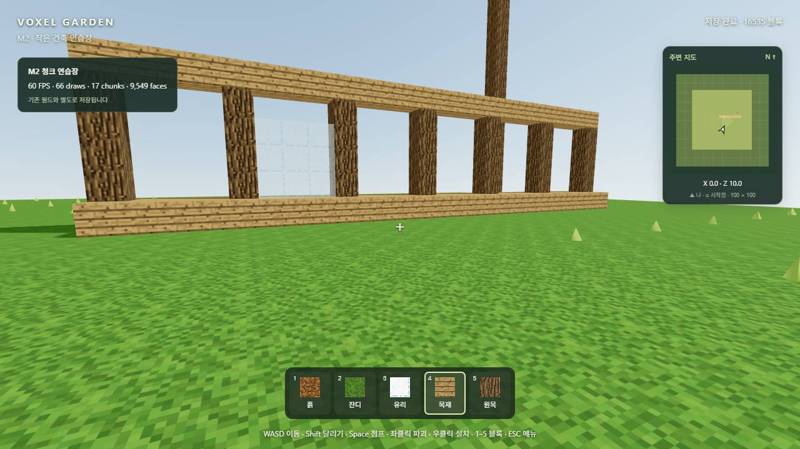

# M2 — 청크 월드 구현 및 검증

검증일: 2026-11-14 (Asia/Seoul)

## 범위

- 좌표 키 기반 블록 인덱스와 16×16×16 청크.
- 블록 내부 면 제거, 청크·재질별 메시 결합, 공유 재질과 텍스처.
- 블록 편집 시 해당 청크와 경계를 맞댄 이웃만 재구축. 빈 청크 제거와 지오메트리 해제.
- 충돌은 플레이어 주변 셀만 조회하고 조준은 DDA 격자 탐색으로 처리.
- 장식 잔디 144개를 단일 InstancedMesh로 렌더링하는 기반.
- 기존 저장 형식 유지 및 별도 데모 저장 키 제공.

시점 전환·별도 캐릭터·설치 미리보기는 사용자 결정에 따라 M4 이후 논의한다. 라이브러리 버전 업데이트는 M2.5로 분리한다.

## 성능 측정

동일한 64×64×4 = 16,384블록 월드에서 시작 위치에서 전진 입력을 유지하며 약 5초간 브라우저 requestAnimationFrame 간격을 측정했다. 1초 준비 후 측정했다. 환경과 실행 부하에 따라 달라지는 관측값이며 모든 PC의 성능을 보장하지 않는다.

- Windows Chromium 157, NVIDIA GeForce GTX 1060 6GB / ANGLE D3D11.
- 화면 1280×720, DPR 1, 프로덕션 빌드, 그림자 활성화.
- 브라우저 보고 논리 프로세서 수 16. CPU 모델은 환경에서 조회하지 못했다.
- 원본 기록: [m2-measurements.json](m2-measurements.json).

| 지표 | M1 블록별 메시 | M2 청크 메시 |
|---|---:|---:|
| 블록 수 | 16,384 | 16,384 |
| 구성된 블록 면 수 | 98,304 | 9,216 |
| 구성된 블록 삼각형 수 | 196,608 | 18,432 |
| 중앙 프레임 시간 | 83.4 ms | 16.7 ms |
| 중앙 프레임 간격 환산 FPS | 약 12 | 약 60 |
| 95백분위 프레임 시간 | 100.1 ms | 16.8 ms |
| 5초 관측 프레임 수 | 61 | 300 |
| 관측 드로콜 최대 | 미계측 | 50 |

면 수는 90.625% 감소했다. M1 면·삼각형 수는 블록별 박스 구성으로 계산한 값이며 화면에 실제 제출된 삼각형 수와 구분한다. M2 메시 면 수는 자동 테스트와 런타임 집계 모두 확인했다. M2 마지막 관측 프레임은 42드로콜·22,798삼각형이며, 이는 그림자 패스와 지면·하늘 등을 포함하므로 블록 메시 삼각형 수와 다르다. Three.js의 자동 통계 초기화를 끄고 프레임 시작 시 초기화하여 그림자 패스도 집계했다.

동일한 전진 입력을 사용했지만 프레임당 시간 제한 때문에 두 빌드의 이동 궤적은 완전히 같지는 않다. 고정된 대형 평면에서의 실사용 비교이며 정밀한 GPU 벤치마크는 아니다.

목표: 중앙 FPS 50 이상, 드로콜 100 이하, 노출 면 9,216개. 이 환경의 측정 구간에서 충족했다.

## 정확성 검증

`npm run test:ci`: 4개 스위트, 39개 테스트 통과.

- 양수·음수 청크 좌표, X/Y/Z 경계의 공유 면 제거와 복원.
- 내부 편집 시 다른 청크 객체 유지. 모서리 편집 시 면을 공유하는 이웃만 갱신.
- 유리/유리 내부 면 제거, 불투명/유리 경계의 불투명 면 보존.
- 6개 면의 법선·삼각형 방향·UV, 조준 거리 제한·6방향 선택·지면 선택.
- 주변 셀 기반 충돌과 기존 이동 결과 일치, 플랫폼 접지·점프·발밑 블록 제거 후 낙하.
- 59/60/120/144FPS 조건에서 접지 유지. 작은 물리 계산 간격에서 접지 상태가 흔들리던 허용 오차를 분리해 수정했다.
- 기존 저장 복원·손상 복구·실패 처리 및 4방향/상하 시선별 이동 회귀 테스트.

브라우저 검증:

- x=15/16 경계 블록 파괴·복원 시 메시 생성 횟수 3 → 5 → 7. 재구축된 청크는 `0,0,0`과 `1,0,0` 두 개뿐이다.
- x=-1/0 경계에서도 `-1,0,0`과 `0,0,0`만 재구축했다.
- y=15/16 경계에서도 `0,1,0`과 `0,0,0`만 재구축했다.
- 같은 높이 경계 블록 20회 파괴·복원 후 GPU 지오메트리는 6개로 유지됐다. 메시 생성 기록은 7 → 87로 증가하여 재구축 자체는 실제로 수행됐음을 확인했다.
- 편집 후 새로고침하여 저장값 일치 확인.
- 16,384블록 플랫폼에서 0/90/180/270도 × WASD 총 16가지 이동 모두 기대 방향과 일치. 각 방향에서 점프·착지도 확인.
- 데모 설치·파괴 후 개인 월드 저장값은 변경되지 않았다. 데모 16,535 → 16,536 → 16,535블록 및 재접속 복원 확인.
- 미니맵에서 (0,4,5) 위에 (0,5,5)를 설치하면 지도 이미지가 변경되고, 파괴하면 원래 이미지로 돌아왔다. 플레이어 화살표 바로 아래에 놓인 블록은 표시에 가려질 수 있다.
- 공유 재질로 바꾼 후 텍스처가 밝게 보이는 문제를 발견해 sRGB 변환을 명시했다. 최종 스크린샷으로 확인했다.
- 브라우저 콘솔 오류 0건. 프로덕션 빌드 및 공백 검사 통과.

## 데모

`npm run build` 후 `npm run preview`.

- [기존 개인 월드](http://127.0.0.1:4173/react-three/)
- [M2 청크 연습장](http://127.0.0.1:4173/react-three/?demo=chunks)
- [고정 성능 측정 월드](http://127.0.0.1:4173/react-three/?demo=benchmark)

연습장은 `voxel-garden.m2-demo.v1`에 저장한다. 개인 월드의 `voxel-garden.world.v1` 및 이전 `world` 키를 사용하지 않는다. 성능 측정 월드는 저장하지 않는다.

연습장에서 목재 구조물과 유리를 파괴·설치하고, 미니맵과 성능 패널을 확인할 수 있다. 기본 조작은 WASD/마우스, Space 점프, 좌클릭 파괴, 우클릭 설치, 1–5 블록 선택, ESC 메뉴다.

## 현재 한계 및 후속

- 유한 월드이며 무한 스트리밍, 작업 스레드 메시 생성, greedy meshing은 구현하지 않았다.
- 편집 시 블록 Map 복사와 저장용 배열·미니맵 재생성은 전체 블록 수에 비례한다. 매 프레임 충돌·조준 및 메시 재구축 범위를 줄인 단계다.
- 유리는 청크 단위로 묶여 복잡하게 겹친 투명 구조의 정렬에는 제한이 있다.
- 장식 잔디는 인스턴싱 기반 검증용이며 충돌·파괴 대상이 아니다. 풍경 생성은 M3 범위다.
- 다른 GPU·브라우저·모바일과 더 큰 월드의 성능은 아직 검증하지 않았다.
- GitHub Pages에 실제 업로드하지 않았다. 다음 단계는 M2.5 개발 환경 업데이트다.
