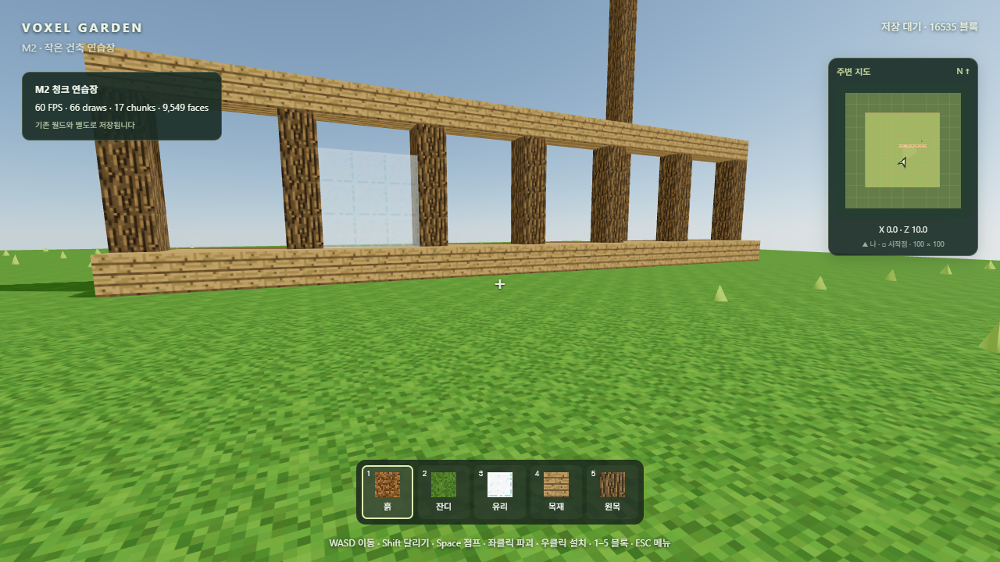

# M2.5 개발 환경 업데이트 검증

검증일: 2026-11-14. 로컬 Windows / Chromium / GTX 1060 6GB.

## 변경

| 항목 | 이전 | 현재 |
|---|---|---|
| Node.js | 20.19.5 | 26.13.1 LTS |
| npm | 11.18.0 | 11.20.0 |
| React / React DOM | 17 | 19.3.1 |
| Three.js | 0.128 | 0.187.0 |
| React Three Fiber | 6 | 9.8.2 |
| Drei | 4 | 10.7.9 |
| Zustand | 3 | 5.1.0 |
| 빌드 | CRA 4 | Vite 8.3.8 / React plugin 6.3.0 |
| 테스트 | CRA Jest | Vitest 5.1.0 / jsdom 31.0.1 |

- 사용자 승인에 따라 nvm-windows로 Node 26.13.1을 설치하고 활성화했다. 기존 20.19.5 등은 보존했다. 활성 Node 전환은 이 PC의 nvm 공용 경로에 적용된다.
- `.nvmrc`와 package.json engines에 Node 26.13.1 기준을 기록했다. 모든 직접 의존성 버전을 고정하고 잠금 파일을 재생성했다.
- React createRoot, JSX 확장자, Zustand named create, Three 색 공간·지오메트리·controls import API를 전환했다.
- 현대 Three 조명 계산에 맞춰 기존 밝기를 보정했다. 제거된 PCFSoftShadowMap 대신 R3F의 `shadows="percentage"`로 PCFShadowMap을 지정했다.
- 미사용 Cannon·nanoid·CRA·OpenSSL 호환 실행 옵션과 옛 미리보기 스크립트를 제거했다.
- Vite base는 `/react-three/`, 산출물은 기존과 같은 `build/`, 배포 명령은 `gh-pages -d build`이다. 실제 GitHub Pages 배포는 수행하지 않았다.
- 기존 저장 v1과 개인/데모 저장 키는 유지한다.

## 자동 검증

- Node 26.13.1에서 `npm ci`: 성공, 180개 패키지 설치, 감사 결과 취약점 0건(해당 시점).
- `npm run test:ci`: 4개 파일, 39개 테스트 통과.
- `npm run build`: 성공. JS gzip 322.78 kB.
- `npm ls --depth=0`: 직접 의존성 버전 일치, peer 의존성 충돌 없음.
- Windows에서는 실행 중인 Vite가 Rolldown 네이티브 파일을 잠가 최초 npm ci가 EPERM으로 실패했다. 개발·미리보기 서버를 종료한 후 재설치 및 전체 테스트·빌드에 성공했다.

## 브라우저 회귀 검증

테스트 전용 브라우저 컨텍스트를 사용해 사용자의 실제 저장값과 분리했다.

- 1280×720, DPR 1에서 화면·텍스처·유리·그림자·미니맵·HUD 표시 확인.
- 0/90/180/270도 수평 시선과 상하 시선을 조합한 WASD 16가지: 실제 이동과 기대 방향의 내적 비율 0.999999 이상, 약 220ms당 0.976–1.051칸, 발 높이 4.5 유지.
- 점프 발 높이 4.5 → 5.345 → 4.5, 접지 복귀 확인.
- 음수 경계 (-1,2,6) 파괴/설치: 대상이 (-1,2,5)로 변경 후 복귀. 메시 생성 누적 3 → 5 → 7, 변경 청크는 -1,0,0 / 0,0,0뿐. 저장 후 새로고침 복원.
- 높이 경계 (0,16,6) 파괴/설치 20회: 누적 메시 생성 3 → 83, 변경 청크 0,1,0 / 0,0,0. GPU 지오메트리는 6개로 유지.
- 데모 블록 설치: 16,535 → 16,536, 파괴 후 원상복구. 미니맵 이미지도 변경 및 원상복구. 새로고침 후 저장 유지, 개인 저장은 불변.
- 손상된 `{broken` 저장: 원문을 backup 키에 보존하고 8블록 연습 월드와 복구 안내 표시.
- React StrictMode 개발 서버에서도 설치·파괴·이동·ESC·재개 정상. 개발 모드의 이중 렌더로 메시 생성 계수는 두 배이지만 제거 후 GPU 지오메트리는 42 → 43 → 42로 복귀.
- 최종 개발/배포 진입 및 재개 검증에서 런타임·콘솔 오류 0건. 빠른 자동 새로고침/재잠금 과정에서 Pointer Lock 거부가 한 차례 발생했으며, 잠금 해제 후 대기하고 재개한 검증은 오류 없이 통과했다.
- `/react-three/`의 HTML·JS·CSS·텍스처 5종·manifest·favicon 응답 모두 200.

## 성능

64×64×4 = 16,384블록, 약 5초 전진, GTX 1060 6GB / ANGLE D3D11 / 1280×720 / DPR 1.

| 항목 | M2 | M2.5 |
|---|---|---|
| 중앙 프레임 시간 | 16.7ms | 16.7ms |
| p95 프레임 시간 | 16.8ms | 16.8ms |
| 관측 최대 드로콜(그림자 포함) | 50 | 50 |

M2.5 측정은 5,004.3ms, 300프레임이다. 이 환경·경로에서 M2 성능 목표를 유지했다. 모든 하드웨어 성능을 보장하는 수치는 아니다.

## 남은 경고

- R3F 9.8.2 내부에서 `new THREE.Clock()`을 사용해 Three의 사용 중단 예정 경고가 1회 발생한다. 앱 런타임 오류는 아니며 라이브러리 내부를 임의 패치하거나 경고를 숨기지 않았다. 후속 R3F 업데이트 시 재확인한다.
- Vite는 단일 JS 번들 1,170.24 kB(압축 전)에 대해 500 kB 초과 안내를 출력한다. 빌드는 성공하며, 첫 로딩 크기 개선은 공개 마감 M5에서 검토한다.

## 데모

`npm run preview` → http://127.0.0.1:4173/react-three/?demo=chunks

## 확인한 공식 자료

- [Node 공식 배포 목록](https://nodejs.org/dist/index.json): 조회 시 26.13.1 / Lithium LTS 확인.
- [R3F React 버전 조합](https://r3f.docs.pmnd.rs/getting-started/introduction)
- [Vite GitHub Pages 하위 경로](https://vite.dev/guide/static-deploy.html)
- [Three 색 공간](https://threejs.org/manual/en/color-management.html)
- [Three r155 조명 변경](https://discourse.threejs.org/t/updates-to-lighting-in-three-js-r155/53733)
- [Zustand v5 마이그레이션](https://github.com/pmndrs/zustand/blob/main/docs/reference/migrations/migrating-to-v5.md)
