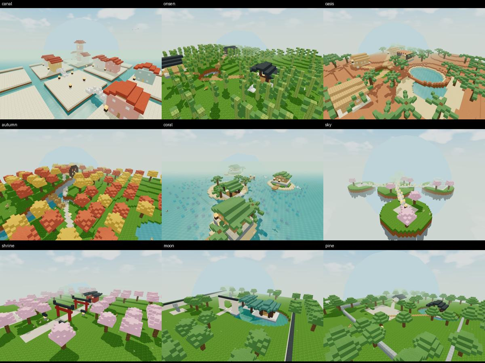
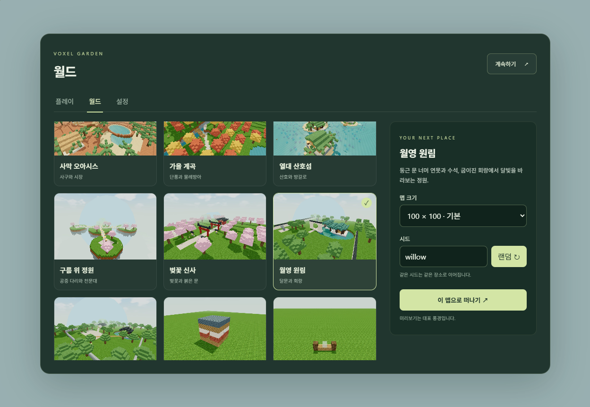
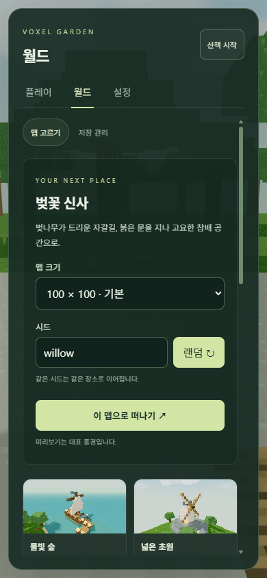

# M20–M28 · 아홉 개의 새로운 풍경

2026-11-15. 국가명 대신 장소의 정취를 드러내는 이름을 사용한다.

| 단계 | 맵 | 구성 |
|---|---|---|
| M20 | 수상 도시 | 운하, 색 회벽의 집, 아치 다리, 광장, 종탑, 곤돌라 |
| M21 | 대나무 온천 마을 | 대숲, 여관과 찻집, 노천탕, 수증기 |
| M22 | 사막 오아시스 | 모래언덕, 야자수, 샘, 천막 시장, 사암 유적 |
| M23 | 가을 계곡 | 붉은·황금 단풍, 계곡 다리, 물레방앗간, 전망 정자 |
| M24 | 열대 산호섬 | 야자수, 얕은 산호초, 방갈로, 선착장 |
| M25 | 구름 위 정원 | 떠 있는 섬, 연결 다리, 구름, 유리 천문대, 추락 복귀 |
| M26 | 벚꽃 신사 | 붉은 문, 참배길, 신사, 돌등, 모래 뜰 |
| M27 | 월영 원림 | 달문, 연못, 비취 기와 회랑, 수석, 정자 |
| M28 | 솔바람 별서 | 소나무, 낮은 돌담, 기와집과 툇마루, 빈 마당, 연못 정자 |

## 공통 연결

- 건축 재료 20종 추가, 총 34종. 팔레트, 미니맵, 저장/가져오기에 연결.
- 시드로 재현하며 건축 블록은 편집 가능. 일반 건물 진입 계단과 수상 도시 2층 집 실내 계단 포함.
- 월드 메뉴 15개 카드(풍경 13 + 작은 집 + 연습장), 실제 렌더 미리보기 9장 추가.
- 데스크톱 생성 옵션 고정, 작은 화면에서는 옵션을 갤러리 앞에 배치.
- 감상 모드 전체 13종 순회, 맵·시드·시간·날씨 전환 및 테마별 주요 장소 우선 감상.
- 동물은 테마별 구성을 적용하며 기존 상한과 서식지 판정을 유지.
- 구름 맵은 바닥 평면 없이 떠 있는 섬으로 구성. 보행 중 추락하면 도착 섬으로 복귀.

## 검증

- npm run test:ci: 34개 파일 / **165개 테스트 통과**.
- npm run build: 성공.
- 9종 모두 재현성, 경계, 재료, 시작 위치, 랜드마크, 감상 카메라 블록 침범, 새 재료 편집 후 저장 파일 왕복 검사.
- 기존 생성기 해시 회귀 검사 통과.
- preview 브라우저: 신사 W 이동 Z 10 → 1.822, Y 4.5 유지. B 건축 모드 및 E로 6번째 재료 페이지 확인.
- 월드 카드 15개 및 모든 이미지 로딩 확인.
- 감상에서 13개 맵 실제 교체, 시간/날씨 변경, 페이지 오류 0, localStorage 보존.
- 390×844 모바일 에뮬레이션: 가로 넘침 없음, 생성 옵션 노출, 맵 선택/시작, 터치 UI 자동 활성화, 캔버스 390×844. 원래 브라우저 크기로 복원. 실기기 검사는 사용자 요청대로 생략.
- preview 런타임 오류 0. 외부 의존성의 기존 Three.Clock 경고 1건 유지.
- 미리보기는 시드 preview의 대표 구도이며 저장 파일 스크린샷이 아니다.

### 400×400 CPU 생성 및 경계 검사

단일 로컬 실행 결과. GPU 프레임 성능을 뜻하지 않는다.

| 맵 | 블록 | 생성 ms |
|---|---:|---:|
| 수상 도시 | 568,385 | 702 |
| 대나무 온천 마을 | 1,012,028 | 728 |
| 사막 오아시스 | 815,960 | 514 |
| 가을 계곡 | 1,087,652 | 684 |
| 열대 산호섬 | 290,665 | 225 |
| 구름 위 정원 | 155,620 | 285 |
| 벚꽃 신사 | 1,423,496 | 1,042 |
| 월영 원림 | 675,367 | 407 |
| 솔바람 별서 | 1,249,814 | 755 |

전체 좌표 ±199 / 높이 1~64 내. 400 맵은 장치에 따른 성능 차이가 크며 감상 모드 기본 크기는 100을 유지한다.

## 메뉴 데모

## 배포

구현 검증 완료. 실제 커밋 및 공개 배포 확인 결과를 추가할 예정.
