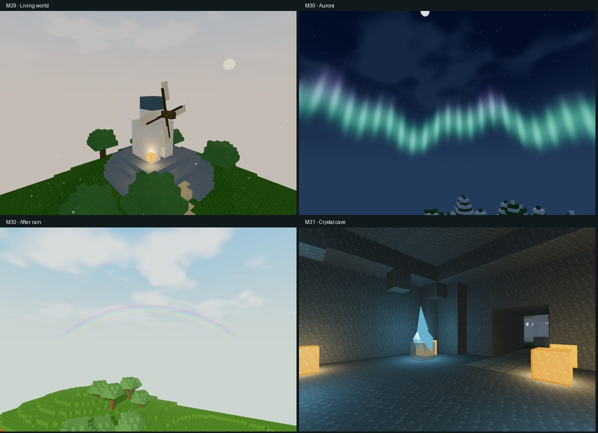
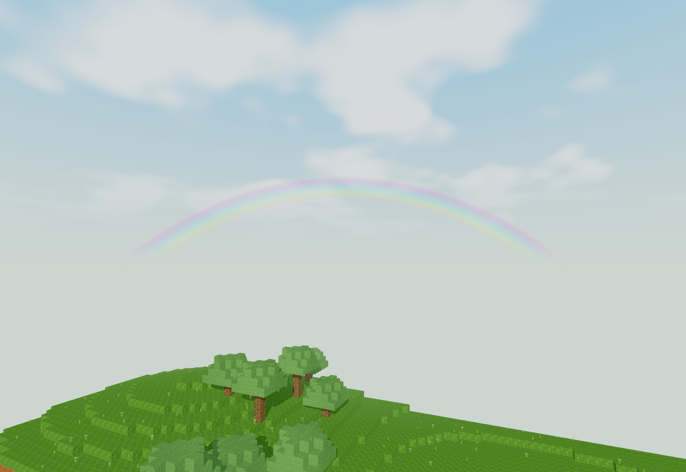
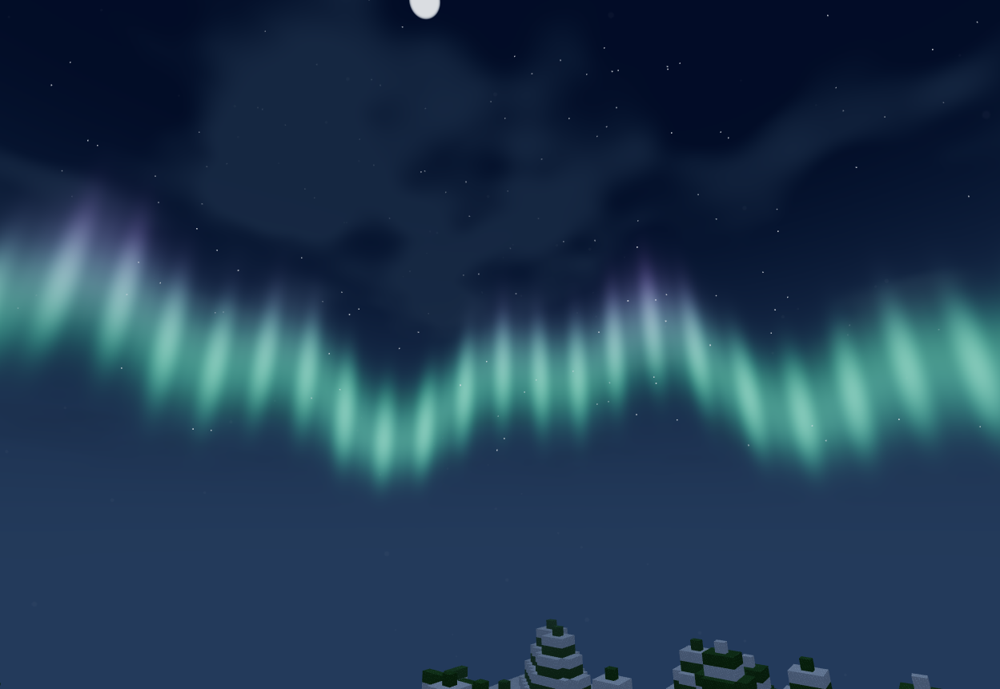
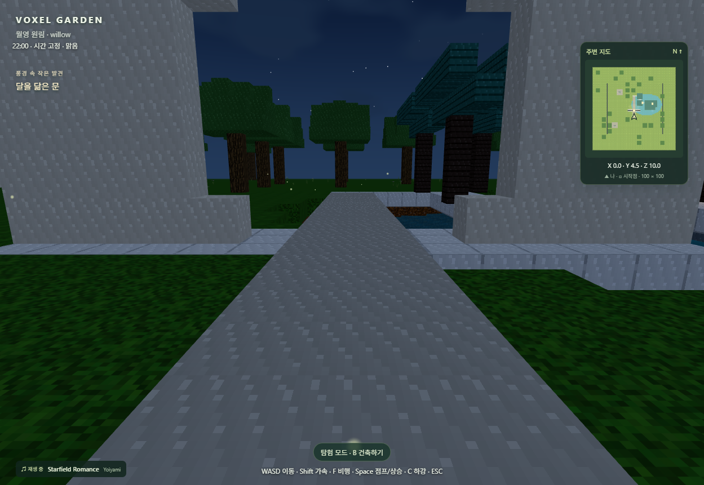
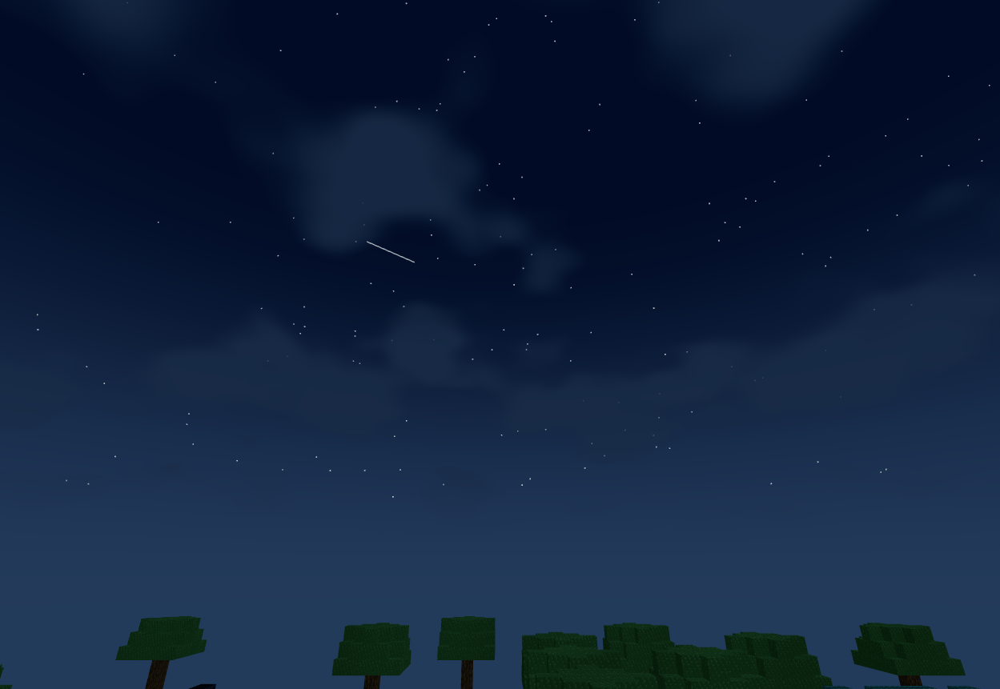
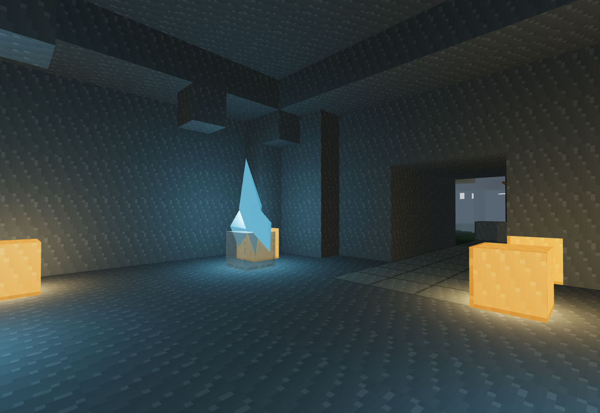
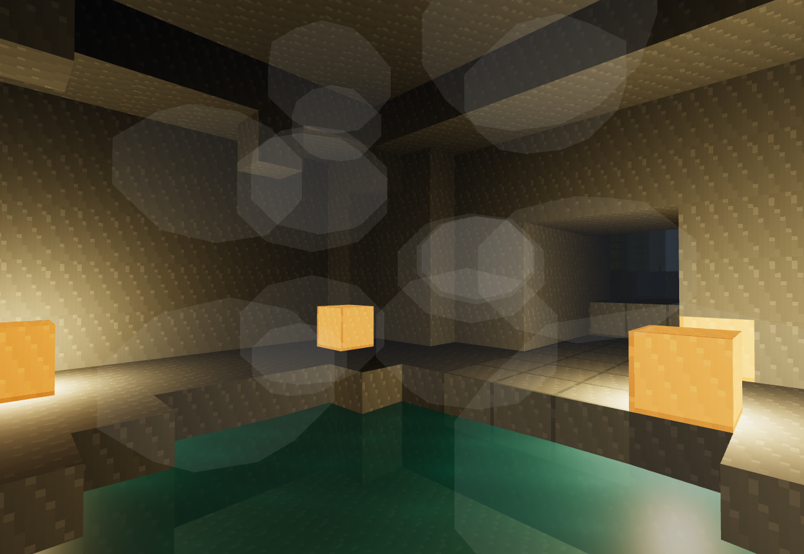
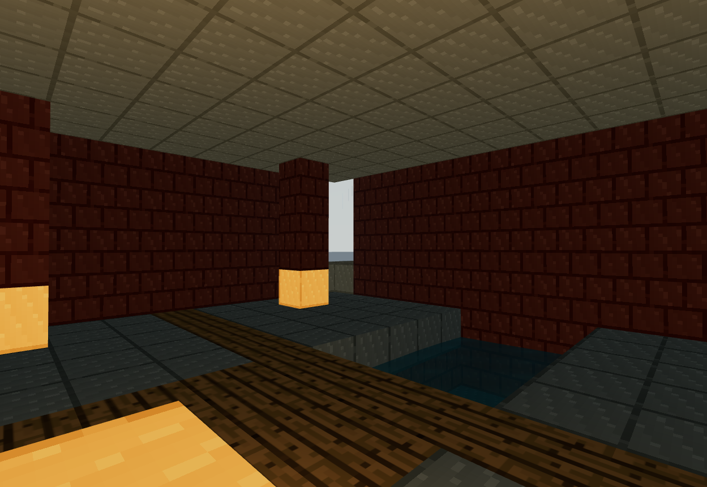

# M29–M31 · 머무는 세계

2026-11-15. 로컬 구현 완료. 이 단계의 변경은 아직 커밋/공개 배포하지 않았다.

## M29 — 세계의 작은 움직임

- 초원 풍차와 가을 계곡 물레방아 회전. 축 블록에 연결된 비충돌 장식이며, 축 제거 시 숨김 / 실행 취소 시 복구.
- 집과 산장에 편집 가능한 굴뚝 추가, 굴뚝 끝 블록과 연기 연결.
- 벚꽃잎/단풍 낙엽. 근처 원본 잎 블록이 남아 있는 곳에서만 발생.
- 근거리 회전/연기 갱신, 낙엽 최대 72개, 연기 최대 144개, 반딧불이 최대 64개. 인스턴싱/공유 버퍼 사용.
- 일시정지·백그라운드·풍경 움직임 설정을 반영. 온천 물을 블록으로 덮으면 해당 수증기도 숨김.

[로컬 풍차 감상](http://127.0.0.1:4173/react-three/?world=willow&map=meadow&gen=3&tour=1)

## M30 — 자연현상

- 맑은 설원 밤(20시~05시)에 녹색/보라색 오로라.
- 비가 온 뒤 맑아지면 낮에 무지개. 흐림을 거쳐 맑아지는 전환도 기억하며, 맑아진 뒤 약 90초 유지/페이드. 태양 반대쪽, 낮은 태양에서 잘 보임.
- 맑은 밤의 낮은 지대에 반딧불이. 설원/사막/공중섬/수상 도시는 제외.
- 맑은 밤, 활성 시간 150초 주기 중 3초간 유성. 일시정지와 백그라운드에서는 시간 정지.
- 지붕 아래에서는 하늘 현상/반딧불이를 숨김. 감상 카메라는 오로라/무지개가 있을 때 잠시 하늘을 바라봄.
- 자연현상은 기존 월드에서도 표시. 건축/지형 변경은 새 생성기에서만 적용.

## M31 — 세 개의 작은 지하 공간

| 맵 | 장소 | 입구 X / Z |
|---|---|---|
| 가을 계곡 | 단풍 아래 수정 동굴 | -29 / 15 |
| 대나무 온천 마을 | 바위 품의 지하 온천 | -29 / 15 |
| 수상 도시 | 물빛 아래 지하 수로 | 0 / -29 |

- 얕은 기존 지형 위에 바위 언덕/벽돌 테라스의 실제 천장을 만들고 내부를 비움. 넓은 지하 던전이 아닌, 걸어서 왕복하는 작은 발견 장소 3종.
- 입구 계단은 시드별 지면 높이에 맞추며, 입구 구간에서 한 블록 자동 오르기를 지원. 수정 동굴의 입구부터 내부까지 점프 없이 왕복 확인.
- 수정 조명, 수로의 마른 통로/다리, 온천의 물/수증기. 수정 받침 유리 블록 제거 시 수정과 조명도 숨김.
- 실제 천장 블록으로 비/눈을 차폐. 내부에서는 외부광과 안개를 낮추며, 기존 배경음에 저역통과 필터(1.4kHz)를 적용. 밖으로 나오면 원래 음색으로 복원. 새 효과음을 겹치지 않음.

[로컬 수정 동굴 월드](http://127.0.0.1:4173/react-three/?world=willow&map=autumn&gen=3)

## 저장 및 호환성

- 생성기 1/2를 유지하고 새 월드/새 감상 전환에 생성기 3을 사용.
- 새 저장 키 v4. 기존 v1/v2/v3 저장과 분리하며 월드 라이브러리와 파일 가져오기/내보내기 모두 지원.
- 기존 월드의 지형을 덮어쓰지 않는다. 새 움직임/지하 공간을 보려면 월드 메뉴에서 새 월드를 생성한다.

## 검증

- 전체 테스트 36개 파일 / 185개 테스트 통과.
- 빌드 성공. preview 런타임 오류 0; 기존 의존성 Three.Clock 경고 1개.
- 지하 3종 × 5개 시드: 마른 왕복 경로, 실제 물리 이동/자동 계단 오르기, 천장 차폐, 좌표 범위 검사.
- 생성기 3 편집 저장/파일 복원/라이브러리 노출 검사. 기존 생성기 회귀 검사 유지.
- 회전축 삭제 → 장식 숨김 → 실행 취소 → 복원, 브라우저 실제 확인.
- 재생 중 효과 시간 증가 및 일시정지 시 고정 확인.
- 실제 키보드 동굴 왕복: 입구 (-28.661, 6.500, 14.952) → 내부 (-28.661, 3.500, 25.831) → 원래 입구. 지하 판정 진입/해제 정상.
- 비가 오는 상태에서 세 내부를 렌더해 천장 차폐 확인. 강수 입자는 주변 바깥쪽에는 남으며 내부로 관통하지 않음.
- 오로라/무지개/반딧불이 렌더 확인, 실제 활성 시간 경과 후 유성 출현 확인. 유성 데모 이미지는 QA 프레임 전진으로 해당 순간을 재현.
- 낮밤/날씨를 QA에서 고정해 찍은 대표 화면 포함. 테스트 이후 카메라/시간 주입은 새로고침으로 해제.
- 배포용 preview에서 연속 감상 맵 교체와 새 효과 초기화, 페이지 오류 0 확인.
- 모바일 실기기 검사는 사용자 방침대로 생략.
