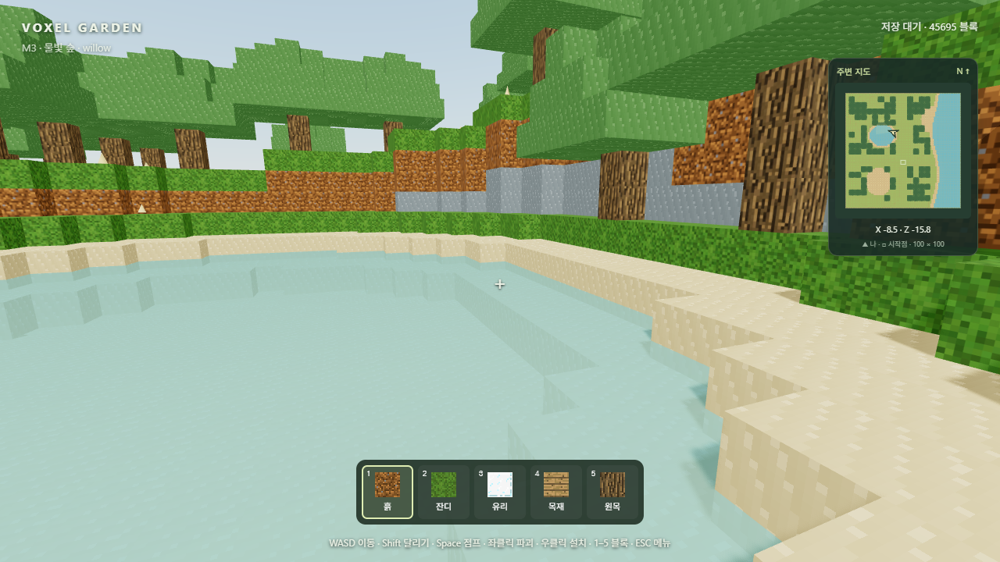

# M3 풍경 및 경고 검토

검증일: 2026-11-14. 기존 M1/M2 개인 저장과 별도 테스트 브라우저 컨텍스트에서 검증했다.

## 내부 경고 검토 결과

- R3F의 공식 npm `latest`는 9.8.2, 10은 alpha/canary였다. 설치된 R3F는 store 생성 시 `new THREE.Clock()`을 호출한다. 앱에서 useFrame의 delta를 사용하는 것과 별개로 발생하는 upstream 경고다.
- [공식 이슈 #3741](https://github.com/pmndrs/react-three-fiber/issues/3741)와 [v10 마이그레이션](https://r3f.docs.pmnd.rs/next/migration/v10)에서 Clock 제거 방향을 확인했다.
- 해결을 위해 사전 공개 R3F 10으로 바꾸거나 내부 패치를 유지해야 하므로, 현재 안정판을 유지했다. 경고를 필터링하거나 node_modules를 수정하지 않았다. 최신 안정판에서 해결되는지 후속 확인 대상이다.
- 번들 경고는 해결했다. Rolldown의 codeSplitting으로 Three core / renderer / React vendor를 분리했다. 최종 JS 파일 크기는 383.48 / 367.36 / 218.80 / 앱 210.22 kB, 런타임 0.72 kB. 500 kB 초과 경고 없이 빌드된다.
- 이 분리는 캐시 재사용 단위를 바꾼다. 전체 초기 다운로드 용량 감소나 지연 로딩을 의미하지 않는다.

## 구현

- `?world=willow`: 99×99셀의 시드 기반 언덕·숲·얕은 호수·동쪽 해변. 기본 시드는 45,695블록 / 65청크다.
- 같은 시드와 생성기 버전은 같은 지형·나무·장식물을 만든다. `?world=cedar` 등으로 다른 풍경을 열 수 있다. 시드는 최대 64문자다.
- 기존 주소의 월드·M2 데모는 유지하고 메뉴에 탐험 링크를 추가했다. 두 모드의 URL 매개변수가 함께 있으면 기존 demo 모드를 우선한다.
- 시작점 (0,10)은 높이 5의 빈 공터다. 남북·동서 산책로가 연결되고 한 칸 단차는 기존 점프로 넘는다.
- 나무 줄기·잎도 편집 가능한 블록이다. 모래·돌·잎은 결정적인 픽셀 텍스처를 사용한다. 설치 핫바는 기존 5종이며, 건축 재료 확장은 M4에서 다룬다.
- 수면은 원래 수역에만 표시하는 반투명 메시다. 수면 높이에 블록을 설치하면 해당 셀의 물 표시를 숨긴다. 장식물은 인스턴싱하며 지지 블록이 없어지면 숨긴다.
- 하늘·안개와 수면, 미니맵의 모래·숲·물 색을 추가했다.
- 새 월드는 `voxel-garden.terrain.v1.<인코딩된 시드>`에 생성기 버전·시드·변경 블록만 저장한다. v2 편집 기록을 생성 지형에 적용하며 기존 개인 v1 저장은 건드리지 않는다.
- 손상·불일치 저장은 원문을 `.backup`에 보존한 후 시드 지형을 복원한다. 저장소 접근/백업 실패 시 저장을 비활성화한다.

## 검증

- `npm run test:ci`: 6개 파일, 49개 테스트 통과.
- 새 검증: 같은 시드 재현/다른 시드 차이, 중복·범위 검사, 네 시드의 스폰과 주요 풍경 도달 경로, 편집 저장 왕복, 손상/잘못된 편집 거부, 개인/시드 저장 격리, 정상 저장에 불필요한 백업 없음, 저장소 실패 시 지형 표시.
- `npm run build`: 성공, 번들 크기 경고 없음. `git diff --check`: 통과.
- 배포 빌드에서 청크 분리 후 자산 로딩 실패·런타임 오류 0건. Clock 경고 1건은 위 사유로 유지.
- 시작점 발 높이 5.5, 접지 true. 실제 키보드 이동·점프로 호수 (-18.440, 1.5, -13.225), 동쪽 수역 (38.513, 1.5, 10), 북서 언덕 (-19.397, 7.5, -46.721)에 도달했다. 좌표는 X/발 높이/Z다.
- 설치 (0,6,8) → 자동 저장 → 새로고침 → 동일 대상 복원 → 파괴 후 빈 edits로 복귀. 전체 지형을 저장하지 않고 한 편집만 기록되는 것을 확인했다.
- 다른 시드 cedar의 개발 StrictMode에서 설치·파괴·저장 정상, 런타임 오류 없음. GPU 지오메트리는 152 → 153 → 152로 복귀했다.
- 기존 M2 benchmark에서도 이동·점프·착지 정상, 발 높이 4.5 → 5.487 → 4.5 확인.
- GTX 1060 6GB / Chromium / 1280×720 / DPR 1: 기본 숲길 약 3.3초 전진, 198프레임, 중앙 16.7ms, p95 16.8ms. 해당 구간 최대 199드로콜. 언덕에서 숲 전체를 바라볼 때는 274드로콜을 관측했다. M2의 100드로콜 목표는 16,384블록 기준 월드에 대한 목표이며 M3 전체 풍경에 그대로 적용한 결과가 아니다.

## 범위와 제한

- 수영·유체 시뮬레이션·파도·수역 확산은 없다. 물은 걸어서 건너는 얕은 수면이다.
- 유한 지형이며 시드에 따라 지형 높이·나무 분포가 달라지지만 호수·해변의 대략적 위치는 탐험 안내를 위해 고정했다.
- 생성기 버전 1은 저장 재현 기준이므로 이후 지형 알고리즘 변경 시 버전/이전 정책을 함께 바꿔야 한다.
- 기존 합의대로 시점 변경과 설치 미리보기 논의는 M4 이후다. 실제 GitHub Pages 배포는 하지 않았다.

## 데모

`npm run preview` → http://127.0.0.1:4173/react-three/?world=willow

추가 화면: [숲길](m3-initial.png), [얕은 호수](m3-lake.png), [동쪽 수역](m3-coast.png), [북서 언덕](m3-hills.png).
