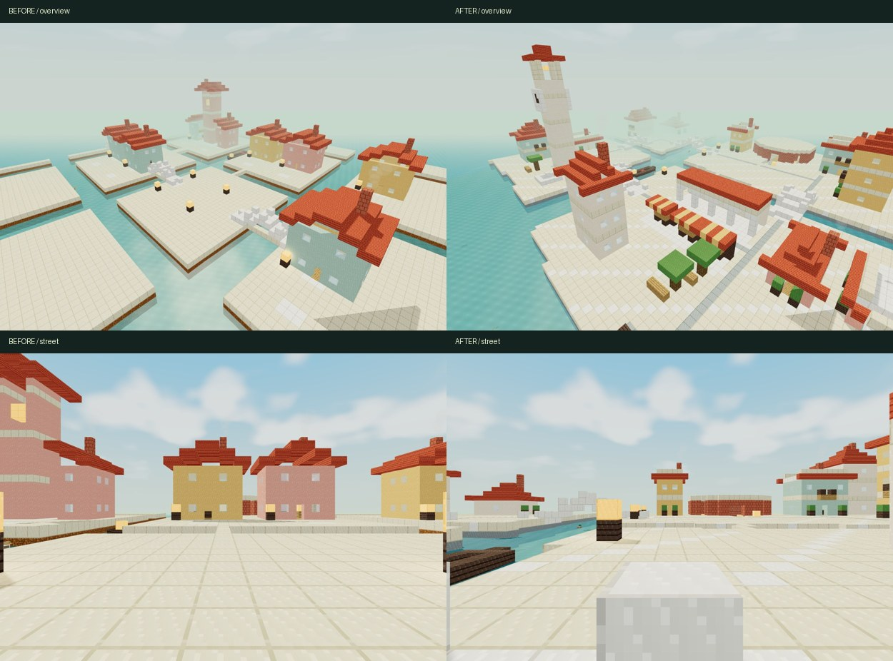
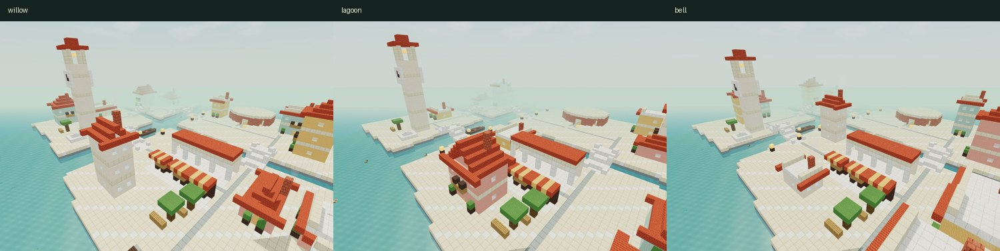

# M32 수상 도시 — 첫 개선안

2026-11-15. 로컬 구현 중이며 커밋·공개 배포 전이다. 전체 13종은 기준 화면과 생성 코드를 점검했고, 실제 개선 구현은 수상 도시부터 진행했다. 다른 12종의 개선은 후속 작업이다.

## 구현

- 굽은 운하를 중심으로 시장, 종탑 광장, 주택 골목, 항구를 배치하고 다리로 순환 산책길을 연결했다.
- 시드에 따라 운하와 건물 배치, 층수, 지붕, 외벽이 달라진다. 시장 차양, 발코니, 옥상 화분과 조명을 추가했다.
- 지하 수로 입구를 별도 구역으로 옮기고 입구 장식을 보강했다.
- 새 수상 도시는 생성기 4와 별도 저장 키를 사용한다. 기존 생성기 3 월드는 보존한다.
- **곤돌라는 정박된 블록 장식이다. 자동 이동, 항로, 탑승은 구현하지 않았다.**

## 비교 자료

크기 100, 맑음, 14시. 전후 비교는 같은 카메라 위치와 방향이다. 실제 새 시작 방향은 시장 쪽이다.

| 구도 | 기존 | 개선 |
| --- | --- | --- |
| 전경 | [기존](M32-willow-3-overview.jpg) | [개선](M32-willow-4-overview.jpg) |
| 거리 | [기존](M32-willow-3-street.jpg) | [개선](M32-willow-4-street.jpg) |

시드 비교: [willow](M32-willow-4-overview.jpg), [lagoon](M32-lagoon-4-overview.jpg), [bell](M32-bell-4-overview.jpg). 주택 수는 각각 12, 11, 12채다.

## 검증과 남은 항목

- 최종 전체 테스트 198개(38개 파일) 및 빌드 통과. 수상 도시 테스트는 큰 맵 경계/확장을 포함해 10개다.
- 5개 시드에서 실제 플레이어 물리 함수를 이용해 순환 산책길과 항구 왕복을 검증했다.
- 동일 시드 재현성, 생성기 3 결과 해시 보존, 생성기 4 저장/파일 왕복을 확인했다.
- 생성 시간 참고: 크기 150은 85,480블록/42채/약 83ms, 크기 400은 638,677블록/379채/약 914ms. 로컬 CPU 생성 측정이며 렌더링 FPS 검증은 아니다.
- 브라우저 고정 시점 비교 완료. 이후 별도 검증 탭에서 터치 이동 축과 카메라 방향을 입력해 실제 프레임/플레이어 물리로 항구 포함 순환 동선을 3회 통과했다. 21개 경유점, 전체 경과 173.7초(첫 바퀴 뒤 약 15초 중간 정지 포함), 순수 이동 약 158초. 위치 강제 이동·비행·점프 없이 복귀했으며 페이지 오류는 0이었다. [항구 보행 화면](M32-walk-harbour.jpg).
- 크기 400 브라우저 로딩 확인: 생성 약 685ms. 로딩 직후의 프레임 지연을 제외한 시작점 5초 측정에서 프레임 간격 중앙값 16.7ms / p95 16.8ms, draw call 1,149회, 325,128삼각형이었다. 이 PC의 고정 시점 표본이며 큰 맵 전체 보행·저사양 성능을 보장하지 않는다. 첫 개선안의 시각적 검토와 후속 12종 개선은 남아 있다.

로컬 데모: http://127.0.0.1:4173/react-three/?world=willow&map=canal&gen=4

## 발판 오르기 시점 보정

사용자 피드백으로 자동 발판 오르기의 즉시 높이 변경이 카메라에 그대로 전달되는 현상을 수정했다. 충돌 좌표는 즉시 안전한 발판 위로 이동하고, 시점만 지수 감쇠로 따라간다. 일반 점프와 비행은 보정하지 않는다. 반복 계단의 보정량은 1블록 이내로 제한한다.

실제 브라우저 다리 통과에서 세 번의 1블록 상승을 측정했다. 해당 프레임의 카메라 상승은 각각 0.1694 / 0.1751 / 0.1765블록(약 16.7ms 프레임)이었다. 자동 테스트는 충돌 좌표 유지, 프레임 속도별 수렴, 점프/비행 초기화 및 연속 계단의 보정 한계를 확인한다.

[전체 맵 개선 우선순위](MAP-QUALITY-AUDIT.md)
