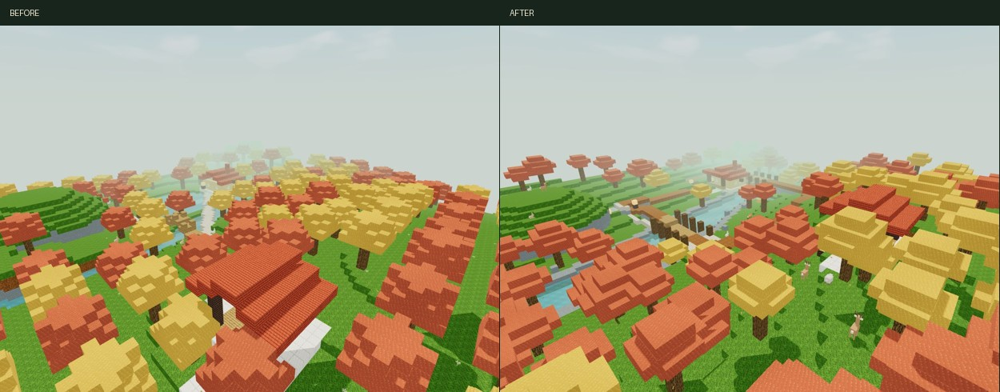
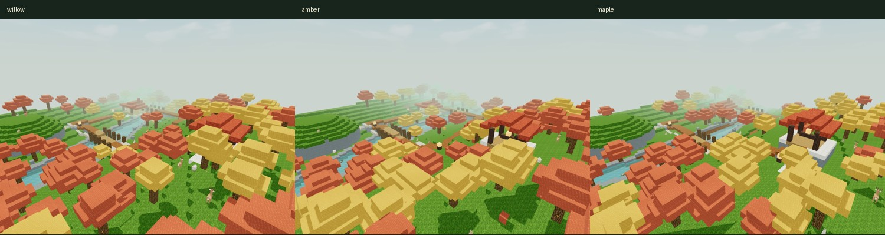
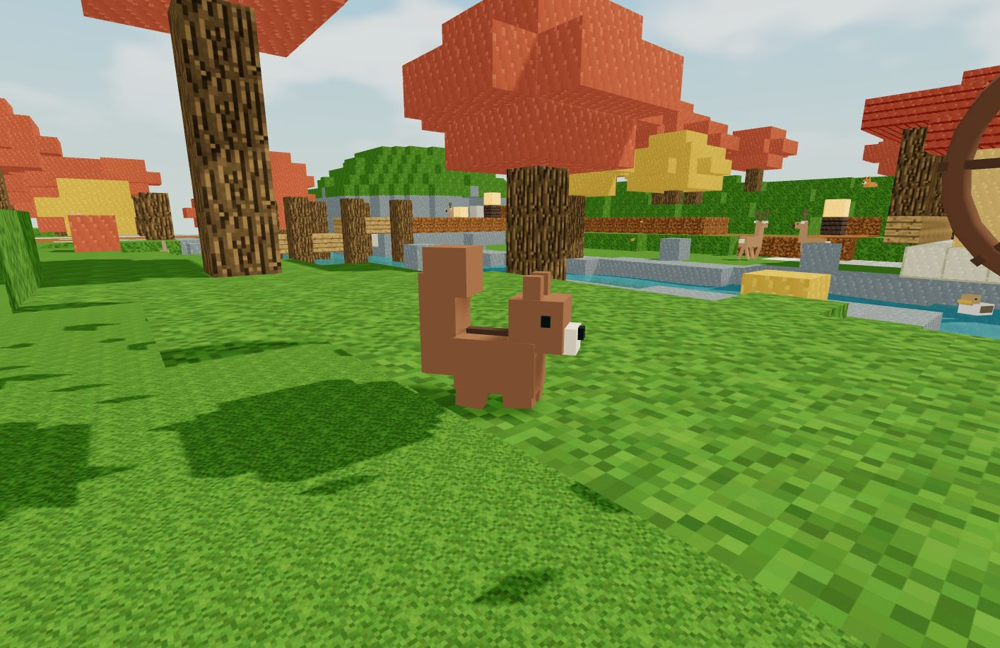

# M33 가을 계곡 — 지형, 산책길, 동물

2026-11-15. 로컬 구현. 공개 배포 전이다.

## 달라진 풍경

- 시드에 따라 굽이치는 강과 좁은 상류, 넓은 여울, 양쪽 능선을 구성했다.
- 시작점에서 전망대로 올라갔다가 숲길·상류 다리·물레방앗간·수정 동굴 입구를 거쳐 돌아오는 길을 연결했다. 방앗간에는 물레방아 아래 수로와 처마가 있는 작업 공간을 두었다.
- 나무의 격자 배치를 군락과 빈터로 바꾸고, 위치·높이·수관 크기·군락별 잎 색을 다르게 했다. 강변에는 바위와 작은 관목을 배치했다.
- 150/400 맵은 강변 숲길을 상류로 확장한다.
- 새 가을 계곡은 생성기 4를 사용한다. 이전 생성기 3의 블록 결과 해시와 저장 키는 유지한다.

## 가을 계곡의 동물

다람쥐 5마리를 추가했다. 총 구성은 토끼 5, 오리 4, 여우 2, 사슴 5, 물고기 6, 다람쥐 5로 27마리이며 기존 32마리 상한을 유지한다. 양은 이 맵에서 제외했다.

개선판에서 다람쥐·여우는 나무 5블록 이내의 숲 가장자리, 사슴은 나무에서 떨어진 빈터를 초기 서식 후보로 사용한다. 이후에는 기존 충돌/회피 규칙으로 움직인다. 다람쥐는 지상에서 이동하고 쉬며, 나무를 오르는 동작은 구현하지 않았다. 브라우저에서 5마리의 활성 상태와 휴식/이동을 확인했다.

다른 맵의 새로운 동물은 아직 추가하지 않았다. 해당 맵의 완성도 개선 단계에서 서식 구역과 종 구성을 함께 다룬다.

## 비교

시드 willow, 크기 100, 맑음 14시, 카메라 위치 (36,30,36), 바라보는 위치 (-6,5,-8).

| 시드 | 블록 수 | 나무 수 | 전망대 바닥 높이 |
| --- | ---: | ---: | ---: |
| willow | 76,022 | 117 | 11 |
| amber | 75,076 | 115 | 11 |
| maple | 74,659 | 108 | 12 |

## 검증

- 5개 시드에서 플레이어 물리 함수로 전망대·방앗간·수정 동굴 내부 왕복·순환 동선을 검증했다. 비행이나 점프를 쓰지 않았다.
- 저장 편집 왕복, 기존 생성기 결과 보존, 150/400 경계와 상류 동선 확장을 테스트했다.
- 3개 시드에서 다람쥐의 안전한 서식, 나무 주변 배치, 사슴의 빈터 배치와 이동 후 지면 유효성을 확인했다.
- 초기 터치 입력 자동 보행은 PC 입력 검증과 별개다. 동물 코드 개발 중 HMR의 모델/개체 목록 갱신 시차로 일시적인 렌더 오류가 발생했다. 새로 로딩한 최종 코드에서 재검증했으며 해당 오류는 재발하지 않았다.
- PC 입력 검증에서는 터치 모드 false, 실제 시작 버튼의 마우스 잠금, 마우스 이동에 따른 heading 변화(-0.87→-0.736), W 키 전진, Esc 메뉴 복귀와 계속하기를 확인했다. 최초 잠금 과정에서 Pointer Lock API 오류 로그가 1회 있었고, 재개 후 잠금은 정상 작동했다.
- PC 반복 보행은 실제 W 키를 누른 상태에서 경유점 방향만 자동으로 조정했다. 132.127초에 3바퀴, 39개 경유점을 통과하고 시작점에 복귀했다. 위치 강제 이동·비행·점프를 사용하지 않았다. 종료 후 키를 놓고 Esc로 메뉴에 복귀했다. [PC 보행 화면](M33-desktop-walk.jpg).
- 최종 전체 테스트 210개(39개 파일)와 빌드 통과. 400 생성 경계 테스트는 전체 병렬 실행 시 5초 기본 제한을 한 번 초과하여 해당 큰 맵 테스트만 15초 제한을 적용했다. 이는 성능 합격 판정이 아닌 경계 검증용 시간 제한이다.
- 배포용 빌드의 크기 400을 실제 브라우저에서 로딩했다. 지형 생성 약 1,534ms, 시작점 draw call 849회, 298,468삼각형, 다람쥐 5마리 활성. 페이지 오류 0, 기존 Three.Clock 경고 1. 로딩 안정화 후 시작점의 5초 프레임 간격은 중앙값 16.7ms / p95 16.8ms였다. 큰 맵 전체 보행과 저사양 기기는 검증하지 않았다.

로컬 데모: http://127.0.0.1:4173/react-three/?world=willow&map=autumn&gen=4
