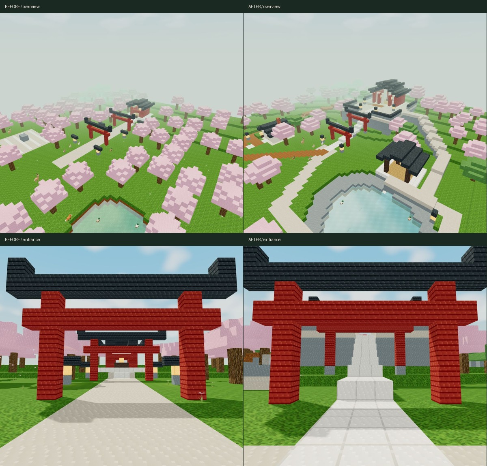
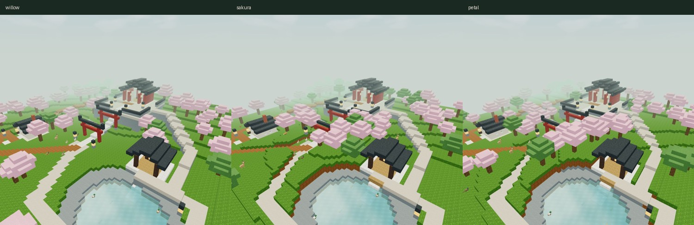
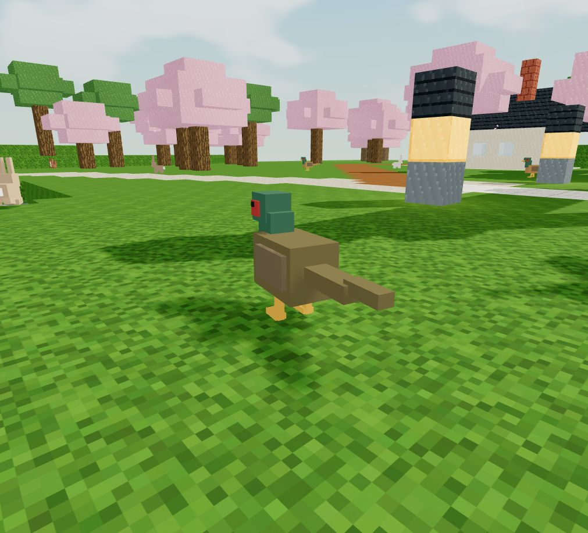

# M34 벚꽃 신사 — 돌계단과 두 갈래 산책길

2026-11-15. 로컬 구현이며 커밋·공개 배포 전이다.

## 구현

- 두 개의 붉은 문을 통과해 돌계단을 오르고 높은 안뜰과 본당에 도착한다. 본당은 깊은 처마, 두 겹 기와지붕, 회벽·주홍 기둥과 조명을 갖춘 편집 가능한 블록 건물이다.
- 동쪽은 연못과 정자, 서쪽은 숲길과 찻집으로 돌아온다. 돌 수반, 낮은 담장과 석등을 접근로 옆에 두었다.
- 벚나무와 녹색 나무의 군락을 섞고, 나무 높이와 수관 크기를 달리했다. 시드에 따라 지형, 연못 가장자리, 나무 배치와 안뜰 위치·높이가 달라진다. 핵심 참배 동선은 유지한다.
- 150/400 크기에서는 북쪽 산길과 숲이 확장된다.
- 새 벚꽃 신사는 생성기 4를 사용한다. 이전 생성기 3의 결과 해시와 기존 저장은 유지한다.

## 동물

긴 꼬리, 녹색 머리와 붉은 얼굴 무늬를 가진 꿩을 추가했다. 꿩은 빈터에서 걷고, 쉬는 동안 고개를 움직인다. 비행 동작은 없다.

벚꽃 신사는 꿩 4, 다람쥐 3, 사슴 3, 여우 2, 토끼 4, 오리 3, 물고기 5의 총 24마리 구성을 사용한다. 기존 최대 32마리 제한과 인스턴스 렌더링을 유지한다. 초기 배치는 꿩·사슴은 빈터, 다람쥐·여우는 나무 주변, 오리·물고기는 유효한 물 영역을 사용한다. 이동 시 지형·블록 충돌, 플레이어 회피, 일시정지와 야간/악천후 휴식 규칙을 따른다.

## 비교 자료

동일 시드 willow, 크기 100, 맑음 14시. 전경은 카메라 (38,35,36)→(0,7,-13), 입구는 (0,6.12,10)→(0,9,-24)로 고정했다.

| 시드 | 블록 수 | 나무 수 | 안뜰 바닥 높이 |
| --- | ---: | ---: | ---: |
| willow | 65,921 | 86 | 11 |
| sakura | 65,589 | 82 | 11 |
| petal | 65,866 | 85 | 11 |

## 검증

- 5개 시드에서 플레이어 물리 함수로 동쪽 순환길과 서쪽 찻집 곁길을 왕복했다. 점프·비행 없이 자동 발판 오르기를 사용한다.
- 각 시드의 꿩 4마리 활성과 모든 활성 동물의 유효한 지면/수면 배치를 검증했다.
- 편집 저장 왕복, 동일 시드 재현, 이전 생성기 해시, 150/400 경계와 북쪽 동선 확장을 검증했다.
- 전체 테스트 219개(40개 파일)와 빌드 통과.
- PC 모드에서 시작 버튼으로 마우스 잠금, 실제 마우스 이동(heading 0→-0.19), W 키 이동, Esc 메뉴 복귀와 계속하기를 확인했다. 터치 모드는 false다.
- 실제 W 키를 누른 상태에서 경유점 방향만 자동 조정하여 동쪽 순환과 서쪽 곁길을 두 차례 돌았다. 158.553초, 52개 경유점 통과 후 시작점에 복귀했다. 위치 강제 이동·비행·점프는 사용하지 않았다. 종료 시 키 해제와 Esc 메뉴 복귀를 확인했다. [PC 보행 화면](M34-desktop-walk.jpg).
- 배포용 빌드의 400 크기 로딩: 지형 생성 약 1,314ms, 시작점 draw call 728회, 226,246삼각형, 꿩 4마리 활성. 로딩 안정화 후 5초 프레임 간격은 중앙값 16.7ms / p95 16.8ms였다. 이 PC의 고정 시점 표본이며 큰 맵 전체 보행이나 저사양 성능 보장은 아니다.
- 최종 브라우저 페이지 오류 0, 기존 Three.Clock 경고 1.

로컬 데모: http://127.0.0.1:4173/react-three/?world=willow&map=shrine&gen=4
