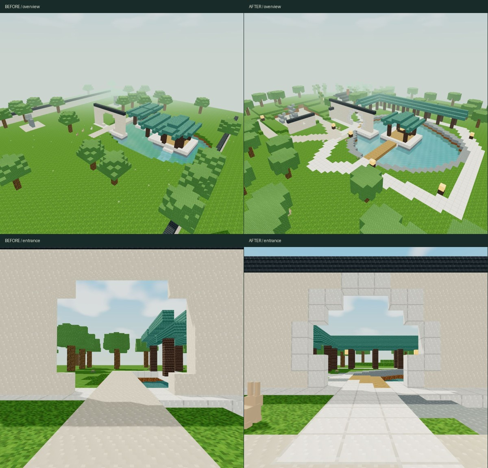
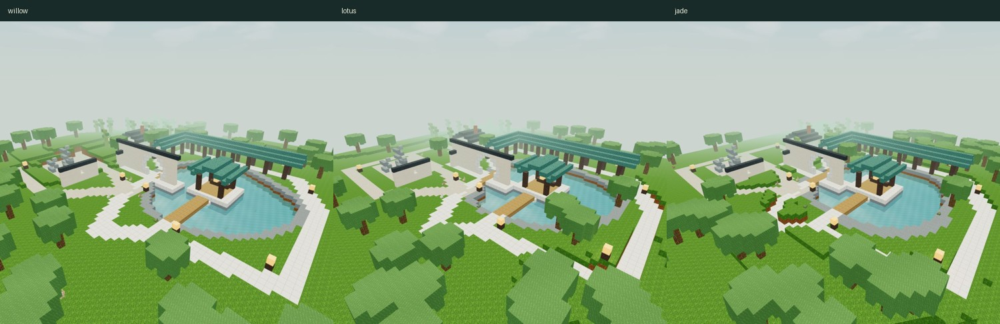
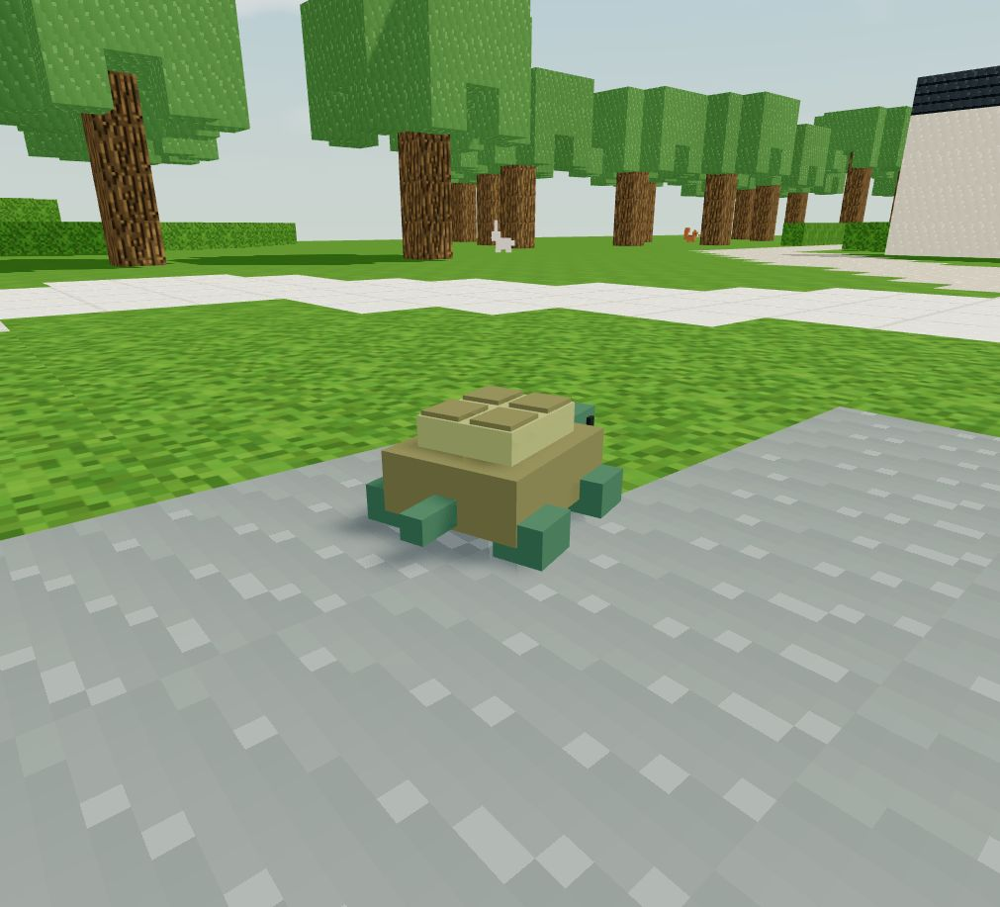

# M35 월영 원림 — 연못과 회랑을 도는 정원

2026-11-15. 로컬 구현이며 커밋·공개 배포 전이다.

## 구현

- 둥근 문 너머로 연못과 회랑을 바라보는 입구를 만들었다. 벽은 백색 회벽과 석재 문틀, 검은 기와로 구성한다.
- 연못의 작은 섬에 월영정을 두고 나무다리로 연결했다. 북쪽 회랑은 지붕 아래를 실제로 걸어갈 수 있고, 꺾이는 모서리도 막힘 없이 통과한다.
- 서쪽은 구멍과 높이가 다른 수석, 찻집, 대숲을 잇는 곁길로 구성했다. 담장의 열린 부분과 낮은 나무 군락으로 장면을 구분한다.
- 시드에 따라 연못 가장자리와 위치, 나무·대나무 군락, 주변 지형이 달라진다. 150/400 크기는 대숲 뒤 산책길과 숲으로 확장한다.
- 새 월영 원림은 생성기 4를 사용한다. 기존 생성기 3의 블록 결과와 저장은 유지한다.

## 동물

거북을 새로 추가했다. 물가 4블록 이내의 유효한 풀밭·바위에서 느리게 걷고 쉬며, 물속으로 내려가거나 수영하는 동작은 없다. 이동 중에도 수변 범위를 확인한다. 블록이 변경되면 기존 동물과 동일하게 안전한 위치를 다시 찾는다.

월영 원림은 거북 4, 토끼 4, 오리 4, 물고기 8, 다람쥐 2의 총 22마리 구성이다. 기존 32마리 상한과 인스턴스 렌더링을 유지한다. 다람쥐는 나무 주변, 오리·물고기는 유효한 수면·수중에 배치한다.

## 비교

시드 willow, 크기 100, 맑음 14시. 전경 카메라 (38,30,38)→(0,4,-5), 입구 (0,6.12,10)→(0,6.5,-8).

| 시드 | 블록 수 | 나무/대나무 수 | 물 영역 셀 수 |
| --- | ---: | ---: | ---: |
| willow | 45,056 | 78 | 810 |
| lotus | 44,145 | 59 | 739 |
| jade | 42,952 | 65 | 722 |

## 검증

- 5개 시드에서 플레이어 물리 함수로 월문·회랑·섬 정자와 찻집 곁길을 왕복했다. 회랑 모서리를 막던 기둥을 수정했다.
- 각 시드에서 거북 4마리 활성 및 동물의 이동 후 유효한 지면/수면을 확인했다.
- 저장 편집 왕복, 동일 시드 재현, 이전 생성기 해시, 150/400 경계와 산책길 확장을 확인했다.
- 전체 테스트 228개(41개 파일)와 빌드 통과.
- PC 모드에서 시작 버튼의 마우스 잠금, 실제 마우스 입력으로 heading 0→-0.29 변화, W 키 이동, Esc 메뉴 복귀 및 계속하기를 확인했다. 터치 모드는 false다.
- 실제 W 키를 누른 상태에서 경유점 방향만 자동 조정하여 연못·회랑·정자와 찻집 곁길을 두 차례 순환했다. 148.529초, 42개 경유점 통과 후 시작점에 복귀했다. 위치 강제 이동·비행·점프 없이 진행했고, 종료 후 키 해제와 Esc 복귀를 확인했다. [PC 보행 화면](M35-desktop-walk.jpg).
- 21시의 조명과 수변 시인성을 확인했다. [야간 화면](M35-night.jpg).
- 배포용 빌드 크기 400 로딩: 지형 생성 약 753ms, 시작점 draw call 557회, 197,506삼각형, 거북 4마리 활성. 안정화 후 시작점 5초 프레임 간격 중앙값 16.7ms / p95 16.8ms. 이 PC의 고정 시점 표본이며 큰 맵 전체 보행이나 저사양 성능 보장은 아니다.
- 최종 브라우저 페이지 오류 0, 기존 Three.Clock 경고 1.

로컬 데모: http://127.0.0.1:4173/react-three/?world=willow&map=moon&gen=4
