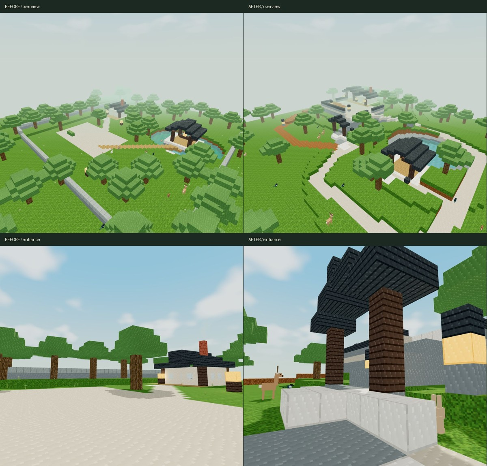
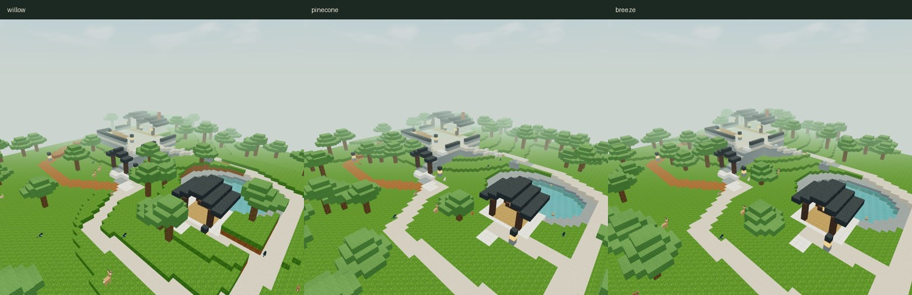
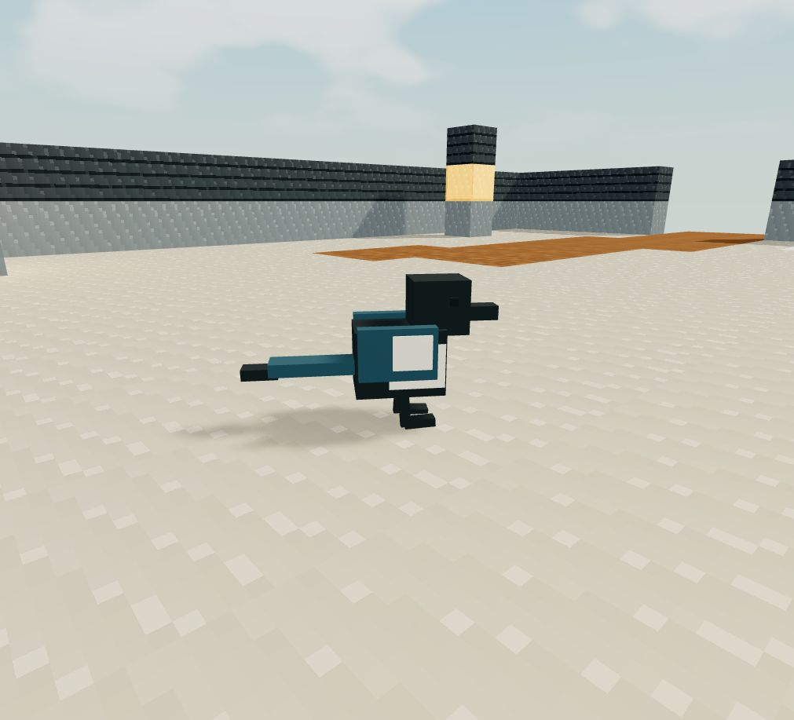

# M36 솔바람 별서 — 언덕의 마당과 솔숲길

2026-11-15. 로컬 구현이며 커밋·공개 배포 전이다.

## 구현

- 소나무 언덕에 안채와 열린 사랑채를 두고 나무 툇마루로 연결했다. 앞마당은 장식을 채우기보다 비워 두고 낮은 돌담·기와·석등으로 경계를 만든다.
- 작은 대문과 돌계단을 지나 마당으로 오르는 길, 연못 정자로 내려오는 길, 서쪽 솔숲 곁길을 연결했다.
- 시드에 따라 마당 높이, 연못 위치·가장자리, 소나무 군락과 주변 지형이 달라진다. 소나무 줄기 높이와 수관의 치우침을 다르게 했다.
- 숲길이 과도하게 솟던 구간을 낮추고, 겹치는 길이 기존 돌계단과 나무 툇마루의 재료를 덮지 않게 했다.
- 150/400 크기는 능선 산책길과 숲이 확장된다. 새 별서는 생성기 4를 사용하며 이전 생성기 3의 결과와 저장은 유지한다.

## 동물

검고 흰 몸통, 푸른빛 날개와 긴 꼬리의 까치를 추가했다. 풀밭과 자갈 마당에서 걷고 쉬며 고개를 움직인다. 비행이나 나뭇가지에 앉는 동작은 구현하지 않았다.

솔바람 별서는 까치 4, 다람쥐 3, 사슴 3, 토끼 4, 오리 3, 물고기 5의 총 22마리 구성이다. 기존 최대 32마리와 인스턴스 렌더링을 유지한다. 까치·사슴은 빈터, 다람쥐는 소나무 주변, 오리·물고기는 유효한 물 영역에 초기 배치한다.

## 비교

시드 willow, 크기 100, 맑음 14시. 전경 카메라 (36,32,38)→(-7,6,-7), 입구 (0,6.12,10)→(-20,9,-2)로 전후를 고정했다.

| 시드 | 블록 수 | 소나무 수 | 마당 바닥 높이 |
| --- | ---: | ---: | ---: |
| willow | 52,767 | 52 | 9 |
| pinecone | 52,001 | 54 | 9 |
| breeze | 53,006 | 49 | 10 |

## 검증

- 5개 시드에서 플레이어 물리 함수로 안채·사랑채 앞, 연못 정자, 솔숲 순환 동선을 검증했다. 점프·비행은 사용하지 않았다.
- 각 시드에서 까치 4마리 활성과 모든 활성 동물의 안전한 지면/수면을 확인했다.
- 편집 저장 왕복, 동일 시드 재현, 이전 생성기 결과 해시, 150/400 경계와 능선 동선 확장을 검증했다.
- 전체 테스트 237개(42개 파일) 및 빌드 통과.
- PC 시작 버튼의 마우스 잠금, 실제 마우스 이동(heading 1.212→0.982), W 키 이동, Esc 메뉴 복귀 및 계속하기 확인. 터치 모드는 false다.
- 실제 W 키를 누르고 경유점 방향만 자동 조정하여 별채·연못·솔숲 동선을 두 차례 순환했다. 157.627초, 52개 경유점 통과 후 시작점에 복귀했다. 위치 강제 이동·비행·점프 없이 진행했고, 종료 후 키 해제와 Esc 메뉴 복귀를 확인했다. [PC 보행 화면](M36-desktop-walk.jpg).
- 배포용 빌드의 400 크기 로딩: 지형 생성 약 764ms, 시작점 draw call 470회, 185,014삼각형, 까치 4마리 활성. 안정화 후 시작점 5초 프레임 간격 중앙값 16.7ms / p95 16.8ms. 이 PC의 고정 시점 표본이며 큰 맵 전체 보행이나 저사양 성능 보장은 아니다.
- 최종 브라우저 페이지 오류 0, 기존 Three.Clock 경고 1.

로컬 데모: http://127.0.0.1:4173/react-three/?world=willow&map=pine&gen=4
