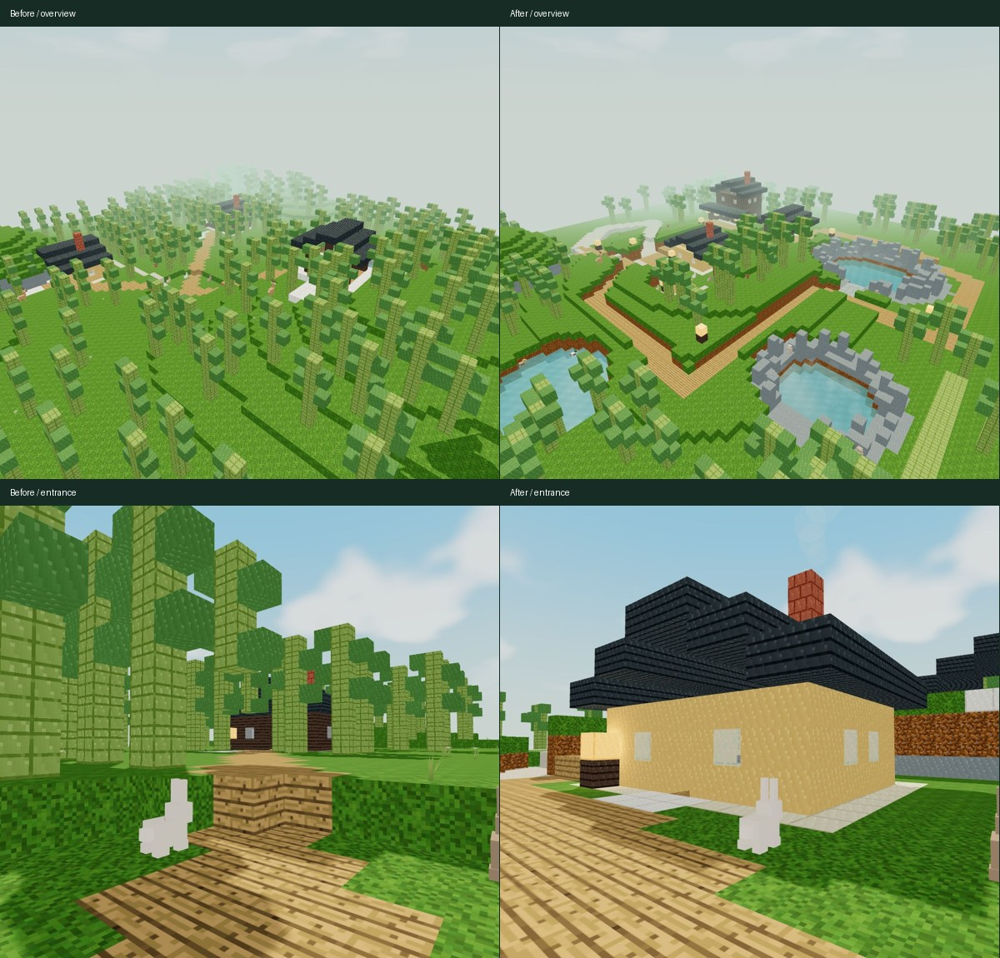
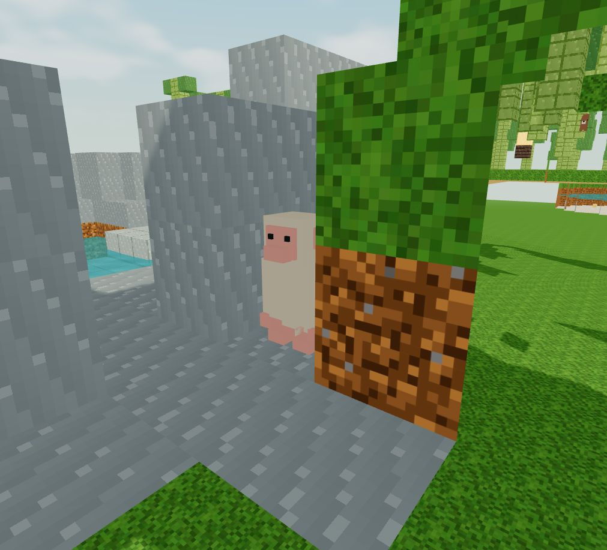

# M37 대나무 온천 마을

대숲 사이에 흩어진 시설을 여관 골목, 찻집 앞마당, 크기가 다른 두 노천탕, 계곡 연못과 지하 온천을 잇는 산책 동선으로 재구성했다. 여관에는 넓은 처마·툇마루·등불을 배치하고, 탕에는 바위와 대나무 가림막, 수증기를 더했다. 입구에서 찻집이 흙 언덕에 가리지 않도록 앞마당을 낮췄다.

대나무는 규칙적인 격자 대신 시드별 군락과 빈터, 높이 차이를 갖는다. 150/400 크기는 북쪽으로 대숲 산책길이 이어진다. 새 온천은 생성기 4를 사용하며 기존 생성기 3의 블록 결과는 보존한다.

## 동물

분홍 얼굴과 짧은 꼬리의 일본원숭이 4마리를 추가했다. 탕 주변 바위·풀밭에서 걷고 쉬며 고개를 조금 움직인다. 입욕·수영·나무 타기는 구현하지 않았다.

원숭이 4, 다람쥐 3, 사슴 2, 토끼 4, 오리 2, 물고기 4로 총 19마리다. 오리와 물고기는 뜨거운 탕과 지하 온천을 제외한 계곡 연못에 배치한다. 기존 32마리 상한과 인스턴스 렌더링을 유지한다.

## 비교

시드 willow, 크기 100, 14시 고정. 전경 카메라 (38,32,38)→(-2,5,-8), 입구 (0,6.12,10)→(-16,7,-10).

## 검증

- 5개 시드에서 실제 플레이어 물리 함수로 여관·노천탕 계단·대숲 순환 및 지하 온천 왕복 검증.
- 모든 활성 동물의 안전한 지면/수면, 원숭이 4마리 활성, 오리·물고기의 온천 제외 확인.
- 편집 저장 왕복, 동일 시드 재현, 이전 생성기 해시, 150/400 경계·확장 검증.

- 전체 246개 테스트(43개 파일), 빌드, git diff --check 통과.
- PC 터치 모드 false, 시작 버튼 마우스 잠금, 실제 마우스 이동(heading 1.212→0.942), W 이동, Esc 복귀 확인.
- 최종 지형에서 실제 W 키를 누르고 방향만 자동 조정하여 92.602초 동안 33개 경유점 통과. 노천탕 계단·지하 온천 왕복·대숲 곁길 포함. 위치 강제 이동·비행·점프 없이 시작점으로 복귀하고 키 해제 및 메뉴 복귀 확인. [보행 화면](M37-desktop-walk.jpg).
- 400 크기 배포 빌드: 생성 1,021ms, 시작점 draw call 519회, 227,112삼각형, 원숭이 4마리 활성. 안정화 후 5초 프레임 간격 중앙값 16.7ms / p95 16.8ms. 이 PC의 고정 시점 표본이며 큰 맵 전체 보행이나 저사양 성능을 보장하지 않는다.
- 브라우저 페이지 오류 0, 기존 Three.Clock 경고 1.
- willow/bamboo/steam 전경 확인: 블록 47,589/48,988/48,654개, 대나무 193/202/232그루.

로컬 데모: http://127.0.0.1:4173/react-three/?world=willow&map=onsen&gen=4

커밋·푸시·공개 배포 전.
