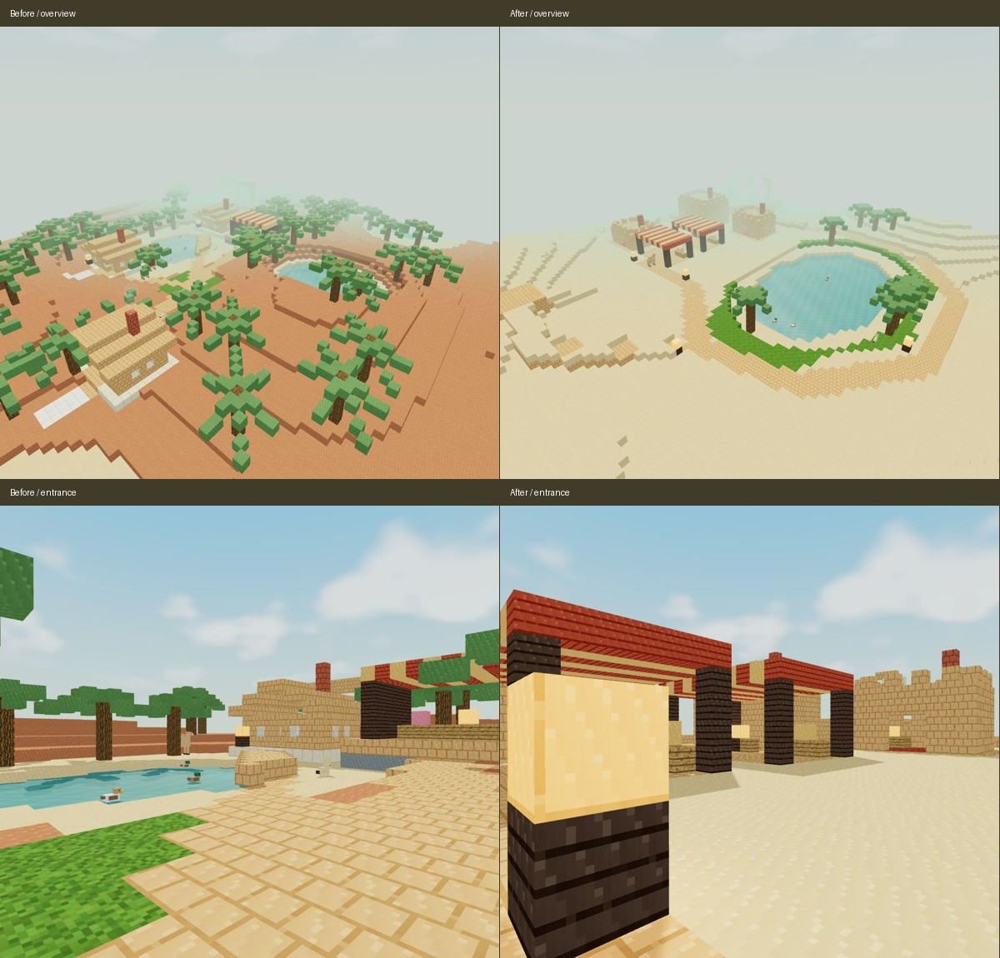
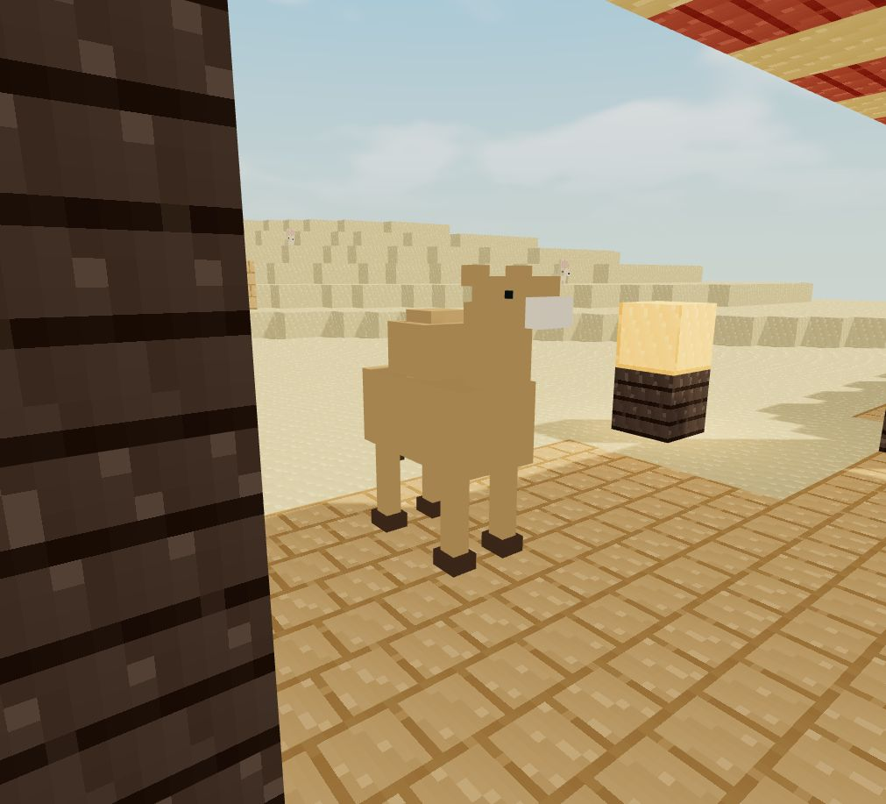
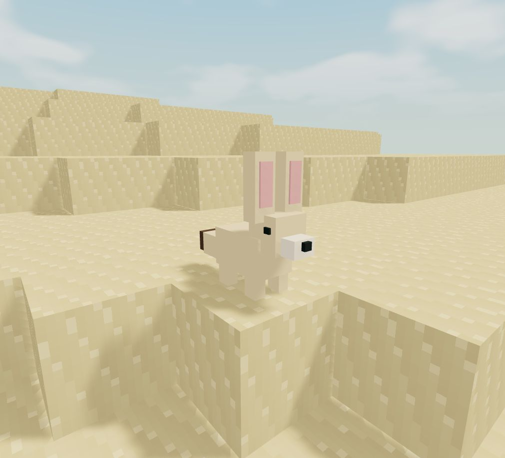

# M38 사막 오아시스

반복되는 집과 단순한 호수 주변을 평지붕 흙집, 천막 시장 골목, 야자 그늘의 호숫가, 무너진 옛 회랑과 사구 전망대로 재구성했다. 실내 탁자·등불과 시장 진열대를 배치했으며, 여관 뒤를 도는 계단길로 유적까지 걸어갈 수 있다.

호수의 폭과 가장자리, 야자 위치·높이, 모래 능선과 유적 단 높이는 시드에 따라 달라진다. 150/400 크기는 북쪽 사구로 대상길이 이어진다. 주요 건물과 동선의 큰 배치는 고정이다. 새 오아시스는 생성기 4를 사용하며 이전 생성기 3의 블록 결과는 보존한다.

## 동물

단봉낙타 3마리와 큰 귀의 사막여우 4마리를 추가했다. 모래·사암·풀밭에서 걷고 쉬며, 플레이어가 가까워지면 피한다. 낙타의 긴 다리·목·혹과 사막여우의 밝은 털·큰 귀를 별도 블록 모델로 구성했다. 타기·먹이주기는 구현하지 않았다.

오리 3, 물고기 6과 함께 총 16마리. 기존 32마리 상한과 인스턴스 렌더링을 유지한다. 낙타는 넓은 발판과 머리 위 3블록의 빈 공간을 확인한다.

## 비교

시드 willow, 크기 100, 14시 고정. 전경 카메라 (42,36,43)→(-2,4,-9), 입구 (0,6.12,10)→(-15,6,-5).

## 검증

- 5개 시드에서 실제 플레이어 물리 함수로 시장·유적·호숫가·사구 동선을 검증했다. 점프·비행 없이 순환한다.
- 낙타 3·사막여우 4 활성, 모든 활성 동물의 안전한 지면/수면, 10초 이동과 낙타의 머리 위 장애물 판정 확인.
- 편집 저장 왕복, 동일 시드 재현, 이전 생성기 해시, 150/400 경계·대상길 확장 검증.

- 전체 256개 테스트(44개 파일), 빌드, git diff --check 통과.
- PC 터치 모드 false, 시작 버튼 마우스 잠금, 실제 마우스 이동(heading 0.85→0.56), W 이동, Esc 메뉴 복귀 확인.
- 실제 W 입력과 자동 방향 조정으로 24개 경유점을 모두 통과하고 시작점에 복귀. 총 140.327초(중간 정지 포함). 사구 구간에서 입력이 끊겨 W를 해제·다시 누른 뒤 지형 수정 없이 나머지 동선을 통과했다. 입력 중단의 정확한 원인은 확인하지 못했다. 위치 강제 이동·비행·점프 없이 진행했다. [PC 보행 화면](M38-desktop-walk.jpg).
- 400 크기 배포 빌드: 생성 711ms, 시작점 draw call 284회, 130,254삼각형, 낙타 3·사막여우 4 활성. 안정화 후 5초 프레임 간격 중앙값 16.7ms / p95 16.8ms. 이 PC의 시작점 표본이며 큰 맵 전체 보행이나 저사양 성능 보장은 아니다.
- 최종 브라우저 페이지 오류 0, 기존 Three.Clock 경고 1.
- willow/dune/mirage 전경 확인: 블록 45,071/48,572/44,647개. 야자 수는 각 8그루이며 위치·높이는 시드별로 다르다.

로컬 데모: http://127.0.0.1:4173/react-three/?world=willow&map=oasis&gen=4

2026-11-15 공개 배포 완료. [배포 검증](M32-M44-DEPLOYMENT.md).
