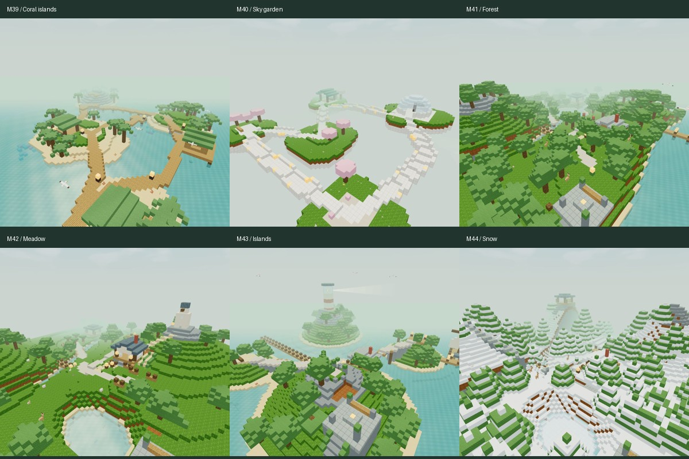

# M39~M44 개선 결과

13종 맵의 첫 개선안을 모두 마무리했다. 이번 연속 작업은 아래 6개 맵이다. 2026-11-15 공개 배포 완료. [배포 검증](M32-M44-DEPLOYMENT.md).

| 단계 | 맵 | 주요 변경 | 데모 / 기록 |
| --- | --- | --- | --- |
| M39 | 열대 산호섬 | 섬별 지형·수상 숙소·군락 산호·게·바다거북 | [데모](https://yooseongc.github.io/react-three/?world=willow&map=coral&gen=4) · [기록](M39-VALIDATION.md) |
| M40 | 구름 위 정원 | 높이별 공중섬·난간·관측소·꽃 뜰·나비 | [데모](https://yooseongc.github.io/react-three/?world=willow&map=sky&gen=4) · [기록](M40-VALIDATION.md) |
| M41 | 물빛 숲 | 버섯 빈터·벤치·작은 뜰·오솔길·다람쥐·나비 | [데모](https://yooseongc.github.io/react-three/?world=willow&map=forest&gen=4) · [기록](M41-VALIDATION.md) |
| M42 | 넓은 초원 | 과수원·소풍 자리·울타리 꽃밭·꿩·나비 | [데모](https://yooseongc.github.io/react-three/?world=willow&map=meadow&gen=4) · [기록](M42-VALIDATION.md) |
| M43 | 작은 군도 | 유목 해변·바다 마루·섬 연결길·게·바다거북 | [데모](https://yooseongc.github.io/react-three/?world=willow&map=islands&gen=4) · [기록](M43-VALIDATION.md) |
| M44 | 고요한 설원 | 눈길 쉼터·야영지·얼음 연못·북극여우·흰토끼 | [데모](https://yooseongc.github.io/react-three/?world=willow&map=snow&gen=4) · [기록](M44-VALIDATION.md) |

최종 전체 테스트 306개(47파일), 빌드, diff 검사 통과. 여섯 맵의 배포용 빌드 로딩·viewport 채움·동물 활성 확인, 페이지 오류 0. 사용자 요청으로 실제 보행 검증은 생략했다. 큰 맵은 생성·경계 검증이며 장시간 성능을 보장하지 않는다.
