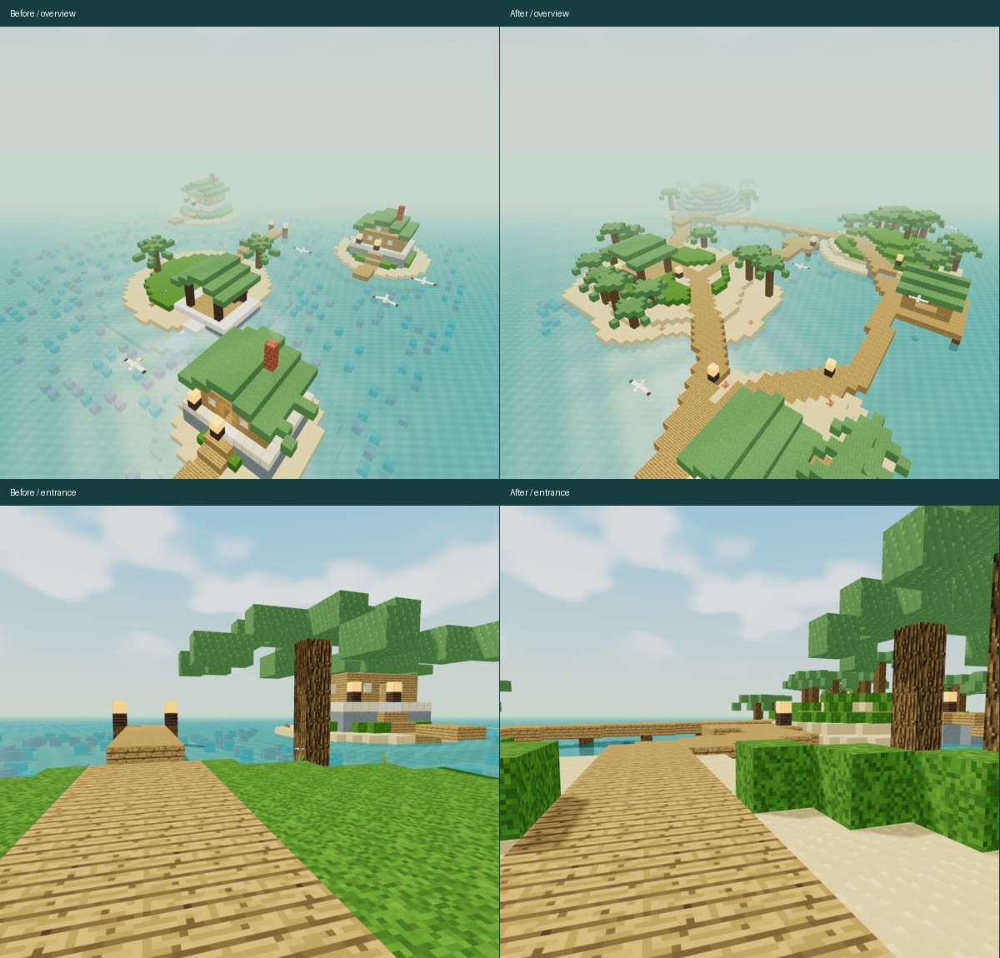
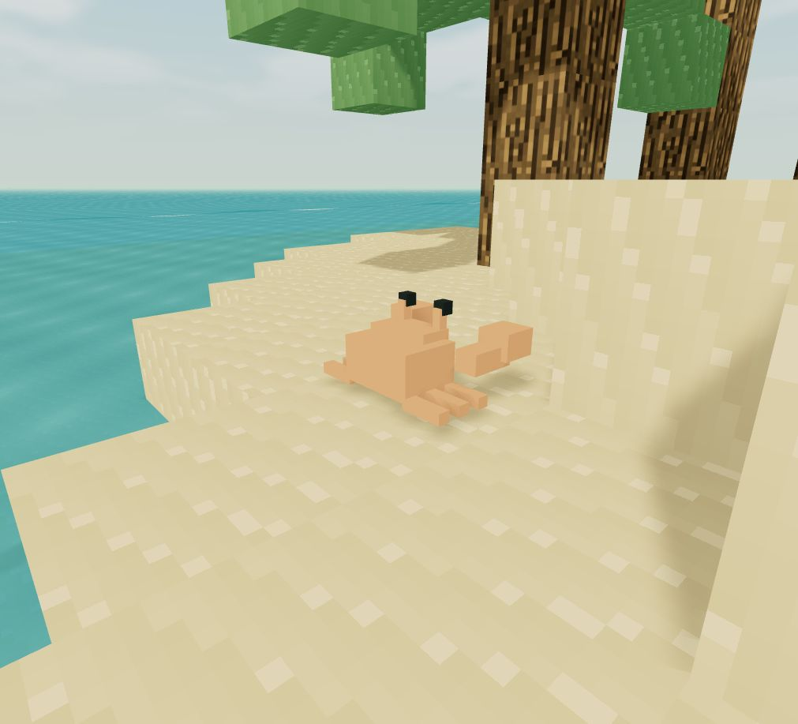
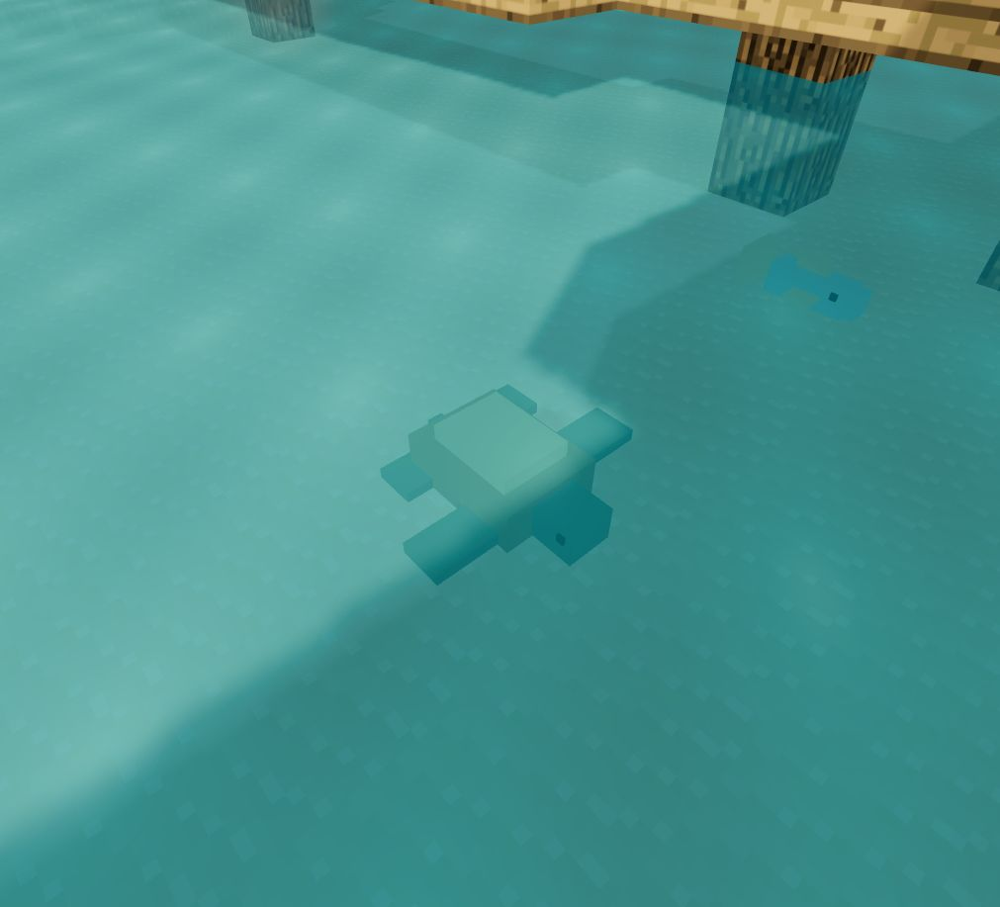

# M39 열대 산호섬

해변섬·높은 바위섬·야자 숲섬·낮은 만의 섬으로 지형을 구분했다. 바위 전망대, 산호 관찰 부두, 해변 쉼터와 서로 다른 방향의 수상 숙소 두 채를 연결했다. 수상 데크는 기둥 아래로 물이 흐르며, 산호는 군락 사이에 물고기가 지날 빈 공간을 남긴다.

게 5마리와 바다거북 3마리를 추가했다. 게는 해변에서 옆으로 걷고, 거북은 지느러미를 움직이며 수중 이동한다. 갈매기 4·물고기 8과 총 20마리다. 육지의 기존 거북과 바다거북은 별도 종이다.

- 5개 시드 자동 동선·안전한 동물 배치 검증 통과. 사용자 요청에 따라 실제 PC 보행 검증은 생략했다.
- 동물 10초 이동과 산호 충돌 판정, 편집 저장 왕복, 이전 생성기 해시, 150/400 추가 섬·경계 검증 통과.
- 전체 266개 테스트(45파일) 및 빌드 통과. 브라우저 오류 0, 기존 Three.Clock 경고 1.
- willow/lagoon/tide 블록 20,300/20,301/20,203개, 야자 35/35/34그루, 산호 77/65/37개.
- 전후 비교는 같은 시드·14시·카메라로 촬영했다. 새 맵 생성기 4, 기존 생성기 3 유지.

로컬 데모: http://127.0.0.1:4173/react-three/?world=willow&map=coral&gen=4

2026-11-15 공개 배포 완료. [배포 검증](M32-M44-DEPLOYMENT.md).
