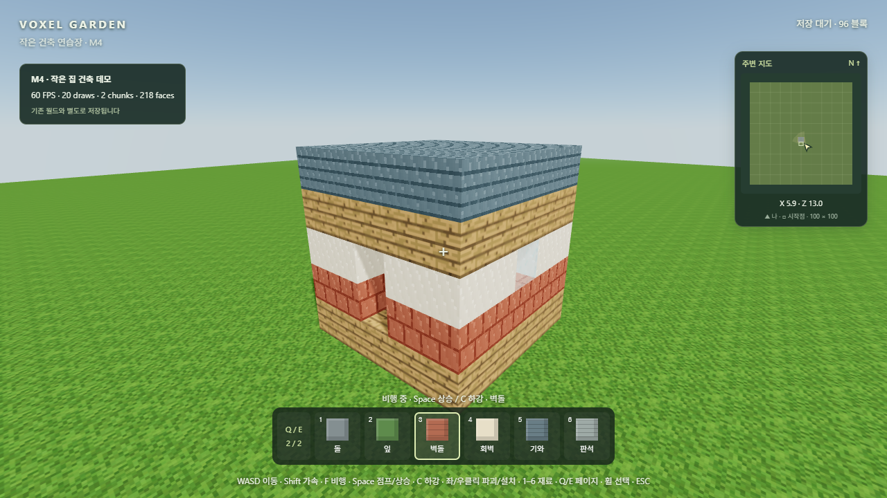
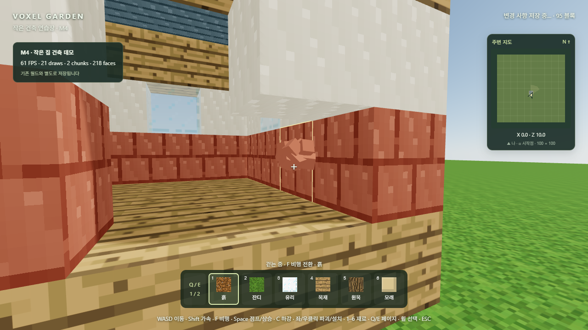

# M4 건축 경험 검증

검증일: 2026-11-14. M3까지의 작업은 `02e8900`에 커밋한 뒤 M4를 진행했다. 외부 배포/푸시는 하지 않았다.

## 변경 사항

- 설치 가능한 재료 12종: 흙, 잔디, 유리, 목재, 원목, 모래, 돌, 잎, 벽돌, 회벽, 기와, 판석.
- 6슬롯 × 2페이지 핫바. Q/E 페이지 전환, 1–6 현재 페이지 재료 선택, 휠로 전체 재료 순환. 선택 재료 이름을 별도 표시한다.
- F 비행 전환, Space 상승, C 하강, Shift 가속. 수평 이동은 실제 시선 기준이며 비행에서도 벽·천장·바닥 충돌을 유지한다. 최대 발 높이는 70이다.
- 선택 블록은 삼각형 대각선이 보이던 wireframe 대신 12개 모서리 테두리로 표시한다. 설치 예정 위치의 미리보기는 추가하지 않았다.
- 성공한 설치·파괴에 서로 다른 짧은 합성 효과음. 시작 버튼의 사용자 동작으로 오디오를 활성화하며 메뉴에서 끌 수 있다. 오디오 실패는 편집을 막지 않는다.
- 파괴 시 재료색 파편 18개를 단일 InstancedMesh로 표시하고 0.65초 후 숨긴다. 연속 파괴는 같은 파편 풀을 재사용한다.
- 사용자가 보류한 시점·캐릭터·설치 미리보기 논의는 M4 종료 이후로 유지했다.
- 커밋 시 발견한 기존 일부 파일의 줄바꿈/EOF 공백도 정리했다.

## 자동 검증

- `npm run test:ci`: 7개 파일, 53개 테스트 통과.
- 추가 검증: 비행 정지/상하 이동/높이 제한, 벽·천장 충돌, 중력 복귀, 3축 대각선 속도 정규화, 12종 재료 저장 왕복.
- `npm run build`: 성공, 번들 크기 경고 없음. `git diff --check`: 통과.

## 실제 건축 검증

테스트 전용 컨텍스트의 빈 개인 월드에서 카메라 회전·키보드 이동·마우스 클릭으로 건축했다. 테스트 코드는 위치를 직접 바꾸거나 store의 블록 편집 함수를 호출하지 않았다.

1. 비행으로 5×5 목재 바닥 설치.
2. 벽돌 기초, 회벽, 유리창 3개, 목재 상부 테두리와 기와 지붕 설치.
3. 내부 임시 받침대와 출입구의 29블록 제거.
4. 총 125회 설치 후 최종 96블록의 빈 내부가 있는 집 완성.
5. 출입구를 점프로 넘어 내부에 들어가 발 높이 1.5로 착지.
6. 내부에서 비행 상승 시 발 높이 2.7에서 천장에 막힘. 하강 시 바닥 높이 1.5에서 멈춤.
7. 상승 키를 누른 채 ESC → 재개 후 발 높이 1.951이 유지되어 잔여 입력 없음 확인.

이 결과를 `src/game/building-demo.json`으로 보존하고 `?demo=build`에서 제공한다. 별도 `voxel-garden.m4-demo.v1` 키에 저장하며 개인/M2/시드 월드와 분리한다.

## 브라우저 확인

- 비행 상승 0.5 → 2.976, 0.4초 정지 동안 높이 유지, C 하강 2.075, 비행 해제 후 바닥 0.5 착지.
- 두 번째 페이지의 4번 회벽 선택, 휠로 기와 선택. 재료에 맞는 설치·저장 확인.
- 건축 데모에서 벽돌 파괴/재설치, 저장 후 새로고침 복원, 96블록 유지.
- 파편 활성 중 22드로콜/1,090삼각형 → 종료 후 21드로콜/874삼각형. 파편 화면도 확인했다.
- 오디오 계측: running AudioContext에서 파괴 triangle / 설치 sine oscillator 생성. 음소거 후 같은 동작에도 oscillator 생성 수 증가 없음. 장치에서 실제 들리는 음질/음량에 대한 청취 평가는 하지 않았다.
- 개발 StrictMode의 M3 willow에서 회벽 (0,6,8) 설치 → 해당 한 블록 delta 저장 → 파괴 후 빈 edits 복귀. 비행 상승 5.5 → 7.075 확인. 런타임 오류 0건.
- 1280×720에서 핫바·메뉴 범위와 데모 화면 확인. 건축 데모 관측 약 60FPS, 20드로콜(조준 테두리/파편 활성 시 증가).
- 기존 R3F 내부 Clock 경고는 M3 기록과 같은 사유로 남아 있다.

## 제한 및 다음 논의

- 설치는 조준한 면의 인접 셀을 사용한다. 앞쪽 블록이 가리면 다른 면이 선택되므로 건축 시 시점을 바꿔야 한다. 반투명 설치 미리보기는 아직 없다.
- 재료는 모두 정육면체다. 기와도 경사 지붕 전용 형상이 아닌 텍스처 블록이다.
- 파편은 장식 효과이며 물리 충돌이 없다. 비행 상태·재료 선택·음소거는 현재 세션에만 유지된다. 영구 설정은 M5 범위다.
- 이제 합의대로 1인칭 유지/별도 캐릭터 및 설치 미리보기 방향을 논의할 수 있다.

## 데모

`npm run preview` → http://127.0.0.1:4173/react-three/?demo=build

