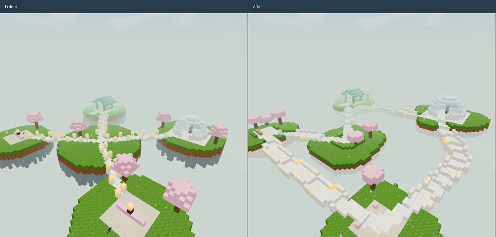

# M40 구름 위 정원

23~34 높이의 섬과 중앙 도착섬을 계단·난간이 있는 흰 돌 연결로로 묶었다. 유리 관측소·구름 정자·꽃 뜰·노을 벤치에 서로 다른 높이와 전망을 주었다. 아래로 뾰족해지는 섬 단면과 시드별 벚나무·꽃 분포를 추가했다. 150/400에는 바깥 공중섬이 추가된다.

나비 5마리 신규 추가, 까치 4·토끼 5로 총 14마리다. 나비는 풀밭 위 낮은 높이에서 날갯짓한다. 자유로운 고도 변경이나 섬 사이 비행은 구현하지 않았다.

- 5개 시드의 지형·꽃·명소·동물 배치·저장 왕복, 150/400 경계, 이전 생성기 해시 검증.
- 전체 274개 테스트 및 빌드 확인. 사용자 요청으로 보행 검증 생략.
- 브라우저 오류 0, 기존 Three.Clock 경고 1.
- willow/breeze 블록 15,161/14,978개. 같은 시드·14시·카메라로 전후 비교.

로컬 데모: http://127.0.0.1:4173/react-three/?world=willow&map=sky&gen=4

커밋·푸시·공개 배포 전.
