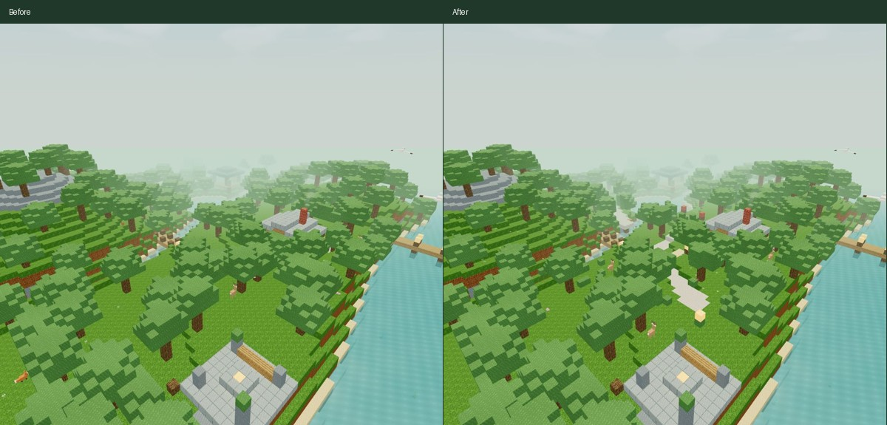

# M41 물빛 숲

기존 산·강·호수·오두막·돛배를 유지하고 버섯 빈터, 호수 곁 벤치, 바닷바람이 드는 작은 뜰과 연결 오솔길을 추가했다. 명소를 피한 지점 중 평탄한 땅을 찾아 배치하며, 빈터 주변의 낮은 관목과 들꽃 군락을 정리했다.

다람쥐 5와 나비 4를 숲에 추가 배치했다. 토끼·오리·여우·사슴·갈매기·물고기와 총 30마리. 다람쥐는 나무 주변에 초기 배치된다.

- 5개 시드 명소 보존·새 쉼터·동물 안전 배치·편집 저장 왕복, 150/400 경계, 기존 생성기 해시 검증.
- 전체 282개 테스트 및 빌드 통과. 보행 검증은 사용자 요청으로 생략.
- 브라우저 오류 0, 기존 Three.Clock 경고 1. willow/breeze 블록 65,871/67,535개.
- 이전 생성기는 보존하고 새 물빛 숲부터 생성기 4 적용.

로컬 데모: http://127.0.0.1:4173/react-three/?world=willow&map=forest&gen=4

2026-11-15 공개 배포 완료. [배포 검증](M32-M44-DEPLOYMENT.md).
