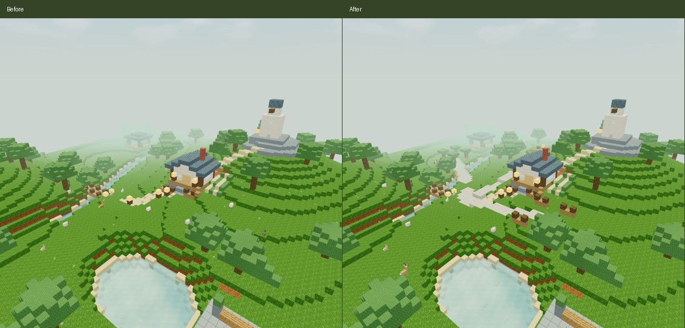

# M42 넓은 초원

풍차·농가·강·연못을 유지하고 작은 과수원, 풍차 방향의 소풍 자리, 낮은 울타리 꽃밭과 연결 산책길을 추가했다. 들꽃은 완전히 흩뿌리는 대신 군락을 이루도록 조정했다.

양 5·말 3을 유지하며 꿩 3·나비 4를 추가 배치했다. 토끼·오리·여우·사슴·물고기 포함 총 31마리로 32마리 상한을 지킨다.

- 5개 시드 명소 보존·새 쉼터·동물 안전 배치·편집 저장 왕복, 150/400 경계, 기존 생성기 해시 검증.
- 전체 290개 테스트 및 빌드 통과. 사용자 요청으로 보행 검증 생략.
- 브라우저 오류 0, 기존 Three.Clock 경고 1. willow/breeze 블록 76,391/74,717개.

로컬 데모: http://127.0.0.1:4173/react-three/?world=willow&map=meadow&gen=4

2026-11-15 공개 배포 완료. [배포 검증](M32-M44-DEPLOYMENT.md).
