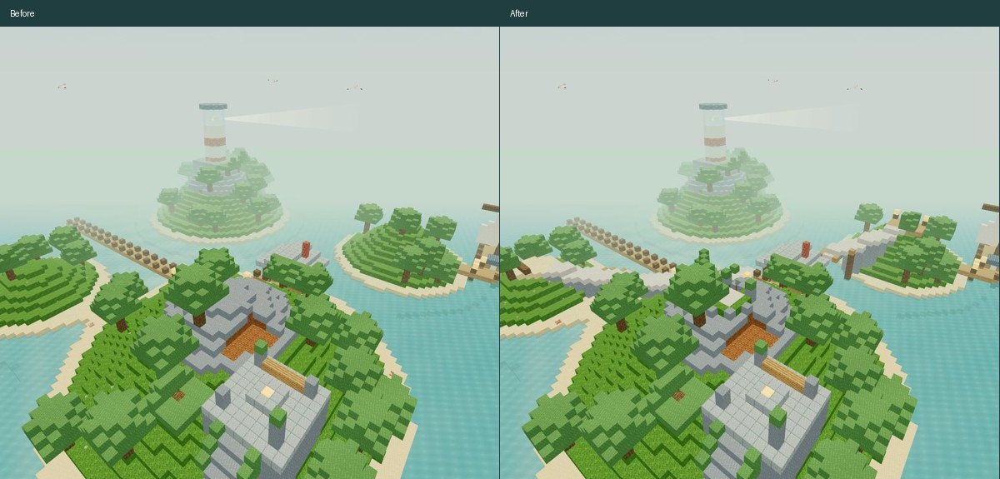

# M43 작은 군도

기존 등대·돛배·섬의 높낮이를 유지하고 유목 해변, 바다 전망 마루, 작은 돌뜰과 섬 사이 연결길을 보강했다. 게 5·바다거북 2를 추가 배치했으며 갈매기·물고기·토끼·오리 포함 총 25마리다.

- 새 길의 폭을 만드는 과정에서 시작 지점을 높이던 문제를 수정하고 기존 도착 지형을 보존했다.
- 자연 맵 관련 24개 테스트 재검증 및 빌드 통과. 5개 시드 명소·시작점 보존, 동물·저장·150/400 경계와 이전 생성기 해시 확인.
- 사용자 요청으로 보행 검증 생략. 브라우저 오류 0, 기존 Three.Clock 경고 1.
- willow/breeze 블록 39,506/39,438개. 같은 시드·14시·카메라로 전후 비교.

로컬 데모: http://127.0.0.1:4173/react-three/?world=willow&map=islands&gen=4

커밋·푸시·공개 배포 전.
