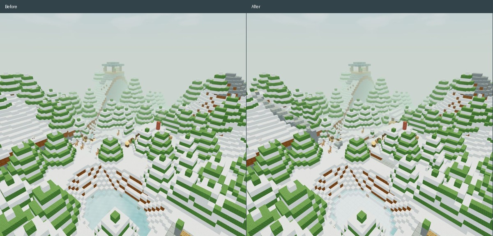
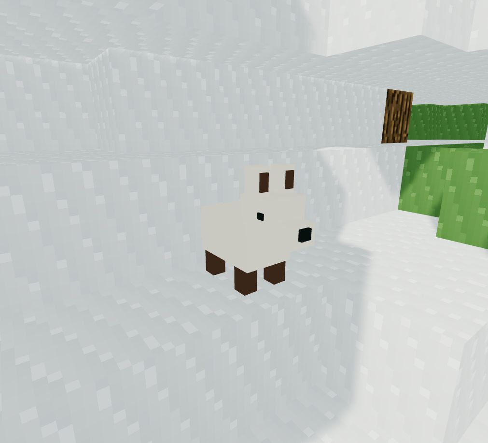

# M44 고요한 설원

기존 설산·침엽수·산장·정자를 유지하고 눈 덮인 작은 쉼터, 장작 야영지, 연못 전망 벤치와 눈길을 추가했다. 연못 일부에 기존 유리 블록을 배치해 걸을 수 있는 얼음을 표현했다. 얼음은 날씨에 따라 녹거나 다시 어는 기능이 아닌 고정 지형이다.

북극여우 4마리와 흰토끼 5마리를 추가했다. 기존 여우·토끼 형태를 흰 겨울 털로 구분하며, 눈밭에서 걷거나 뛰고 쉰다. 사슴 5·물고기 3과 총 17마리다.

- 5개 시드 명소·시작점 보존, 새로운 쉼터·얼음·동물 안전 배치·편집 저장 왕복 검증.
- 150/400 경계, 이전 생성기 해시 검증. 전체 306개 테스트(47파일), 빌드, git diff --check 통과.
- 사용자 요청으로 보행 검증 생략. 최종 배포 빌드에서 M39~M44 여섯 맵 모두 화면 로딩·viewport 채움·동물 활성 확인, 페이지 오류 0.
- 기존 Three.Clock 경고는 남아 있다. 400 크기는 생성·경계 자동 검증이며 전체 보행·장시간 성능 검증은 하지 않았다.
- willow/breeze 블록 114,776/122,985개. 같은 시드·14시·카메라로 전후 비교.

로컬 데모: http://127.0.0.1:4173/react-three/?world=willow&map=snow&gen=4

2026-11-15 공개 배포 완료. [배포 검증](M32-M44-DEPLOYMENT.md).
