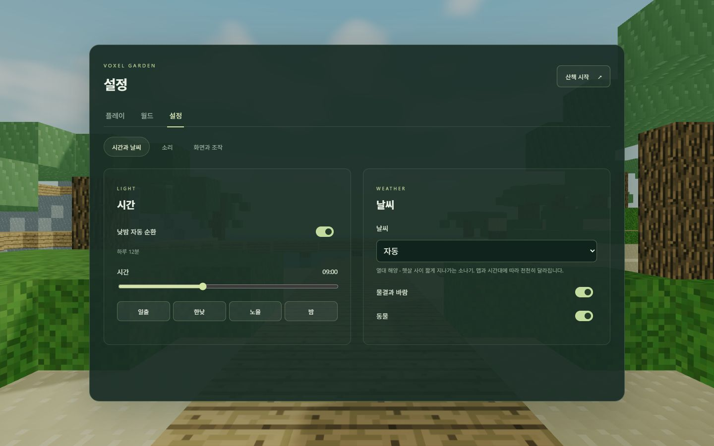

# M45 — 맵별 기후와 자연스러운 날씨 전환

2026-11-16 구현 및 검증.

## 구현

- 13종 맵에 기후별 날씨 선택 가중치와 지속 시간을 적용했다. 실제 관측 통계가 아닌 게임용 조정값이며, 전환 규칙과 지속 시간이 달라 가중치가 곧 체류 시간 비율은 아니다.
- 사막은 긴 맑음과 드문 짧은 비, 열대는 짧은 소나기, 설원은 비 대신 눈을 사용한다. 따뜻한 맵의 자동 눈, 구름 위 맵의 비·눈은 제외했다.
- 안개 선택 가중치는 오전 6시 주변에 높고 낮에는 낮아진다. 낮 안개의 지속 시간도 짧게 했다.
- 맑음/안개에서 강수로 바로 바뀌지 않고 흐림을 거친다. 강수 후에도 흐림으로 돌아오며 구름·비·안개의 시각 혼합을 완만하게 조정했다.
- 기본 지속 시간: 맑음 240–480초, 흐림 90–180초, 비 120–240초, 안개 60–150초, 눈 150–300초. 사막 맑음 360–600초·비 30–60초, 열대 비 45–90초, 낮 안개 30–60초.
- 수동 날씨는 자유롭게 유지한다. 자동 복귀 시 현재 맵·시간에 맞는 날씨를 선택하며 일시정지 중 자동 타이머는 멈춘다.
- 풍경 감상도 같은 기후 선택기를 사용한다. 첫 장면의 실제 맵과 날씨가 어긋날 수 있던 초기화 순서를 수정했다. 맵·시간은 바뀌며 기후에 따라 같은 날씨가 연속될 수 있다.
- 설정에서 현재 맵의 기후를 안내한다. 기존 날씨별 배경음 연동과 저장 형식은 유지했다.
- M46 강수·바람 시각 효과, M47 희귀 기상은 후속 범위다.

## 검증

- 전체 Vitest 48파일 / 323개 통과, Vite 배포 빌드 통과, diff 공백 검사 통과.
- 13종 맵별 2,000회 전환 검사, 긴 시뮬레이션의 사막·숲·설원 체류 성향, 지속 시간·새벽 안개·금지 강수 검사.
- 감상 장면 600회 및 모든 맵의 첫 장면 기후 검사.
- 브라우저: 열대 맵 수동 눈 → 자동 맑음 복귀, 정지 중 타이머 유지, 기후 안내 확인.
- 배포용 로컬 빌드: 사막·설원·산호섬 첫 장면과 다음 풍경(초원·흐림)의 맵/기후 일치, 페이지 오류 0. 기존 Three.Clock 경고는 남아 있다.
- 사용자 요청에 따라 보행 검증 생략. 모바일 실기기 검사도 수행하지 않았다.

## 배포

- 소스 커밋 `9555693` main 푸시 완료.
- gh-pages `7e0e01dadebc432e3ea3512b032217824d3b9204` 게시 완료.
- [GitHub Pages 배포 성공](https://github.com/yooseongc/react-three/actions/runs/43775588615).
- 공개 번들 `index-BiChjt53.js` 반영 확인. 사막 기후 안내와 설원 → 산호섬 감상 장면의 기후 일치 확인, 페이지 오류 0.
- [공개 데모](https://yooseongc.github.io/react-three/).
