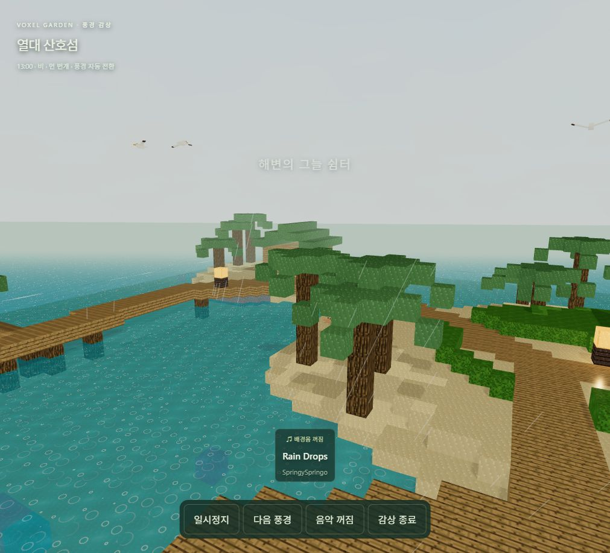
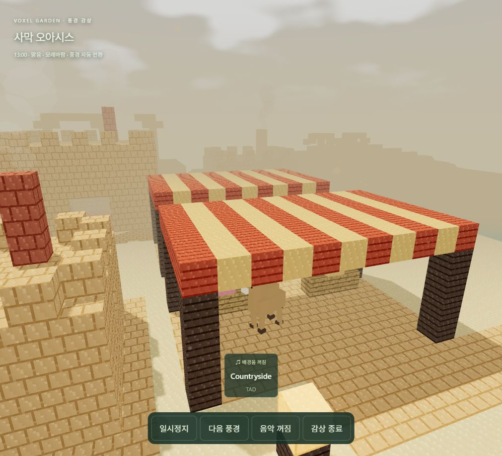
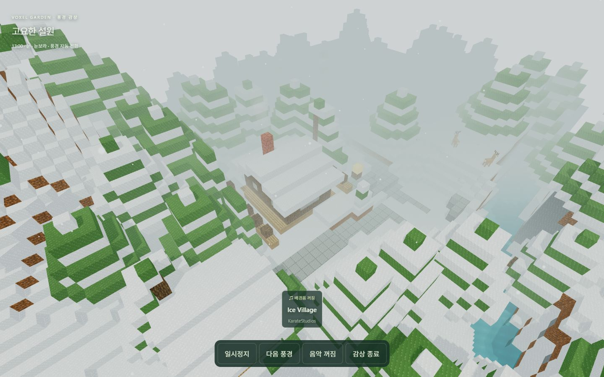
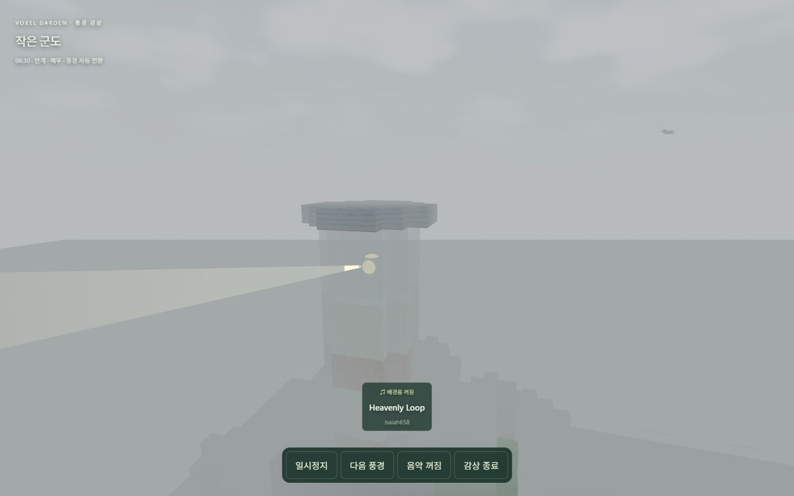
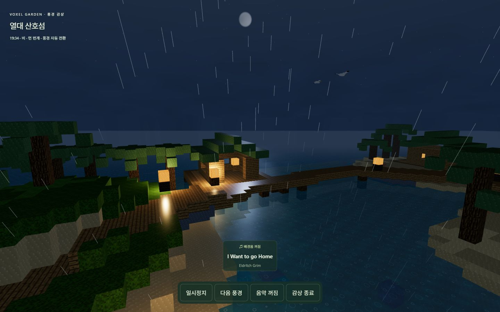

# M46–M47 — 비·바람 표현과 희귀 기상

2026-11-16 구현·검증.

## M46

- 비에 바람 방향의 기울기와 수평 이동을 적용했다. 눈은 같은 바람을 따라 흩날리며 강풍에서 흔들림이 커진다.
- 풀과 나뭇잎이 공유 바람 강도에 반응한다. 블록 좌표·충돌 경계와 물 높이는 바꾸지 않았다.
- 수면 셰이더에 퍼졌다 사라지는 빗물 파문을 추가했다. 지붕 높이 텍스처로 덮인 수면을 제외하며 별도 파문 메시나 매 프레임 지형 재생성은 없다.
- 비 600개·눈 420개 예산 유지. 희귀 모래바람에만 추가 점 240개를 사용한다.
- 셰이더 합성 중 발견한 중복 uniform 선언 충돌을 수정하고 재발 검사 추가.

## M47

| 현상 | 발생 조건 | 표현 |
|---|---|---|
| 모래바람 | 사막, 맑음/흐림 | 황갈색 대기·먼지 입자·강풍 |
| 눈보라 | 설원, 눈 | 눈의 수평 이동·강풍·가시거리 감소 |
| 해무 | 물빛 숲/군도/수상 도시/산호섬, 안개, 04–10시 | 일반 안개보다 짙은 해안 시야 |
| 먼 번개 | 숲/온천/산호섬/군도/초원, 비 | 상부 구름의 약하고 넓은 빛 |

- 일반 플레이의 자동 날씨 및 풍경 감상에서만 발생한다. 일반 플레이의 수동 날씨에는 끼어들지 않는다.
- 시작/감상 장면 변경 8초 뒤 첫 추첨, 이후 60–120초 간격으로 조건 확인. 조건을 만족할 때 18% 확률이며 실제 시간 점유율은 아니다.
- 지속 24–45초, 시작 6초·끝 8초 혼합. 종료 후 180–300초 대기. 조건 변경 시에도 서서히 걷힌다.
- 새 감상 장면은 현상 상태를 초기화한다. HUD와 감상 화면에 현상 이름을 표시한다.
- 먼 번개는 17초 주기 중 2초의 완만한 구름 발광(최대 0.12)이다. 번개 선·큰 천둥 소리·새 음원은 추가하지 않았으며 기존 기본 날씨에 맞는 음악을 유지한다.
- 정지/숨김 시 현상 시간과 입자가 멈춘다. 번개는 정지 시 즉시 꺼진다. ‘물결과 바람’을 끄면 희귀 현상·입자·파문·식생 움직임을 끈다.

## 검증과 한계

- 전체 50파일 / 330개 테스트 통과. 마지막 종료 혼합 보정 후 관련 7개 재검증 통과. 배포 빌드·diff 검사 통과.
- 발생 조건, 빈도 추첨, 지속/종료 혼합, 재발 대기, 일시정지, 효과 끄기, 풍속/발광 상한, 재질 합성의 중복 uniform 검사.
- 브라우저에서 재현을 위해 임시 난수 고정 및 날씨 설정을 사용했다. 실제 배포 코드에 강제 발생 훅은 없다.
- 비와 나뭇잎 렌더링, 모래바람·눈보라·해무 화면, 조건 변경 후 해무 종료, 정지 중 시간 고정, 효과 끄기를 확인했다.
- 배포용 로컬 빌드에서 먼 번개 발광 0.023 및 정지 시 0.000, 일반 수동 비에 희귀 현상 없음, 1440×900 viewport 일치를 확인했다.
- 최종 브라우저에서 페이지/WebGL 오류 없음. 기존 Three.Clock 폐기 예정 경고는 남아 있다.
- 사용자 요청에 따라 보행·모바일 실기기 검증 생략. 400 맵의 신규 성능 벤치마크는 수행하지 않았다. 입자 수는 맵 크기와 무관하게 제한한다.

## 배포

커밋·푸시·배포 진행 중.
