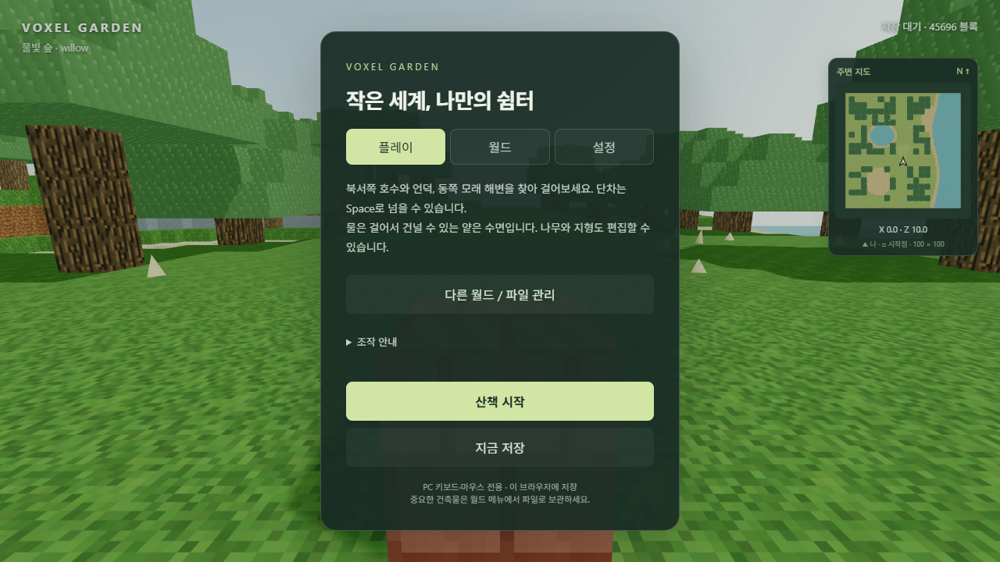

# M5 공개 마감 · 1.0.0

검증일: 2026-11-14. M4는 `9bd5ac2`에 커밋한 뒤 진행했다.

## 구현

- 시작/일시정지 메뉴를 플레이·월드·설정으로 분리했다. 조작 안내는 펼쳐 읽을 수 있고, 메뉴에서는 핫바와 조작 힌트를 숨긴다.
- 시드 입력으로 새 숲 열기, 저장된 월드 선택, 최근 플레이한 월드 이어하기, 건축 연습장/작은 집 데모 이동.
- 마우스 감도(0.25–2배), 효과음, 그림자, 미니맵 설정을 브라우저에 저장한다. 저장 실패 시 현재 세션 적용과 안내를 유지한다.
- JSON 다운로드·파일 검사·복사본 가져오기. 원본 저장을 덮어쓰지 않는다. 숲 복사본은 원래 시드·생성기 버전·수면을 유지한다.
- 가져오기 제한: 8MB / 15만 블록. 형식·버전·재료·좌표·중복 검사. 이전 v1 블록 배열/객체도 평면 월드 복사본으로 지원한다.
- 현재 월드 저장이 실패하면 이동을 막고 내보내기/명시적 저장 없이 이동 선택을 제공한다. 저장되지 않은 상태에서 브라우저를 닫을 때도 경고를 요청한다.
- 복셀 정원 SVG 아이콘과 manifest 색상 정리. 버전 1.0.0.

## 저장 규칙

- 기존 개인/M2/M4/시드 저장 키와 데이터는 유지한다.
- `voxel-garden.copy.<UUID>`: 가져온 월드의 전체 스냅샷. 복사본의 후속 편집도 이 키에 저장한다.
- `voxel-garden.settings.v1`: 브라우저 설정.
- `voxel-garden.recent.v1`: 마지막으로 플레이한 내부 월드 쿼리만 저장한다. 외부 URL로 이어하기는 허용하지 않는다.
- 내보내기 형식은 `format: voxel-garden`, `version: 1`, `kind: flat | terrain`, `cubes`, 숲이면 `seed`와 `generator: 1`이다.
- 플레이어 위치·비행·선택 재료는 세션 상태이며 새로고침 후 안전한 시작점으로 돌아간다.
- 사이트/브라우저별 localStorage이므로 로컬 데모와 공개 사이트, 다른 PC 사이 이동은 내보낸 파일을 사용한다. 슬롯 URL만 공유해서 복사본 데이터가 전달되지는 않는다.

## 자동 검증

- `npm run test:ci`: 9개 파일, 68개 테스트 통과.
- 추가 검증: 새/이전 파일 형식 왕복, 빈 월드/한글 시드, 불량 JSON·미지원 버전·잘못된 재료·좌표·중복·크기 제한, 외부 링크 차단, 월드 목록, 설정 복구, 가져온 숲의 저장 격리, 손상 복사본 덮어쓰기 방지.
- `npm run build` 및 `npm run deploy`: 성공. 번들 경고 없음.
- 최종 배포 앱 JS: `assets/index-D94SmyHm.js`, 최대 청크 383.48 kB.

## 로컬 브라우저

- 설정 감도 1.5배, 효과음/그림자/미니맵 끄기 → 새로고침 후 유지 확인.
- 불량 JSON 업로드 시 오류 안내 및 가져오기 중단.
- willow 45,695블록을 실제 다운로드: 2,433,390 bytes. 같은 파일 업로드 → 확인 → 새 복사본 생성. 내보낸 JSON과 저장된 복사본이 동일하고 원본 시드 저장은 불변.
- 복사본에 블록 설치 후 다른 시드 숲 열기 → 최근 월드 이어하기 → 45,696블록 복원 확인.
- 저장소 setItem 실패를 주입한 상태에서 편집 후 이동: 현재 URL 유지와 실패 안내 확인. 명시적인 저장 없이 이동을 선택한 후에만 목적지로 이동했다.
- 1280×720 메뉴 표시 및 메뉴 스크롤 범위 확인.

## 실제 GitHub Pages 배포 검증

- 공개 URL: https://yooseongc.github.io/react-three/
- Pages 설정: `gh-pages` 브랜치, 루트, 기존 브랜치 배포 방식 유지.
- 배포 커밋: `978b2213eb631453832a3cdcdeab3229c01f4028`.
- GitHub Pages 빌드 상태 `built`, 오류 없음 확인.
- 실제 공개 URL에서 새 앱 JS 해시 확인. 스크립트·텍스처 로딩 실패 및 런타임 오류 0건. garden.svg / manifest.json HTTP 200.
- 공개 숲에서 W 이동 Z 10 → 8.875, 180도 회전 후 W로 Z 10 복귀. 점프 발 높이 5.5 → 6.487 및 비행 상승 6.85 확인.
- 공개 숲에서 벽돌 (0,6,8) 설치 후 v2 delta 저장 확인.
- 공개 사이트에서 편집한 숲을 다운로드(2,433,438 bytes) → 파일 업로드 → 별도 복사본 생성. 다운로드 내용과 복사본 저장 내용이 일치했다.
- 기존 R3F 9 내부의 Clock 사용 중단 예정 경고 1건은 M3에서 검토한 사유로 남아 있다. 경고를 숨기지 않았다.

## 남은 범위

- PC 키보드·마우스 기준이다. 터치 조작·멀티플레이·서버 동기화·유체/수영은 없다.
- 사용자가 보류한 시점/별도 캐릭터와 설치 미리보기는 이번 마감에서 변경하지 않았다.
- 브라우저 저장 공간은 유한하다. 중요한 월드는 파일로 보관할 수 있다.

[월드 메뉴](m5-worlds.png) · [설정 메뉴](m5-settings.png)
