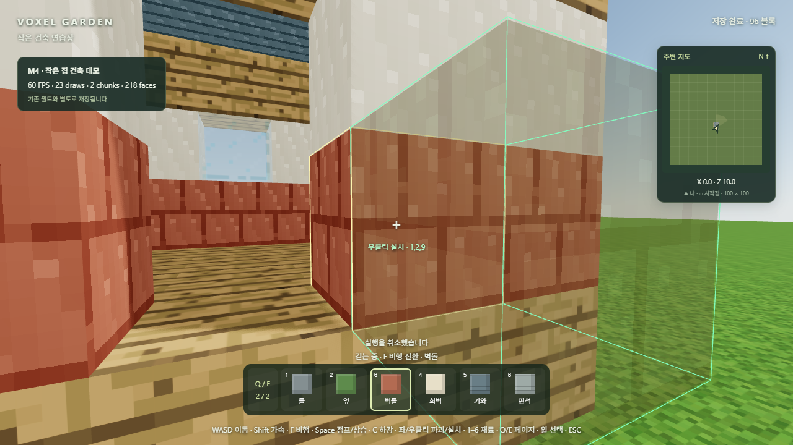
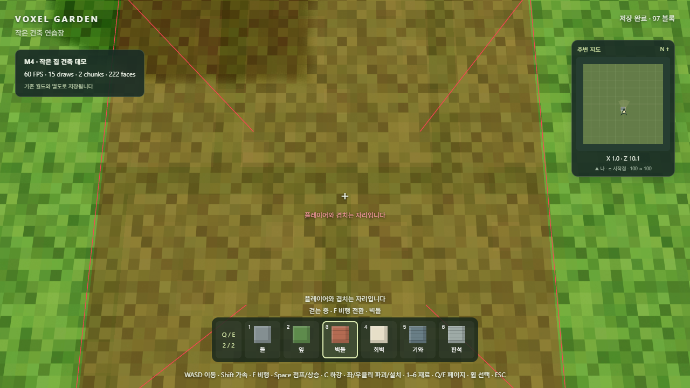

# M6 건축 조작 보완

검증일: 2026-11-14. 이번 단계는 로컬 구현/검증이며 공개 사이트는 기존 M5 배포 상태다.

## 구현

- 실제 설치와 미리보기가 동일한 위치 계산·범위/점유/플레이어 겹침 검사를 사용한다.
- 선택 재료의 반투명 블록과 테두리를 표시한다. 초록/빨강 및 불가 사유 텍스트로 상태를 구분한다. 조준 대상이 없으면 유령 블록을 숨기고 6칸 조작 거리 안내를 표시한다.
- Ctrl/Cmd+Z 취소, Ctrl/Cmd+Shift+Z 또는 Ctrl+Y 다시 실행. ESC 메뉴에서도 실행 가능하다.
- 최근 100개 편집의 좌표·이전/이후 재료만 저장한다. 전체 월드 복사본을 이력으로 유지하지 않는다.
- 성공한 새 편집만 redo를 초기화한다. 취소/재실행도 청크 편집·자동 저장 경로를 사용한다.
- 복원 시 플레이어와 겹치거나 예상한 월드 상태와 다르면 기록을 유지하고 차단한다.
- 이력은 세션 전용이다. 새로고침/월드 전환 시 초기화되며 저장 파일 형식은 유지한다.

## 검증

- 자동 테스트 74개 통과. 여섯 면·음수 좌표·지면 위치, 범위/점유/몸 겹침, 이력 왕복·100개 제한·redo 분기·잘못된 상태 거부·경계 청크 갱신 검증.
- 프로덕션 빌드 성공. 브라우저 런타임 오류 0건. 기존 R3F Clock 경고는 유지된다.
- 건축 데모 조준 (1,2,8) → 미리보기 (1,2,9) → 실제 brick (1,2,9) 설치 확인.
- Ctrl+Z 후 원상복구, Ctrl+Shift+Z 후 동일 재료/위치 복원. 해당 구간 지오메트리 수 14 유지.
- 블록을 삭제한 자리에 직접 이동한 뒤 undo: 몸 겹침 때문에 거부. 뒤로 이동 후 같은 작업 재시도 성공.
- 발밑 지면 조준: 빨간 미리보기와 몸 겹침 안내. 우클릭 설치도 차단.
- willow에서 (0,6,8) 목재 설치 → 저장 edits 1개 → undo 후 빈 edits → Ctrl+Y 후 동일 edits 복원. ESC 메뉴 undo 버튼도 확인.
- 새로고침 후 블록 상태는 유지하고 취소 기록은 0개로 초기화됨을 확인.
- 개발 StrictMode에서도 미리보기·설치·취소 정상. 런타임 오류 없음.
- 1280×720 화면에서 초록 미리보기와 빨간 불가 표시를 직접 확인했다. 건축 데모 미리보기 활성 시 23드로콜(기존 조준 포함 21 + 미리보기 2).

## 데모

`npm run preview` → http://127.0.0.1:4173/react-three/?demo=build

다음 마일스톤은 M7 낮밤·빛과 시간이다. 1인칭은 유지한다.
