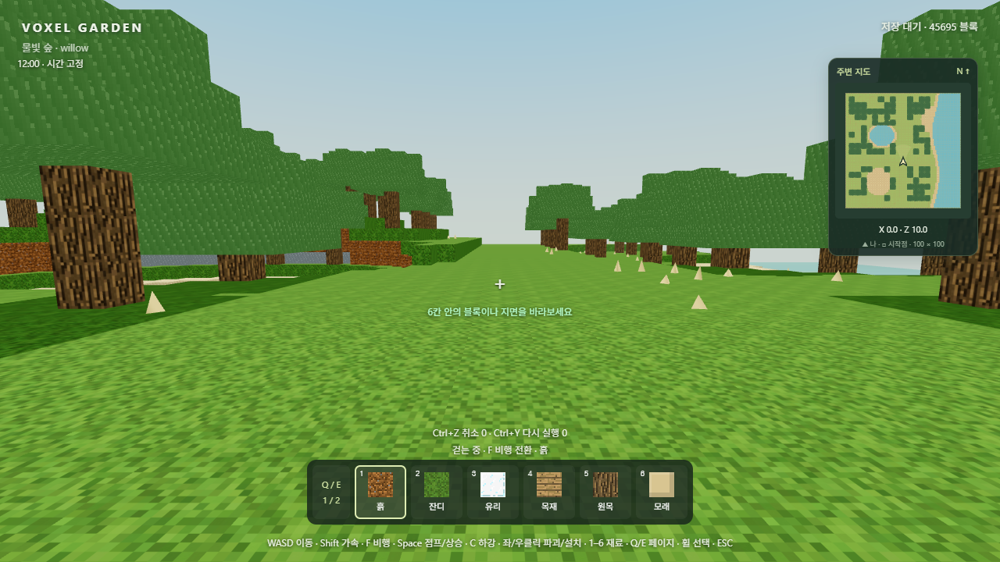
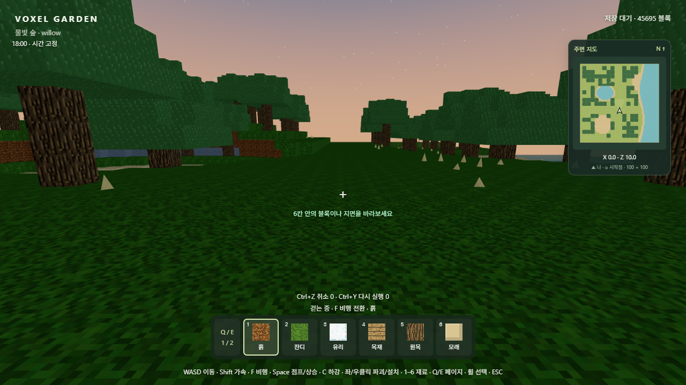
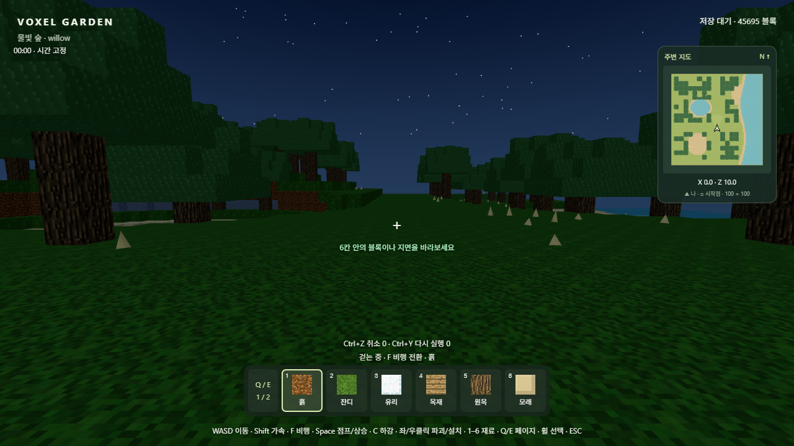
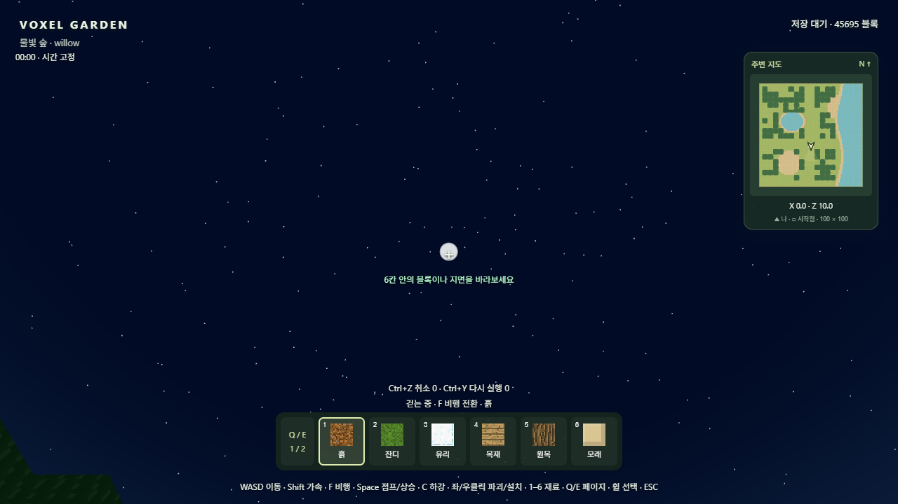

# M7 빛과 시간 — 2026-11-14

M6 커밋: `0dc6446`. M7은 로컬 구현이며 아직 커밋/공개 배포하지 않았다.

## 구현

- 플레이 시간 12분 = 하루. 기본 오전 9시. 메뉴와 숨겨진 탭에서는 정지하며 긴 프레임의 시간 점프를 제한한다.
- 연속적인 하늘 그라데이션, 일출/노을, 태양과 달, 고정된 600개 별. 하늘은 카메라를 따라가며 지형에는 안개 색을 함께 적용한다.
- 태양광은 지평선에서 부드럽게 사라지고 달빛과 야간 주변광을 유지한다. 그림자는 플레이어 주변을 따른다.
- 설정에서 자동 순환, 15분 단위 시간 고정, 일출/한낮/노을/밤 프리셋. HUD 시각 표시.
- 모든 월드 공통 브라우저 설정. 메뉴로 나올 때 현재 시각을 저장한다. 이전 설정에는 오전 9시/자동 순환을 기본 적용한다.
- 프레임마다 GPU uniform과 조명 참조를 갱신한다. 저장소 쓰기와 React 전체 렌더링을 프레임마다 실행하지 않는다.

## 검증

- Vitest 12파일 77테스트 통과. 시간 래핑/정지/긴 프레임, 야간 최소 밝기, 이전·손상 설정 복구 검증 추가.
- 프로덕션 빌드 성공, 번들 크기 경고 없음.
- 별도 브라우저 컨텍스트 `m7-qa`, 1280×720, `?world=willow`에서 실제 조작.
- 시간 고정 00:00 유지, 메뉴 18.0000 유지, 플레이 1.8초 후 18.0600 진행, 메뉴 저장과 새로고침 후 18.0600 복원 확인.
- 일출 06:00/한낮 12:00/노을 18:00/밤 00:00 화면 확인. 달이 표시되지 않던 uniform 참조 문제를 발견해 실제 material uniform 갱신으로 수정 후 달 재확인.
- 밤에 W 이동: Z 10 → 9.1. 미리보기 (0,6,7)에 실제 설치 후 시드 저장 edits 1건, Ctrl+Z 후 edits 빈 배열 확인.
- 그림자 켜기/끄기 정상. 그림자 OFF 노을 순환 120프레임 표본: 중앙 16.7ms, p95 16.8ms. 짧은 정지 장면 표본이며 전체 지형 성능 보장은 아니다.
- 런타임 오류 0. 기존 R3F 내부 THREE.Clock 경고 1건 유지.

## 데모

[로컬 숲 열기](http://127.0.0.1:4173/react-three/?world=willow) → 설정 → 시간 프리셋 → 산책 시작.

날씨, 물결/식생 바람, 동물은 후속 M8–M10 범위다. 달 위상·계절·건축용 조명 블록은 구현하지 않았다.
