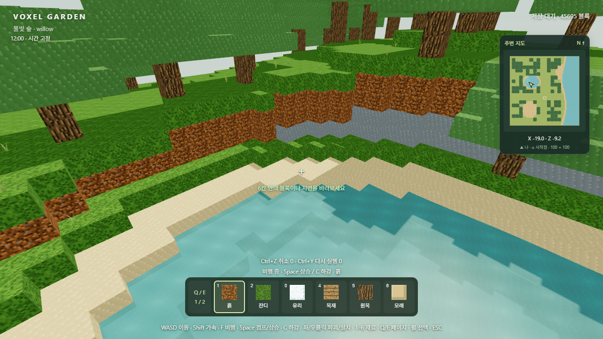

# M8 물결과 바람 — 2026-11-14

M7을 `900000f`로 커밋했다. M8은 로컬 구현이며 아직 커밋/배포하지 않았다.

## 구현

- 수면: 두 방향 파동, 최대 ±0.07칸 높이 변화, 파동 기울기에 따른 조명과 잔물결. 기존 얕은 물의 충돌/건축 규칙 유지.
- 풀: 사용자가 원뿔 장식을 지적하여 다섯 장의 휘어진 풀잎으로 교체. 밑동은 고정하고 끝부분만 바람에 흔들린다. 한 geometry와 material을 인스턴싱한다.
- 잎: 바람에 따른 텍스처와 명암 변화. 블록 경계·선택·충돌·그림자 위치는 유지한다.
- 구름: 하늘 셰이더 안의 3단계 노이즈가 천천히 흐른다. 같은 구름 밀도로 별을 가리고 낮밤의 색에 맞춘다.
- 안개: 기존 색 변화와 함께 거리만 천천히 ±2/3칸 변화한다.
- 설정의 '풍경 움직임 · 물결과 바람'으로 끌 수 있다. OFF는 평평한 물/정지한 식생/고정 구름과 안개로 표시한다. 낮밤 설정과 독립적이다.
- 메뉴/숨겨진 탭에서 애니메이션 시계 정지. 시간 간격 제한으로 탭 복귀 시 급격한 점프 방지. 매 프레임 uniform만 갱신하며 청크와 geometry를 재생성하지 않는다.

## 검증

- 자동 테스트 13파일 79개 및 프로덕션 빌드 통과. 기존 설정 기본값, 움직임 OFF 저장 복원, 시간 정지/긴 프레임 검증.
- 독립 `m8-qa` 브라우저, 1280×720, willow 숲에서 실제 이동·비행으로 호수 도달.
- 고정 카메라/12:00에서 약 1.9초 간격 수면 영역 700×240 비교: ON 103,274픽셀 변화. OFF는 35픽셀의 1/255 차이만 관찰되어 시각적 움직임 없음. OFF 시 애니메이션 시계도 동일.
- 메뉴와 OFF 상태 시계 61.900 유지. 새로고침 후 OFF 복원 확인.
- 애니메이션 전후 meshBuilds 65, 지오메트리 수 219, draw calls 186 유지(풀 모양 교체 전 호수 표본).
- 풀 교체 후 근접 장면 120프레임 측정: 중앙 16.7ms, p95 16.8ms. 약 60fps이며 짧은 단일 장면 측정이다.
- 수면 셀 2,358개에서 (-19,3,-11)에 블록 설치 시 2,357개, 실행 취소 후 2,358개 복원. 저장 delta도 설치 2건에서 실행 취소 후 빈 배열 복원.
- 풀 근접·수면·구름 화면을 직접 확인. 물결/잎 셰이더와 별 구름 마스크 컴파일 정상.
- 최종 프로덕션 화면 런타임/셰이더 오류 없음. 기존 R3F THREE.Clock 경고 유지. 테스트 도중 브라우저 포커스 문제로 pointer lock 요청 1회 실패했고, 화면을 앞으로 가져온 후 재시도하여 정상 조작을 확인했다.

## 데모와 범위

[로컬 숲](http://127.0.0.1:4173/react-three/?world=willow) → 설정에서 한낮 선택 → 산책 시작 → 북서쪽 호수.

[실제 브라우저 물결 영상](m8-water.mp4) · [풀 근접 화면](m8-grass.png) · [구름](m8-clouds.png)

물은 시각 효과이며 유체 시뮬레이션/수영/실시간 반사는 없다. 풀은 비충돌 장식이며 채집 대상이 아니다. 잎 블록 자체는 흔들리지 않는다. 비·흐린 날씨는 M9 범위다.
