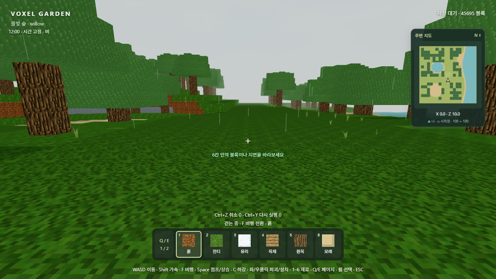
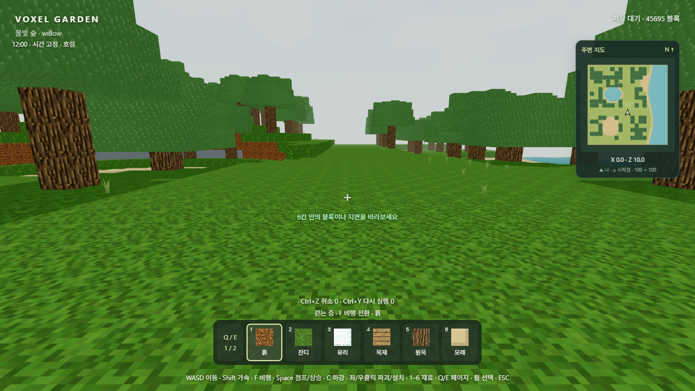
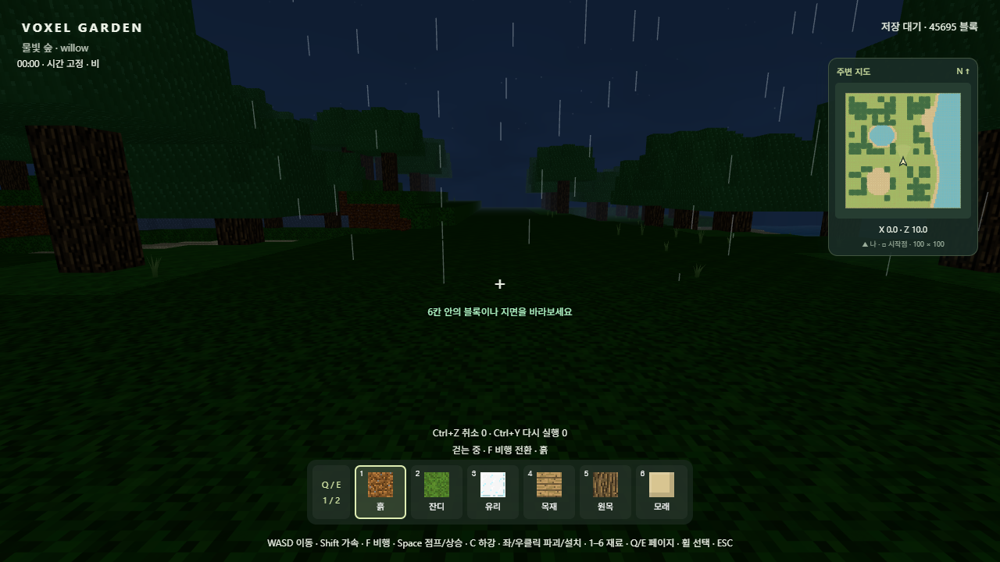
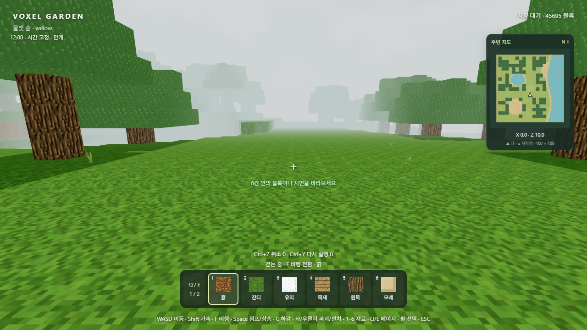

# M9 날씨와 ASMR 배경음 — 2026-11-14

M8 커밋: `9083b73`. M9은 로컬 구현이며 아직 커밋/배포하지 않았다.

## 최종 동작

- 기본 날씨는 자동. 플레이 시간 3–6분 간격으로 변화한다. 맑음 → 흐림(70%)/안개(30%), 흐림 → 맑음(25%)/안개(20%)/비(30%)/눈(25%), 안개 → 맑음(60%)/흐림(40%), 비·눈 → 흐림. 메뉴/숨겨진 탭에서 카운트다운 정지. 자동 날씨 시계는 낮밤 시간 고정과 독립적이다.
- 설정에서 맑음/흐림/비/안개/눈을 선택하면 고정. 자동으로 돌아가면 현재 날씨에서 새 대기 시간을 시작한다. 재접속 시 자동 모드는 맑음에서 새 주기를 시작하며, 수동 날씨와 모드 선택은 저장된다.
- 하늘·구름·안개·햇빛/달빛과 비가 연속적으로 변한다. 젖은 표면은 비가 그친 뒤 더 천천히 마른다.
- 빗줄기 최대 600개를 한 draw call로 표시. 99×99 지붕 높이 표로 빗줄기가 블록/나뭇잎 아래에 나타나지 않도록 자른다. 표는 블록 편집 시 갱신한다.
- 젖은 효과는 비에 노출된 블록 윗면에만 적용한다. 실내 바닥/벽면과 건축 좌표·충돌은 유지한다.
- 독립 안개는 시야를 약 8–32칸으로 부드럽게 줄이고 하늘 색을 맞춘다. 눈은 420개까지 천천히 흔들리며 내리는 입자로 표현하고, 지붕 아래에서는 가린다. 눈이 쌓이거나 지형을 변경하지 않는다.
- 사용자 피드백에 따라 합성 빗소리와 개별 자연음 중심 믹스를 교체했다. 최종본은 여러 녹음을 낮은 음량으로 혼합·필터링·압축·확산한 날씨별 ASMR 사운드스케이프 5종이다. 안개는 낮고 부드러운 질감, 눈은 가볍고 잔잔한 공간감으로 조정했다.
- 특정 효과음이 두드러지지 않는 공간감을 목표로 한다. 날씨 간 크로스페이드, 밤/실내 음량 감소, 독립 ON/OFF·음량 제공. 효과음을 꺼도 배경음은 사용할 수 있다.
- 메뉴/포커스 해제/숨겨진 탭에서 즉시 음소거. 시작 버튼 사용자 제스처 후 오디오 준비. 음원은 합계 약 1.58 MiB이며 자체 호스팅한다. 실패 시 조작은 계속 가능하며 설정에서 재시도한다.
- 풍경 움직임 OFF는 비·눈 입자를 숨긴다. 날씨/표면 변화와 배경음은 별도 설정이다.

## 검증

- Vitest 16파일 92테스트, 프로덕션 빌드 통과. 날씨 경로/확률 분기/기간/일시정지, 지붕 제거, 설정 복구, ASMR 믹스, 다운로드 실패/재시도/중복 로딩/미세 잔음 음소거 및 StrictMode 정리 회귀 검증.
- 실제 브라우저 `m9-qa` 별도 저장 공간, 1280×720에서 맑음/흐림/비·야간 비 화면 및 셰이더 컴파일 확인.
- 자동 모드 카운트다운 메뉴 356.01초 유지, 플레이 후 353.89초로 감소. 전환 경계와 확률 분기는 단위 테스트로 검증했으며 실시간 3–6분 전체 주기를 브라우저에서 대기하지는 않았다.
- 자동 모드와 배경음 15% 설정의 새로고침 복원 확인. 설정은 브라우저 공통이다.
- 집 안으로 실제 점프/이동하여 sheltered=true 확인. (0,5,6) 지붕 제거 시 false, Ctrl+Z 복원 후 true. 편집과 자동 저장 정상.
- 비 강도 0.989 → 맑음 전환 약 6.7초 후 0.003, 젖음 0.320 유지: 비는 멎고 표면은 천천히 마르는 동작 확인.
- Web Audio Analyser로 실제 출력 확인. 효과음 OFF에서도 배경음 재생, 날씨 변경 시 레이어 전환, 최종 음소거 출력 RMS [0,0,0]. 초기 검증에서 작은 잔음이 발견되어 음소거가 게인 허용 오차를 우회하도록 수정하고 회귀 테스트 추가.
- 초기 3종의 실제 오디오 출력/음소거를 검증했고, 확장된 5개 음원도 다운로드/디코딩 성공. 안개 상태 fog 게인 0.437, 눈 전환 후 snow 게인 0.438 확인. 전환 중 게인 합계가 설정 음량을 넘지 않도록 정규화한다. 음색의 주관적 적합성은 아래 샘플로 확인할 수 있다.
- 비 오는 숲 야간 120프레임 표본: 중앙 16.7ms / p95 16.8ms. 65청크, 223 draws, 움직임 중 청크 재생성 없음. 짧은 장면 표본이며 모든 환경의 성능을 보장하지 않는다.
- 기존 R3F THREE.Clock 경고 외 런타임/셰이더 오류 없음.

## 안개·눈 확장 및 뷰포트 검증

- 프로덕션 안개 0.971에서 시야 8.89–33.90칸, 눈 0.992에서 표시 입자 250개, 비 0·젖음 0 확인. 자동 전환의 안개/눈 진입·이탈 분기는 단위 테스트로 확인.
- 개발 서버 StrictMode에서 눈 속 집 진입 후 sheltered=true → 지붕 제거 false → Ctrl+Z true 확인. 움직임 OFF 후 눈 입자 0, 새로고침 후 눈 선택 복원. 조작/저장 정상.
- 검토 중 기존 Weather의 이벤트 등록과 해제 함수가 서로 다른 effect 범위에 있던 오류를 발견했다. 재마운트 시 정리 오류/리스너 누수가 가능했으며, 독립 useAmbience 훅으로 옮겨 등록·해제·타이머 수명 관리를 묶었다. StrictMode 마운트/재마운트/언마운트 테스트에서 모든 구독과 타이머 정리를 확인했다.
- 아래 최초 검증은 Playwright가 지정한 가상 뷰포트에 한정된다. 캔버스 CSS 크기와 카메라 aspect는 그 크기를 따라갔지만, 실제 브라우저 창과 일치하는지는 이때 확인하지 못했다. 아래 사용자 제보 후 검증에서 이 누락을 바로잡았다.
- 실제 발견: 320×240에서 핫바 너비 338px/x=-9로 좌우 잘림, 미니맵 y=64/h=200으로 아래쪽 벗어남. 수정 후 핫바 x=8/w=304, 미니맵 y=55/h=98로 화면 안에 배치된다.
- root/메뉴는 동적 뷰포트 높이(dvh)를 사용하고, 작은 창에서는 핫바·미니맵을 축소하고 보조 안내를 줄인다. 메뉴는 스크롤로 모든 설정과 시작 버튼에 접근 가능하다.

| 뷰포트 | Canvas CSS 크기 | 카메라 aspect | 결과 |
|---|---|---|---|
| 1920×1080 | 1920×1080 | 1.77778 | 화면 충전·UI 정상 |
| 1280×720 | 1280×720 | 1.77778 | 화면 충전·UI 정상 |
| 640×480 | 640×480 | 1.33333 | 화면 충전·UI 정상 |
| 390×844 | 390×844 | 0.46209 | 세로 창·UI 정상 |
| 844×390 | 844×390 | 2.16410 | 낮은 가로 창 정상 |
| 320×240 | 320×240 | 1.33333 | 잘림 수정·메뉴 접근 가능 |

- 실제 플레이 중 연속 리사이징 및 이후 W 이동 확인. 문서 스크롤 크기와 뷰포트가 일치하여 바깥 스크롤/여백 없음.
- DPR 2 별도 브라우저: 640×480 CSS → 960×720 버퍼, 리사이징 후 1280×720 CSS → 1920×1080 버퍼. 기존 성능 제한 DPR 1.5가 적용되며 CSS 화면은 전체를 채운다.
- [작은 창 화면](m9-viewport-small.png) · [세로 창 화면](m9-viewport-portrait.png)

### 사용자 제보 후 실제 창 검증 및 정정

- 사용자 스크린샷에서 오른쪽·아래의 회색 여백을 확인했다. 테스트에서 지정한 Playwright 1280×720 뷰포트를 해제하지 않은 것이 원인이었다. 당시 실제 창은 1378×1012였지만 페이지 innerWidth/innerHeight와 Canvas가 1280×720으로 고정되어 있었다.
- 앞선 '정상' 결론은 가상 뷰포트 내의 검증을 실제 창까지 일반화한 것으로 부정확했다. 앱 CSS 변경으로 해결할 문제가 아니라 자동화가 남긴 브라우저 설정 문제다.
- 모든 로컬 게임 QA 탭의 강제 화면 크기를 해제했다. Playwright의 고정 크기도 0×0(Chromium에서 실제 창 크기 사용)으로 되돌려, CDP 세션 해제나 후속 캡처 뒤에도 예전 1280×720로 재설정되지 않도록 했다.
- 실제 네이티브 창 크기 변경으로 확인: 창 1100×800에서 콘텐츠/Canvas 1084×705, 원래 창 1378×1012로 복귀 후 콘텐츠/Canvas 1362×917. 창 크기에는 브라우저 테두리·주소창이 포함되므로 콘텐츠 크기와 다르다.
- 이후 테스트는 임시 별도 컨텍스트에서 크기를 강제하고 종료 시 닫는다. 사용자에게 남기는 데모 창은 강제 크기를 해제한 상태에서 실제 창 리사이징까지 검증한다.
- [실제 창 크기 복구 화면](m9-native-viewport.png)

## 데모

[로컬 숲](http://127.0.0.1:4173/react-three/?world=willow) → 설정 → 날씨 자동 또는 고정 선택 → ASMR 배경음/음량 → 산책 시작.

[ASMR 샘플: 맑음 → 흐림 → 비 → 안개 → 눈](m9-asmr-preview.mp3) · [음원 출처와 가공 기록](../public/audio/CREDITS.md)

현재 비는 수직 낙하이며 물리적 유체/빗물 웅덩이/번개/적설·융해는 없다. 다음 예정은 M10 작은 생태계다.
