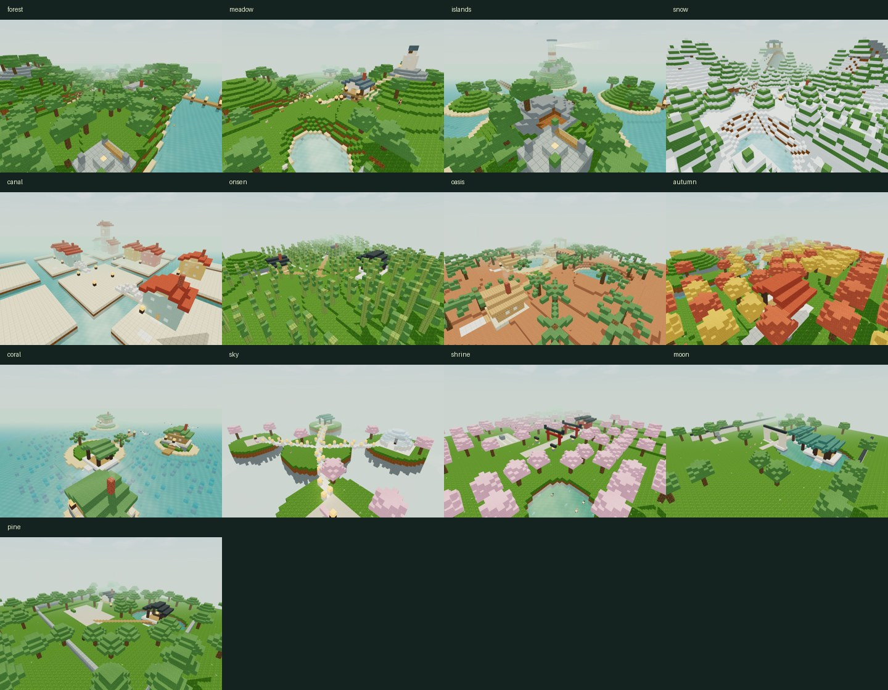

# 풍경 13종 완성도 점검

2026-11-15. 생성 코드와 크기 100 / 시드 willow / 맑음 14시의 대표 화면을 기준으로 점검했다. 모든 맵의 장시간 보행을 완료했다는 뜻은 아니다.

## 공통 기준

각 맵을 건물 목록보다 산책 경험으로 구성한다. 시작점에서 목적지가 보이고, 걷다가 시야가 좁아지고 다시 열리며, 돌아오는 길에는 다른 풍경이 보이도록 한다. 장식 수를 무작정 늘리기보다 지형·나무 군락·건물 높이·여백을 조절한다. 시드에 따라 지형과 구역 배치도 바뀌어야 한다.

| 순서 | 맵 | 현재 약점 | 다음 개선 방향 |
| --- | --- | --- | --- |
| 1 | 수상 도시 | 반복되는 직선 운하, 비슷한 집, 넓고 빈 포장면 | 시장·종탑 광장·주택·항구를 구분하고 순환 동선 연결. M32 첫 개선안 구현 |
| 2 | 가을 계곡 | 일정 간격의 나무, 물레방앗간과 전망대 사이의 빈 동선 | M33 구현: 강 폭과 능선 변화, 단풍 군락과 빈터, 연결 산책길, 다람쥐와 서식 구역 구분 |
| 3 | 벚꽃 신사 | 직선 참배길과 고정된 건물 배치 | M34 구현: 문→계단→안뜰, 연못과 찻집 곁길, 벚꽃 군락과 빈터, 꿩·다람쥐 추가 |
| 4 | 월영 원림 | 연못과 정자의 구성이 단순 | M35 구현: 둥근 문과 담장, 꺾이는 회랑, 섬 정자·수석·대숲 곁길, 거북과 수변 서식 구역 |
| 5 | 솔바람 별서 | 평탄한 앞마당, 분산된 정자·소나무 | M36 구현: 언덕 위 빈 마당·안채·사랑채, 돌계단과 연못·솔숲 순환, 까치·다람쥐 배치 |
| 6 | 대나무 온천 마을 | 규칙적인 대숲, 서로 떨어진 시설 | M37 구현: 여관·찻집 앞마당, 두 노천탕과 지하 온천 순환, 대숲 곁길·원숭이와 계곡 연못 |
| 7 | 사막 오아시스 | 반복되는 집과 단순한 수면 경계 | M38 구현: 사구·평지붕 마을·천막 시장, 호숫가와 옛 회랑 순환, 단봉낙타·사막여우 추가 |
| 8 | 열대 산호섬 | 비슷한 섬과 오두막 | M39 구현: 해변·바위·야자 섬, 군락 산호, 방향이 다른 수상 숙소·부두·전망대, 게·바다거북 |
| 9 | 구름 위 정원 | 평평한 섬 윗면과 직선 연결 | M40 구현: 높이별 섬·난간 연결로·관측소·꽃 뜰·노을 벤치, 나비 추가 |
| 10 | 물빛 숲 | 자연 지형은 있으나 숲 밀도와 명소 접근이 단조로움 | M41 구현: 기존 산·강·명소 유지, 버섯 빈터·벤치·작은 뜰·오솔길·다람쥐·나비 |
| 11 | 넓은 초원 | 넓은 공간에서 볼거리 사이가 비어 보임 | M42 구현: 풍차·능선 유지, 과수원·소풍 자리·울타리 꽃밭·군락 들꽃·꿩·나비 |
| 12 | 작은 군도 | 섬별 개성과 해안 동선이 약함 | M43 구현: 등대·돛배·섬 지형 유지, 유목 해변·바다 마루·돌뜰·섬 연결길·게·바다거북 |
| 13 | 고요한 설원 | 눈과 침엽수의 반복 | M44 구현: 기존 산·설송·산장 유지, 눈길 쉼터·야영지·얼음 연못·북극여우·흰토끼 |

13종의 첫 개선안 구현을 완료했다. 각 행의 세부 범위와 한계는 해당 M32~M44 검증 문서를 따른다. 이전 저장과 생성기는 유지한다. M39 이후는 사용자 요청에 따라 실제 보행 검증을 생략했다. M40~M44는 5개 시드 자동 검증과 2개 시드 화면 비교를 진행했으며, 큰 맵은 생성·경계 검증으로 한정했다.
