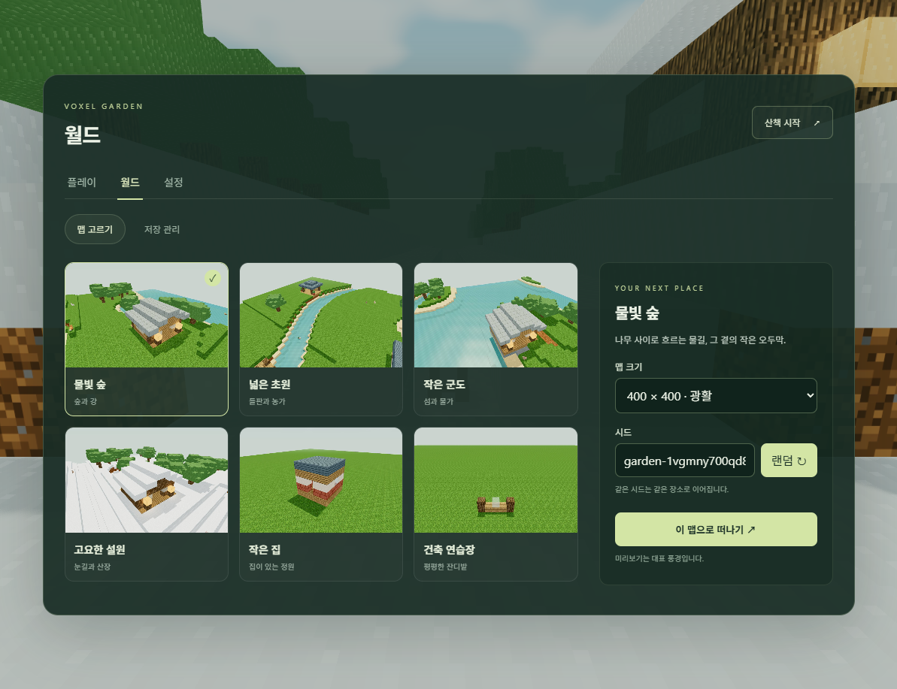
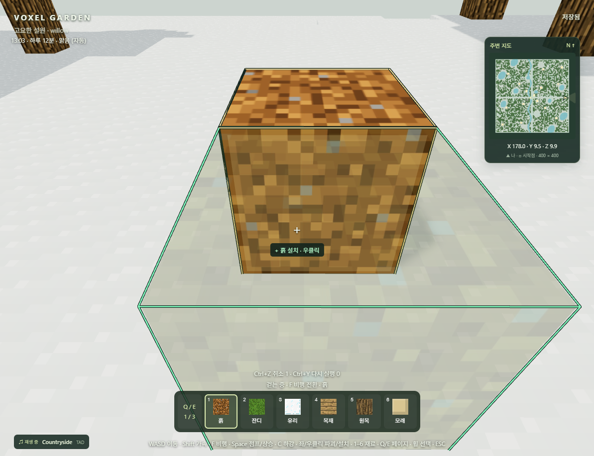

# 맵 크기 400과 랜덤 시드

- 크기 선택: 100×100 기본 / 150×150 넓게 / 200×200 대형 / 400×400 광활. 제품 UI에서 PC·실험 문구 제거.
- 시드 옆 랜덤 버튼은 새 시드를 입력할 뿐 이동하거나 저장 월드를 변경하지 않는다. 이동은 별도 실행 버튼으로 한다.
- 400 크기는 모든 자연 지형에 적용한다. 이동/설치 경계 ±199, 미니맵, 날씨 지붕 가림, 저장/가져오기 범위를 함께 확인했다.
- 400에는 외곽 발견 장소 후보도 추가했다. 기존 100/150/200의 생성 순서와 저장 기준은 유지한다.
- 전체 블록 데이터는 유지하고 렌더링 메시만 주변 청크에 한정한다. 이동하면 새 영역을 만들고 멀어진 메시를 해제한다. 월드 자체를 나누어 로드하는 기능은 아니므로 데이터 메모리는 맵 크기에 따라 증가한다.

## 검증

- 자동 테스트 128개 및 프로덕션 빌드 통과. 랜덤 시드 주소, 400의 블록/재료/좌표, 외곽 장소, ±199 편집·파일 복원, 지붕 가림과 렌더링 범위 검증 포함.
- 실제 UI 랜덤 버튼 연속 클릭 시 서로 다른 시드가 입력되고 현재 URL이 유지되는 것을 확인했다.
- 400 설원에서 비행으로 X178까지 이동하고 착지. (180,10,10) 설치 → 자동 저장 → 파일 내보내기 → 새 복사본 가져오기 → 다시 내보내기. 두 파일의 생성 정보와 변경분이 동일했다.
- 크기별 저장 주소는 분리되며 이전 저장을 덮어쓰지 않는다.

## 이 PC의 참고 측정

프로덕션 preview, willow 시드, 1193×917. 단일 로컬 측정이며 네트워크/기기별 성능 보장이 아니다.

| 400 맵 | 초기 표시 | 지형 생성 | 초기 렌더 청크 | draw calls |
|---|---:|---:|---:|---:|
| 숲 | 3.01초 | 527ms | 293 | 472 |
| 초원 | 3.10초 | 609ms | 293 | 420 |
| 군도 | 2.17초 | 391ms | 293 | 419 |
| 설원 | 4.11초 | 868ms | 310 | 495 |

- 최적화 전 설원: 초기 약 6.6초(500ms 대기 포함), draw calls 803. 최적화 후 전체 725개 청크 중 주변 310개만 메시 생성.
- 설원 비행 180프레임: 중앙값 16.7ms, p95 16.8ms, 최대 83.4ms. 청크 생성 시 순간 지연은 남는다.
- JS 힙 순간 관측 약 647MB → 외곽 이동 후 693MB. 최대치나 GPU 메모리를 포함한 수치가 아니다.
- 실제 휴대폰 검증은 요청에 따라 제외했다.

