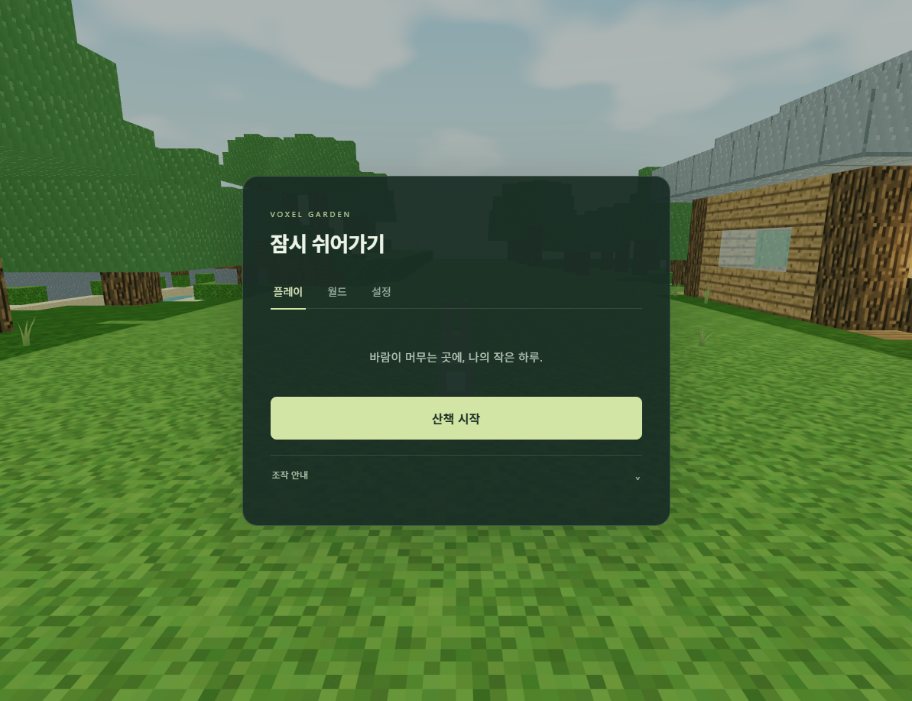
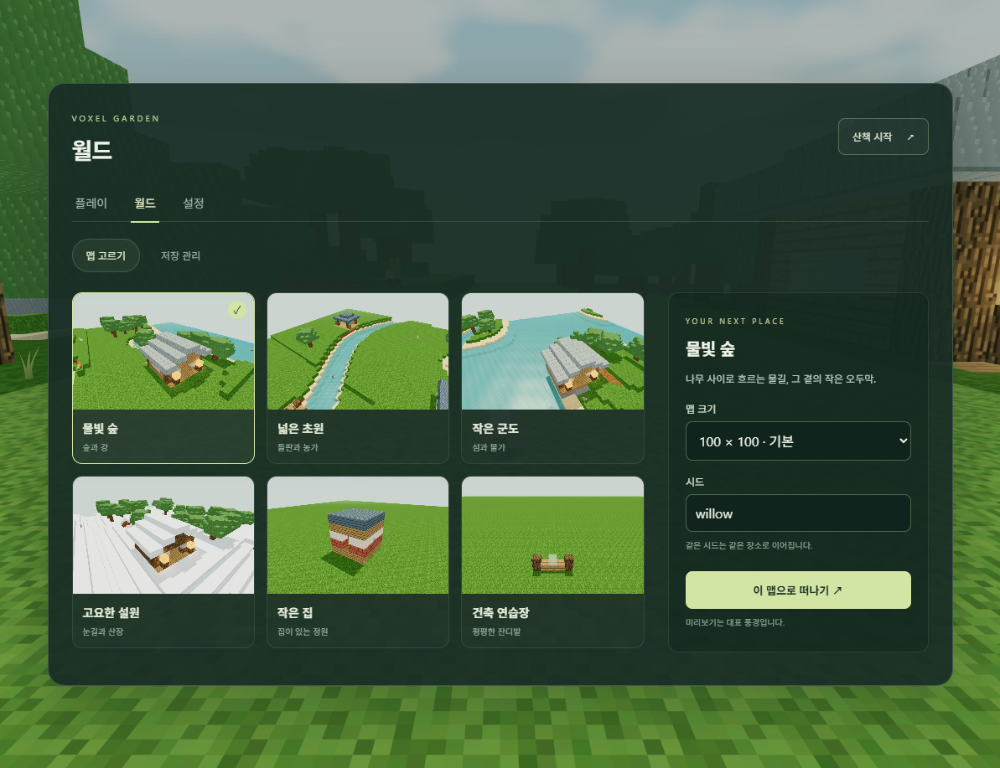
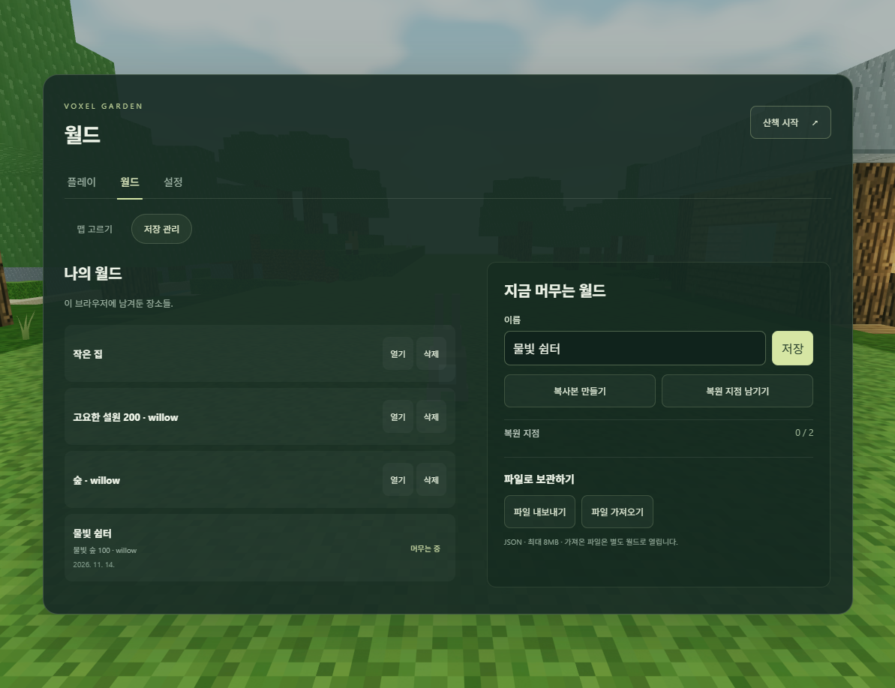
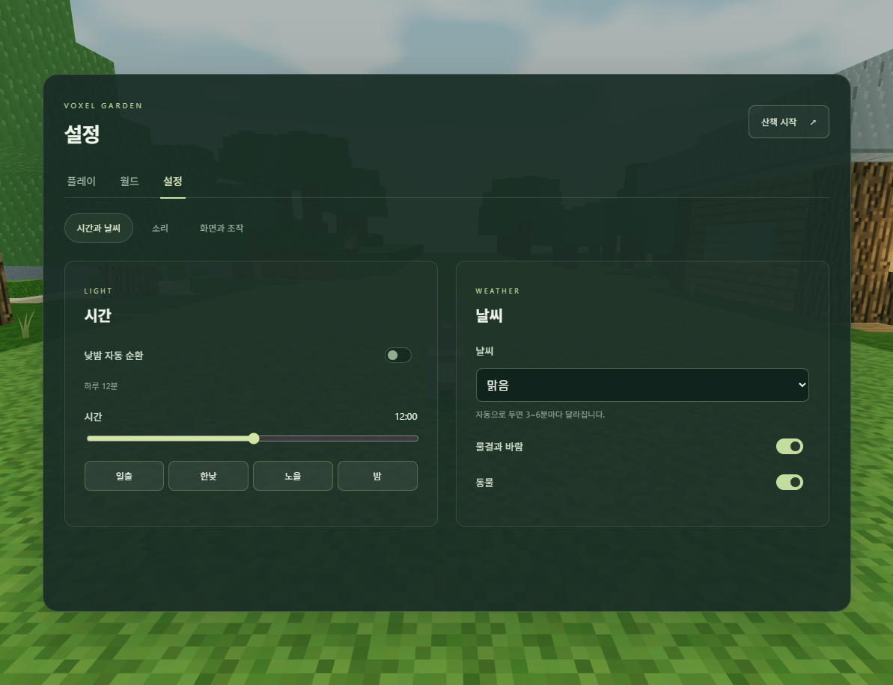
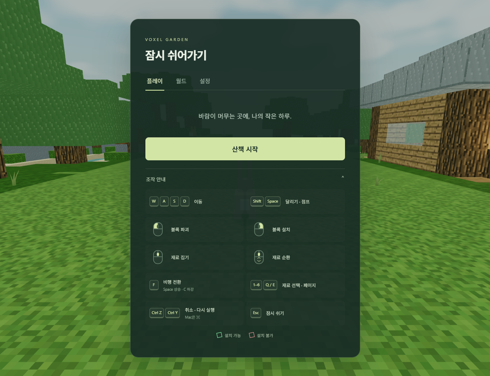
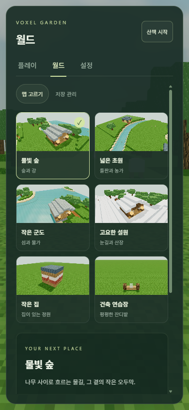
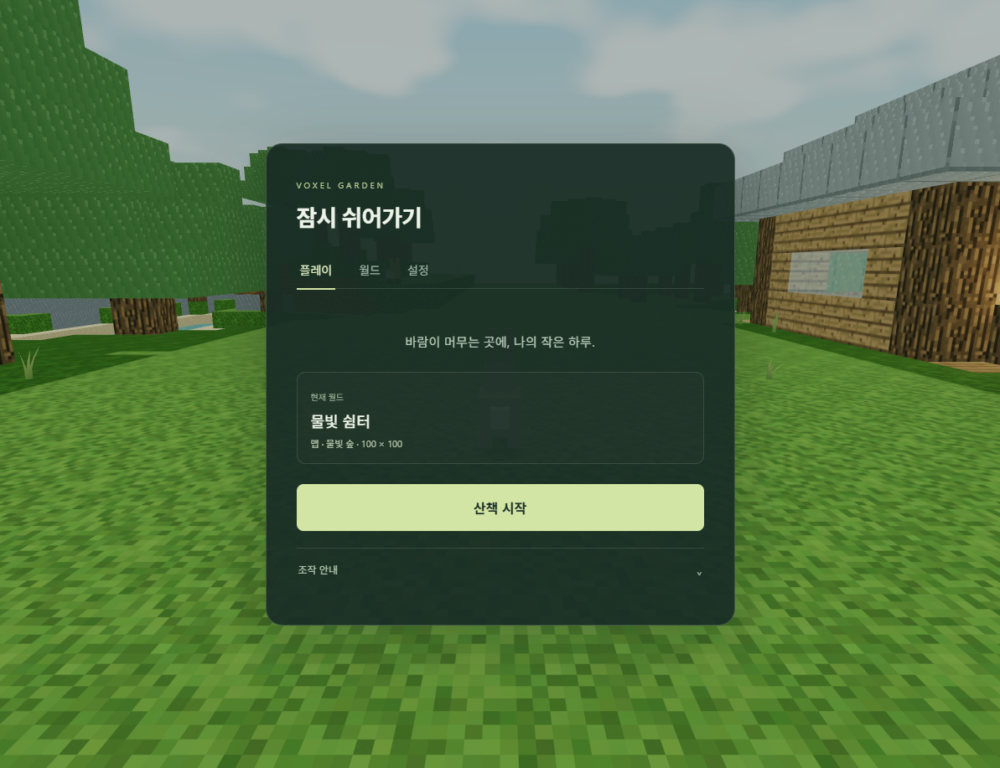
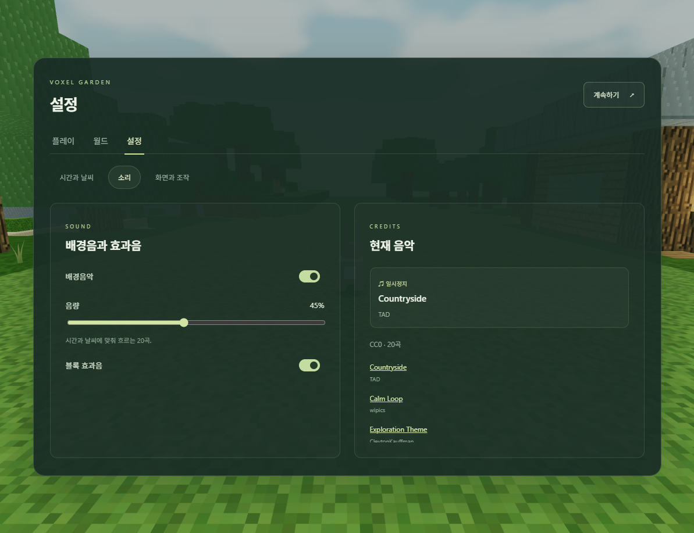

# 일시정지 메뉴 재구성

## 반영 내용

- 플레이: 짧은 문구, 시작/재개, 펼쳐 보는 조작 안내. 키캡과 클릭 위치를 강조한 마우스 그림, 터치 모드별 안내. 관리 바로가기·저장·실행 취소/재실행 버튼은 제거했다.
- 월드: 넓은 패널에서 맵 고르기 / 저장 관리로 구분했다. 숲·초원·군도·설원·작은 집·건축 연습장 6종을 같은 카드로 보여준다.
- 미리보기는 실제 게임 화면에서 촬영한 맵 종류별 대표 이미지다. 개별 저장 파일의 지도 이미지는 표시하거나 새로 만들지 않는다.
- 별도 풍경 선택을 없앴다. 자연 지형 맵은 강·건물·발견 장소를 포함한 생성 규칙을 사용한다. 기존 월드는 저장 목록에서 이전 생성 규칙 그대로 연다.
- 저장 관리에 이름/저장·복사·복원·내보내기·가져오기를 함께 배치했다. 작은 집의 저장도 목록에 나타난다.
- 설정은 시간과 날씨 / 소리 / 화면과 조작으로 분류했다. 음악 출처만 별도 목록 안에서 스크롤한다.

## 검증

- 맵 선택 주소/기존 저장 접근 회귀 테스트 추가.
- 최종 자동 테스트 123개, 프로덕션 빌드 통과. 프로덕션 preview에서 미리보기 이미지 6개와 설정 저장 확인.
- 실제 브라우저: 초원 선택 → 새 지형 생성 주소로 이동. 기존 숲 저장을 목록에서 다시 열기 확인.
- 작은 집 저장 → 파일 다운로드 → 같은 파일 가져오기 → 별도 슬롯으로 표시. 원본 저장 문자열 불변 확인.
- PC 1193×917에서 전체 맵 카드·옵션과 설정 분류별 내용을 확인했다. 파일 미리보기 6개 모두 정상 로드.
- 최종 맵 선택 본문 clientHeight/scrollHeight 모두 495px로 세로 스크롤 없이 표시된다. 플레이 안내는 기본 접힘이며 펼치면 키캡과 마우스 그림을 보여준다.
- 390×844 / 844×390 화면 에뮬레이션: 가로 넘침 없음, 저장 버튼 접근 가능, 터치 조작 안내 표시. 좁거나 낮은 화면에서는 패널 본문만 스크롤하고 주요 메뉴는 고정한다.
- 실제 휴대폰 검증은 요청에 따라 제외. 검증 후 고정 viewport 에뮬레이션을 해제했다.
- 커밋·푸시·공개 배포 전 로컬 변경.

## 자동 기본값과 현재 상태 표시

- 날씨·시간의 초기 기본값은 자동. 수동 선택을 한 경우에는 해당 사용자 설정을 유지한다. 개발/preview 브라우저의 검증용 고정 설정도 자동으로 돌려놓고 재접속 시 유지 확인.
- 조작 방식은 자동 감지가 기본이며 기기의 포인터·터치 지원을 따라 전환한다. 필요할 때 터치/키보드·마우스로 직접 선택할 수 있다. 작은 창 크기만으로 터치 모드를 켜지 않는다.
- 게임 화면과 설정 → 소리에 현재 곡명·작곡가 표시. 재생 예정/재생 중/일시정지/음소거/꺼짐을 구분한다.
- 플레이 메뉴에 현재 월드 이름·맵 종류·크기를 표시한다. 저장 관리에서 바꾼 이름도 돌아오면 반영된다.
- 테스트 125개 및 빌드 통과. 실제 브라우저에서 곡 상태 일치, 이름 반영, 자동 설정 재접속 확인. 390×844 에뮬레이션에서 자동 터치 시작 확인. 실제 휴대폰 검증은 제외했다.

